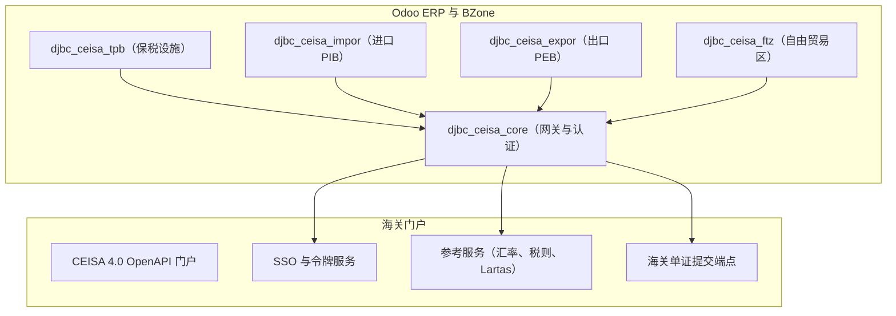

# CEISA 4.0 基础集成（djbc_ceisa_core）

**`djbc_ceisa_core`** 模块作为主要集成网关，通过 RESTful OpenAPI 将 Odoo 中的所有 BZone 海关作业与印度尼西亚海关与消费税总局（DJBC）的 **CEISA 4.0（海关-消费税信息系统与自动化）** 生态系统连接。

---

## 架构与核心作用

本模块充当认证、国家海关参考数据同步以及跨所有专业海关服务模块的端到端 API 审计日志的中央枢纽：

### 依赖服务模块：
* **`djbc_ceisa_tpb`**：保税仓储设施报关（保税区、保税仓库等）。
* **`djbc_ceisa_impor`**：进口货物报关（PIB / BC 2.0）。
* **`djbc_ceisa_expor`**：出口货物报关（PEB / BC 3.0）。
* **`djbc_ceisa_ftz`**：自由贸易区海关报关（PPFTZ）。
* **`djbc_ceisa_barang_kiriman`**：包裹寄送申报。

---

## 凭证配置与认证

要启用与海关 OpenAPI 的通信，管理员必须在 **CEISA 连接器 > 配置 > 设置（CEISA Connector > Configuration > Settings）** 下设置连接参数：

### 1. CEISA OpenAPI 参数
* **用户名（Username）**：海关门户的用户账号标识符。
* **密码（Password）**：海关门户的密码。
* **海关 API 密钥（Bea Cukai API Key）**：在 CEISA OpenAPI 门户（`https://openapi.beacukai.go.id`）的用户配置文件下生成的唯一 API 密钥。
* **CEISA API URL（CEISA API URL）**：官方基础 API 端点（例如生产环境为 `https://openapi.beacukai.go.id`）。
* **公司代码（Kode Perusahaan）**：印度尼西亚海关签发的 6 位公司代码（用于构造 26 位海关申请号 / *Nomor Aju*）。

### 2. OAuth2 令牌生命周期管理
* 认证使用 Bearer 令牌协议（`/v1/openapi-auth/user/login`）。
* 访问令牌有效期为 300 秒（5 分钟），而刷新令牌保持有效期为 24 小时。
* BZone 自主监控令牌过期，并在过期前 30 秒的安全缓冲触发 **自动刷新（Auto-Refresh）**。

---

## 参考数据同步服务

`djbc_ceisa_core` 包含自动化向导，可直接从海关服务器获取官方主数据：

### 1. 每周海关汇率（`ceisa.currency.rate`）
* 菜单：**CEISA 连接器 > CEISA 服务 > 同步汇率（CEISA Connector > Layanan CEISA > Sinkronisasi Kurs）**。
* 拉取每周财政部长令（KMK）汇率，用于计算海关价值（NDPBM）。
* 可设置为每周三新汇率生效时的自动 cron 作业。

### 2. HS 编码与关税（`ceisa.tarif`）
* 菜单：**CEISA 连接器 > CEISA 服务 > 同步关税（CEISA Connector > Layanan CEISA > Sinkronisasi Tarif）**。
* 从印度尼西亚海关税则（BTKI）中获取 8 位或 10 位 HS 编码的进口关税率、增值税、奢侈品销售税和第 22 条所得税。

### 3. 贸易限制与禁令 / Lartas（`ceisa.lartas`）
* 菜单：**CEISA 连接器 > CEISA 服务 > 同步 Lartas（CEISA Connector > Layanan CEISA > Sinkronisasi Lartas）**。
* 检查清关前适用的法规要求（贸易部、检疫局、BPOM 许可证）。

### 4. 舱单集成（`ceisa.manifes`）
* 菜单：**CEISA 连接器 > CEISA 服务 > 同步舱单（CEISA Connector > Layanan CEISA > Sinkronisasi Manifes）**。
* 通过舱单提单和分提单编号从航空港和海港的临时存储设施（TPS）检索货物舱单（BC 1.1）记录。

---

## 主数据对齐

在处理海关申报之前对齐内部 Odoo 主数据：

1. **产品 HS 编码**：
    * 进入 **库存 > 产品 > 产品（Inventory > Products > Products）**。
    * 在 **CEISA** 选项卡上，分配正确的 **税则 / HS 编码（Pos Tarif / HS Code）** 和标准 CEISA 计量单位。
2. **海关合作伙伴配置文件**：
    * 进入 **联系人（Contacts）**。
    * 在 **CEISA** 选项卡上，指定合作伙伴的 **16 位 NPWP**、**NIB（商业识别号）** 和相关实体角色。
3. **UOM 标准映射**：
    * 将 Odoo 内部计量单位映射到 CEISA 标准国际编码（例如 `KGM` 表示千克、`PCE` 表示件、`LTR` 表示升）。

---

## API 日志与审计追踪

每次出站请求有效负载和来自 CEISA 的入站响应都会被记录以供审计：

* **API 日志菜单（API Log Menu）**：位于 **CEISA 连接器 > 配置 > API 日志（CEISA Connector > Configuration > API Log）**。
* 捕获的指标包括：
    * 访问的端点 URL。
    * HTTP 状态代码（200 OK、400 Bad Request、401 Unauthorized、500 Server Error）。
    * 请求 JSON 正文和响应 JSON 正文。
    * 往返执行延迟。
* 帮助运维和 IT 团队迅速排查提交拒绝（*rejects*）或模式验证错误。

> [!TIP]
> 在进行首次正式单证提交之前，请始终通过单击设置页面上的 **测试连接（Test Connection）** 按钮来验证您的凭证。