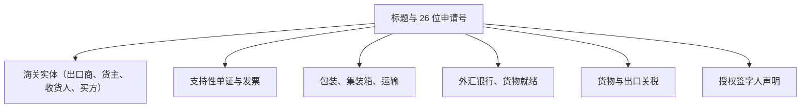

# CEISA 出口模块（djbc_ceisa_expor）

**`djbc_ceisa_expor`** 模块管理 **出口报关单（PEB / BC 3.0）** 和 **BC 3.3** 提交到 DJBC 的 CEISA 4.0 门户。本文档是进出口运营、后勤、保税报关行（PPJK）和公司海关工作人员的用户指南。

> [!IMPORTANT]
> 根据 `__manifest__.py` 中的实现和 `ceisa.export.document` 中的 `_default_kode_dokumen` 默认值，**本模块仅支持 BC 3.0 和 BC 3.3 单证**（参考代码 `30` 和 `33`）。对于保税区的出口，请使用 [`djbc_ceisa_tpb`](../djbc_ceisa_tpb/pengelolaan_dokumen_tpb.md) 模块。

---

## 1. 模块范围与单证类型

| BC 编码 | 单证类型 | 用途 |
|---|---|---|
| **BC 3.0** | 出口报关（PEB） | 从 TLDDP（海关区域内的其他位置 / 一般仓库）到海外目的地的确定性出口。 |
| **BC 3.3** | 来自保税物流中心（PLB）的 PEB | 从保税物流中心（PLB）存放货物到海外目的地的货物出口。 |

> [!TIP]
> 单证成功提交到 CEISA 并达到 `Sent` 状态后，印度尼西亚海关将返回 **NPE（出口登记号）**，用作港口清关的参考。

### BC 3.3 中的原海关单证概念与关联（类似于 BC 2.6.1 与 BC 2.6.2）

与直接从一般仓库/TLDDP 出口货物的 BC 3.0 不同，**BC 3.3** 用于将货物从 **保税物流中心（PLB）** 出口到海外。由于 PLB 是保税仓储场所，存放在 PLB 内的每件货物 **必定事先通过入库海关单证进入 PLB**。

在海关概念上，此机制 **类似于 TPB 中 BC 2.6.1 和 BC 2.6.2 的关系**（出库/核销单证必须引用其原始入库单证以扣减保税库存余额）：

| 进入 PLB 的货物来源 | 原单证代码 (`kodeDokAsal`) | 说明 |
|---|---|---|
| **来自国内 (TLDDP)** | **`40`** (BC 4.0) | 从关境内其他地方进入 PLB 的货物。 |
| **来自海外 (进口)** | **`16`** (BC 1.6) | 从关境外进入 PLB 的货物。 |
| **来自其他 PLB / 保税区** | **`27`** (BC 2.7) | 保税仓储场所 (TPB) 之间的货物转移。 |
| **出口货物集拼** | **`331`** (BC 3.3.1 / P3BET) | 通过 PLB 集拼出口货物。 |

因此，在 **BC 3.3** 的 CEISA 4.0 JSON 架构中，`barang[]` 中的每个商品项都必须包含 **原海关单证** 属性（`kodeKantorAsal`、`kodeDokAsal`、`nomorDaftarDokAsal`、`tanggalDaftarDokAsal`、`nomorAjuDokAsal` 和 `seriBarangDokAsal`）。

---

## 2. 出口单证表单解析



---

## 3. 单证生命周期

| 状态 | 描述 | 可用操作 |
|---|---|---|
| **草稿（Draft）** | 新单证 / 正在准备。 | 自由编辑、添加商品 |
| **确认（Confirm）** | 数据内部有效。 | **发送单证**、设置为草稿 |
| **已发送（Sent）** | 成功传输到 CEISA。 | **检查状态与响应**、**开始修订** |

> [!WARNING]
> 状态变为 `Sent` 后，服务器返回 `tanggal_daftar`（登记日期），会自动填充为 CEISA 中的单证登记日期。此字段为只读，作为 NPE 跟踪的基础。

---

## 4. 分步填写流程

打开 **DJBC CEISA > 出口 > 出口单证（DJBC CEISA > Export > Export Documents）** 菜单，然后单击 **创建（Create）**。

### 步骤 1：标题选项卡

* **26 位申请号** - 当选择 `kode_kantor` 和 `kode_dokumen` 时自动生成。
* **单证代码** - 如果用户有权限，默认为 BC 3.0。选项仅限于 `30`（BC 3.0）和 `33`（BC 3.3）。
* **出口海关办公室（`kode_kantor_ekspor`）** 和 **装货海关办公室（`kode_kantor_muat`）** - BC 3.0 必填。
* **装货港（`kode_pel_muat`）**、**出口港（`kode_pel_ekspor`）**、**卸货港（`kode_pel_bongkar`）**、**目的地港（`kode_pel_tujuan`）** - 根据单证类型设置（请见下表）。
* **目的地国家（`kode_negara_tujuan`）** - 从国家主数据中选择。
* **付款方式** 和 **贸易方式** - BC 3.0 必填。
* **保险代码** - `LN`（海外）或 `DN`（国内）。
* **散装标志** 和 **油气标志** - 设置 `1`（是）或 `2`（否）。
* **FOB、运费、保险、CIF、NDPBM** - 出口交易价值。

| 字段 | BC 3.0 | BC 3.3 |
|---|---|---|
| 出口海关办公室 | 必填 | – |
| 装货海关办公室 | 必填 | – |
| 装货港 | 必填 | 必填 |
| 出口港 | 必填 | – |
| 卸货港 | – | 必填 |
| 目的地港 | 必填 | 必填 |
| CIF / 出口价值 | – | 必填 |
| 货物就绪 | 必填 | – |

  

### 步骤 2：实体选项卡

系统会在创建单证时自动生成实体行：

| BC 类型 | 系列与实体代码（顺序） |
|---|---|
| **BC 3.0** | 1：出口商（`2`），2：所有者（`7`），3：收货人（`8`），4：买方（`6`） |
| **BC 3.3** | 1：出口商（`2`），2：运营商（`3`），3：买方（`6`），4：收货人（`8`），5：所有者（`7`） |

**出口商实体（代码 2）** 在 BC 3.0 和 BC 3.3 中都从 `company.partner_id` 自动填充。

  

### 步骤 3：支持性单证选项卡

对每个支持性单证使用 CEISA 参考代码（发票 `380`、B/L `705`、AWB `740`、装箱单 `217`、合同 `315`、原产地证书 `861` 等）。系统在确认单证时自动安排系列顺序。

  

### 步骤 4：包装、运输、集装箱选项卡

* **包装** - 填写数量和单位（CTN、PLT、PK 等）。
* **运输** - 选择方式和运输工具 / 船舶名称。对于 BC 3.3，还要填写 `kode_cara_angkut_plb`（到 PLB 的运输方式）。
* **集装箱** - 11 位集装箱编号和尺寸。标题字段 `jumlah_kontainer` 是必填的（如不使用集装箱则设置为 `0`）。

  

### 步骤 5：外汇银行与货物就绪选项卡（BC 3.0）

* **外汇银行** - 填写接收出口外汇的银行。
* **货物就绪** - BC 3.0 必填，包含 PIC 和准备检查的地点。这成为海关确定 **检查通道（红/绿）** 的依据。

  

### 步骤 6：货物详情选项卡与原海关单证（BC 3.3）

从主数据中选择产品 → HS 编码和 CEISA 单位自动填充。输入 **数量**、**每单位 FOB 价格** 和每个项目的 **FOB 值**。

针对 **BC 3.3** 单证，货物详情表单和货物列表列包含 **原海关单证（Dokumen Pabean Asal - BC 3.3）** 部分，用于关联并自动填充 `kodeKantorAsal`（原海关办公室）、`kodeDokAsal`（原单证代码，如 `40`、`16`、`27`）、`nomorDaftarDokAsal`（原登记号）、`tanggalDaftarDokAsal`（原登记日期）、`nomorAjuDokAsal`（26 位原申请号）以及 `seriBarangDokAsal`（原单证商品序号）。

  

### 步骤 7：签字人选项卡

* **签字人姓名**（来自 `hr.employee`）、**职位**、**城市** 和 **免责声明**（`1` 表示是）。

---

## 5. 自动验证（`validate_before_send`）

在提交之前，系统运行 `validate_before_send()`：

| 通用验证 | 描述 |
|---|---|
| 申请号 | 26 位符合 CEISA 标准 |
| 货物行 | 至少 1 项 |
| 实体、包装、运输、外汇银行 | 必须包含至少 1 项 |
| 海关办公室、货币、NDPBM、毛重、净重 | 必填 |
| 支持性单证（发票） | 必填 |
| 实体代码 `2`（出口商）或 `3`（运营商） | 必须存在 |

| BC 3.0 特定 | 描述 |
|---|---|
| 货物就绪 | 至少 1 行必填 |
| FOB / 货物价值 | 必填 |
| 装货港、出口港、目的地港、出口海关办公室、装货海关办公室 | 必填 |

| BC 3.3 特定 | 描述 |
|---|---|
| CIF / FOB / 货物价值 | 至少一项必须填写 |
| 装货港、卸货港、目的地港 | 必填 |

如果缺少任何项目，系统将显示需要完成的字段列表。

---

## 6. 将单证发送到 CEISA（发送单证）

1. 单击 **确认（Confirm）** —— 状态变为 `Confirm`。
2. 单击 **发送单证（Send Document）** —— 系统 POST 到：
   ```
   POST {CEISA_BASE_URL}/openapi/document?isFinal=false&isRevision=false
   ```
3. JSON 有效负载由 `_prepare_ceisa_export_data()` 组装 —— BC 3.0 和 BC 3.3 的结构不同。
4. 对于 **BC 3.0**，正文包含：`asalData`、`kodeDokumen`、dokumenInvoice、barang、entitas、pengangkut、kemasan、kontainer、bankDevisa、kesiapanBarang 和 disclaimer。
5. 对于 **BC 3.3**，正文添加：`kodeKantorEkspor`、`kodeKantorMuat`、`kodeNegaraTujuan`、`kodePelEkspor`、`kodePelBongkar`、`tanggalEkspor` 等。
6. 如果服务器返回 `401`，则自动刷新令牌并重试请求。
7. 成功 → 状态 `Sent`，`tanggal_daftar` 自动填充，`idHeader` 记录在 `ir.api.log` 中（通过 **API 日志（Api Log）** 按钮）。
8. 如果 `ceisa.send_email_on_success=True`，则会向用户发送通知电子邮件。

> [!TIP]
> `isFinal` 参数由系统参数 `ceisa.is_final_dokumen` 控制（默认 `false` = 草稿）。如要在首次提交时定稿单证，请设置 `true`。

---

## 7. 修订单证

**开始修订（Start Revision）** 按钮仅适用于 `Sent` 状态的单证。系统将：

1. 增加标题中的 `revision_count` 和 `seri`。
2. 将状态恢复为 `Draft`。
3. 设置 `is_revision = True`，以便服务器在重新提交时收到 `isRevision=true`。

---

## 8. 助手操作：拉取 TPS 数据（开发）

**获取 TPS 代码（Get Kode TPS）** 按钮可用于调用端点 `/openapi/gudangTPS/kodeKantor/{kode_kantor}`，从 CEISA 服务器同步 TPS 主数据。结果作为 `ir.api.log` 条目记录以供审计。

---

## 9. 关键术语

| 术语 | 描述 |
|---|---|
| **PEB (BC 3.0)** | Pemberitahuan Ekspor Barang —— 从 TLDDP 出口的官方海关申报。 |
| **BC 3.3** | 来自 PLB（保税物流中心）的 PEB。 |
| **NPE** | Nomor Pendaftaran Ekspor —— 提交后 CEISA 中登记的证明。 |
| **FOB** | 离岸价 —— 装货港的货物价值。 |
| **运费** | 出口货物的运输成本。 |
| **外汇银行** | 出口商接收出口外汇的银行。 |
| **货物就绪** | 声明货物已准备在指定地点进行检查。 |
| **PLB** | Pusat Logistik Berikat —— 用于出口物流活动的保税区。 |

---

> 本文档是 **`djbc_ceisa_expor`** 模块的非技术指南。对于一般进口，请使用 [`djbc_ceisa_impor`](../djbc_ceisa_impor/dokumentasi_impor.md) 模块。对于保税区的出口 / TPB 间，请使用 [`djbc_ceisa_tpb`](../djbc_ceisa_tpb/pengelolaan_dokumen_tpb.md) 模块。