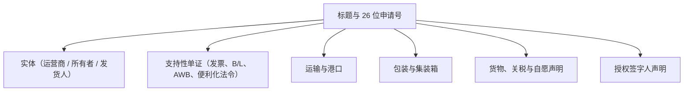

# CEISA FTZ 模块（djbc_ceisa_ftz）

> **最后更新：** 22 Oktober 2026

**`djbc_ceisa_ftz`** 模块管理在 **自由贸易区（FTZ）/ 自由贸易区和自由港口（KPBPB）** 内运营的公司的海关单证。本文档是进出口运营、后勤、保税报关行（PPJK）和公司海关工作人员的用户指南。

---

## 1. 谁应该使用本模块？

本模块由持有以下印度尼西亚 **KPBPB** 区域之一运营许可证的公司使用：

| 区域 | 位置 |
|---|---|
| **KPBPB 巴淡（Batam）** | 廖内群岛省巴淡岛 |
| **KPBPB 民丹（Bintan）** | 廖内群岛省民丹岛 |
| **KPBPB 卡里蒙（Karimun）** | 廖内群岛省卡里蒙岛 |
| **KPBPB 沙旺（Sabang）** | 亚齐省韦岛，沙旺 |

> [!NOTE]
> 这些区域受 **PP No. 10/2012 jo. PMK 42/PMK.04/2020** 管辖，并具有 **特殊（sui generis）** 地位 —— 既不是保税区，也不是自由港。对于来自海外、在区域内使用的货物进入该区域，享受 **免税、免增值税、免所得税和免消费税** 待遇。

**使用本模块的公司的示例：**

* 巴淡的制造工厂，其原材料来自新加坡、日本或中国。
* 巴淡丹戎温仓（Tanjung Uncang）的物流公司，处理往返海外的中转货物。
* 民丹的工业园区运营商。
* 沙旺的免税店。
* KPBPB 中的分包商或仓库租户，在区域之间接收/装运货物。

> [!TIP]
> **与保税区（`djbc_kb` / `djbc_ceisa_tpb` 模块）的区别：** 保税区是"暂停 TLDDP"状态的印度尼西亚 *内部*，而 FTZ 在某些交易中 *被视为海关区域外*。单证规则遵循 **PPFTZ（Pemberitahuan Pabean FTZ）**，而不是标准的 PIB/PEB。

---

## 2. 模块范围与单证类型

根据 `serializers/` 中的实现和 `kode_dokumen` 域，该模块支持 **4 种 PPFTZ 单证类型**（加上回退到 `512`）：

| 代码 | 名称 | 用途 |
|---|---|---|
| **511** | **来自 LDP 的 PPFTZ-01** | 从 **海关区域外（LDP）** 到 KPBPB 的入境货物。 |
| **513** | **来自 TLDDP 的 PPFTZ-01** | 从 **TLDDP**（KPBPB 之外的印度尼西亚大陆）到 KPBPB 的入境货物。 |
| **522** | **PPFTZ-02** | 从 KPBPB 到 **保税区 / SEZ / 其他 FTZ / 便利化区域** 的出境货物。 |
| **531** | **PPFTZ-03** | 从 TLDDP 到 KPBPB 的入境（PMK 42/PMK.04/2020）。 |
| **512** | （回退） | 内部区域单证变体。 |

> [!IMPORTANT]
> 编号 **511/512/513/522/531** 是内部 CEISA 编码，**不是保税区使用的 BC 1.6 / 2.3 / 2.5**。操作人员必须区分：**BC** 用于 KB 和 TPB，**PPFTZ** 用于 FTZ。

---

## 3. FTZ 单证表单解析



每个 **序列化器**（511/513/522/531）根据 CEISA 模式添加特定字段：

| 序列化器 | 主要附加字段 |
|---|---|
| `FTZ511Serializer` | `kodeKategoriBarangFtz`、`kodeTujuanPemasukan`、`kodeKategoriMasukFtz`、`namaTransaksiLainnyaFtz`、`nomorBc11`、`posBc11`、`tanggalTiba`、`biayaTambahan`、`biayaPengurang`、`tanggalBc11`。货物：`barangSpekKhususes`（注意 **复数 +es**）。 |
| `FTZ513Serializer` | `kodeKategoriKeluarFtz`、`kodeTujuanPengeluaran`、`nomorBc11`、`posBc11`、`tanggalTiba`、`biayaTambahan`、`biayaPengurang`、`tanggalBc11`、**`status: '1'`**（根必需）。货物：`kodePerhitungan`（`0`/`1`）、`barangSpekKhusus`（单数）。 |
| `FTZ522Serializer` | `kodeJenisProsedur`、`kodeKategoriKeluarFtz`、`kodeNegaraTujuan`、`nilaiBarang`、`nilaiIncoterm`、`nilaiMaklon`、`flagCurah`、`tanggalBc11`、`jumlahTandaPengaman`。 |
| `FTZ531Serializer` | `kodeKategoriBarangFtz`、`kodeKategoriKeluarFtz`、`kodeTujuanPemasukan`、`kodeTujuanPengeluaran`、**`status: '1'`**（根必需）。 |

---

## 4. 单证生命周期

| 状态 | 描述 | 可用操作 |
|---|---|---|
| **草稿（Draft）** | 新单证 / 正在准备。 | 自由编辑、添加商品 |
| **确认（Confirm）** | 数据内部有效。 | **发送单证**、设置为草稿 |
| **已发送（Sent）** | 成功传输到 CEISA。 | 检查状态与响应（通过 API 日志）、开始修订 |

---

## 5. 分步填写流程

打开 **DJBC CEISA > FTZ > PPFTZ 单证（DJBC CEISA > FTZ > PPFTZ Documents）** 菜单，然后单击 **创建（Create）**。

### 步骤 1：标题选项卡

* **26 位申请号** - 从 `kode_kantor`（4 位）+ `kode_dokumen`（前 2 位）+ `company_code`（6 位）+ 序列自动生成。系统修剪为正好 26 个字符。
* **单证代码** - 根据交易从 `511`、`512`、`513`、`522`、`531` 中选择。
* **单证类型（选择字段）** - 建议选择 `511`、`513` 或 `522`（用作回退）。
* **海关办公室** - 根据 KPBPB 区域选择。
* **FTZ 货物来源代码** 和 **程序类型代码** - 必填，用于记录货物的来源。
* **保险代码**（`LN` / `DN`） - 511 和 513 必填。
* **付款方式、贸易方式、Incoterm** - 511 和 513 必填。
* **货币代码与 NDPBM** - 选择货币时自动填充每周 KMK 税率。
* **BC 1.1 子位置** - 用于参考 BC 1.1 舱单（匹配 `subpos_bc11`）。
* **BC 1.1 编号、位置、日期** - 对于绑定到港口舱单的单证。

  

### 步骤 2：实体选项卡

标准海关实体遵循 CEISA 模式（代码 `1`–`10`）。大多数实体的必填字段：`alamatEntitas`、`kodeEntitas`、`kodeJenisApi`（01/02）、`kodeJenisIdentitas`（2–6）、`kodeNegara`、`kodeStatus`、`namaEntitas`、`nomorIdentitas`、`seriEntitas`。

> [!TIP]
> 序列化器 511 和 513 接受多个实体；序列化器 531 仅接受 **1 个实体**，其 `kodeEntitas: '6'`。序列化器 522 在根上没有 `entitas` 属性。

  

### 步骤 3：支持性单证选项卡

单证遵循 **3 元素元组**（请参阅 `serializers/base.py:100-147`）：

| 索引 | 类型 | 代码 |
|---|---|---|
| 0 | 便利化法令 / 其他单证 | （可选） |
| 1 | 内部提单或 AWB | `705` 或 `740` |
| 2 | 发票 | `380`（必填） |

每个单证的必填字段：`idDokumen`、`kodeDokumen`、`nomorDokumen`、`seriDokumen`、`tanggalDokumen`。

  

### 步骤 4：运输、包装、集装箱选项卡

* **运输** - 车辆 / 船舶名称和编号、国家旗帜代码（2 个大写 ISO 字母）、运输方式代码。
* **包装** - 数量、类型（`CTN`、`PLT` 等）、系列和品牌。
* **集装箱** - 11 位编号、尺寸（20/40/45）、类型。

  

### 步骤 5：货物选项卡

从主数据中选择产品 → 自动填充 HS 编码、CEISA 单位和规格详情。每个序列化器添加不同字段：

* **511 和 513**：`kodeKondisiBarang`、`nilaiBarang`、`kodePerhitungan`（仅 513）、`barangSpekKhususes`（511）或 `barangSpekKhusus`（513）。
* **522**：`hargaPatokan`、`hargaPenyerahan`、`hargaSatuan`、`jumlahDilekatan`、`jumlahRealisasi`、`kapasitasSilinder`、`kodeDaerahAsal`、`nilaiBarang`、`nilaiDanaSawit`、`nilaiDevisa`、`persentaseImpor`、`seriBarangDokAsal`、`kodeBarang`、`seriIjin`、`tahunPembuatan`、`tarifCukai`、`hargaPerolehan`、`barangSpekKhusus`。
* **531**：仅 `kodeDokumen`、`kodeKondisiBarang`。

  

### 步骤 6：自愿声明选项卡（可选）

如果存在与货物相关的自愿声明（例如受出口关税 / 棕榈油基金 / 消费税约束的货物），请使用 `voluntary_declaration_ids` 选项卡。

### 步骤 7：签字人选项卡

* **签字城市**（来自 `res.city`）。
* **签字人姓名**（来自 `hr.employee`）。
* **签字人职位**（来自 `hr.job`）。
* **签字日期**。

---

## 6. 自动验证

在单证已验证之前，系统运行 5 个验证函数（类似于进口/出口模块），在与 import/export 模块类似，验证函数包括：
1. `check_detail_dokumen` - 26 位申请号、海关办公室、装货 / 中转 / 目的地港 / TPS、货币、付款方式、Tutup PU 代码、程序类型、FTZ 货物来源代码、签字人。
2. `check_entitas` - 至少 1 个具有必填字段的实体。
3. `check_dokumen_pelengkap` - 发票 `380` 必填。
4. `check_kemasan_pengangkut` - 已填写包装和运输数据。
5. `check_barang` - 每个项目都有 HS 编码、单位、包装类型。

---

## 7. 将单证发送到 CEISA（发送单证）

1. 单击 **确认（Confirm）** —— 状态变为 `Confirm`。
2. 单击 **发送单证（Send Document）** —— 系统根据 `kode_dokumen` 通过工厂 `get_ftz_serializer()`（在 `serializers/__init__.py` 中）自动选择 **序列化器**：
   * `511` → `FTZ511Serializer`
   * `513` → `FTZ513Serializer`
   * `522` → `FTZ522Serializer`（也通过回退 `512`）
   * `531` → `FTZ531Serializer`
3. JSON 有效负载发送到：
   ```
   POST {CEISA_BASE_URL}/openapi/document
   ```
4. 成功 → 状态 `Sent`，有效负载记录在 `ir.api.log` 中（通过 **API 日志（Api Log）** 按钮）。

> [!WARNING]
> 序列化器 513 和 531 **必须** 在根级别包含 `status: '1'`，由于 DJBC 模式异常，即使未在 `properties` 中定义，也将其列为 `required`。这已由相应的序列化器处理。

---

## 8. 序列化器策略模式（技术说明）

本模块通过 **序列化器** 文件夹使用 **策略模式**：

* `base.py` → `BaseFTZSerializer`（共享助手：日期格式化、get_code、get_header_common、get_kemasan、get_kontainer、get_pengangkut、get_dokumen、get_entitas、get_barang_base）。
* `serializer_511.py` → 专用于 PPFTZ-01 LDP。
* `serializer_513.py` → 专用于 PPFTZ-01 TLDDP。
* `serializer_522.py` → 专用于 PPFTZ-02。
* `serializer_531.py` → 专用于 PPFTZ-03。
* `__init__.py` → 工厂调度器 `get_ftz_serializer(doc)`。

---

## 9. 关键术语

| 术语 | 描述 |
|---|---|
| **FTZ / KPBPB** | 自由贸易区 / 自由贸易区和自由港口 —— 印度尼西亚的海关特殊区域。 |
| **PPFTZ** | Pemberitahuan Pabean FTZ —— 区域交易的官方单证。 |
| **LDP** | Luar Daerah Pabean —— 海关意义上的印度尼西亚以外区域。 |
| **TLDDP** | Tempat Lain Dalam Daerah Pabean —— KPBPB 之外的印度尼西亚大陆。 |
| **NDPBM** | Nilai Dasar Perhitungan Bea Masuk —— 每周 KMK 税务汇率。 |
| **BC 1.1** | 港口 / 机场舱单单证（由 `nomorBc11` 和 `posBc11` 引用）。 |
| **VD** | 自愿声明 —— 某些货物的自愿声明。 |
| **便利化法令（SK）** | 作为 FTZ 支持性单证的便利化法令。 |

---

> 本文档是 **`djbc_ceisa_ftz`** 模块的非技术指南。对于保税区（BC 1.6/2.3/2.5/2.6.1/2.6.2/2.7/4.0/4.1），请使用 [`djbc_ceisa_tpb`](../djbc_ceisa_tpb/pengelolaan_dokumen_tpb.md) 模块。对于一般进口，请使用 [`djbc_ceisa_impor`](../djbc_ceisa_impor/dokumentasi_impor.md) 模块。对于出口，请使用 [`djbc_ceisa_expor`](../djbc_ceisa_expor/dokumentasi_expor.md) 模块。