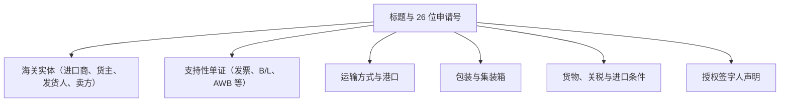

# CEISA 进口模块（djbc_ceisa_impor）

**`djbc_ceisa_impor`** 模块管理 **进口报关单（BC 2.0 / PIB）** 并将其提交到印度尼西亚海关与消费税总局（DJBC）的 CEISA 4.0 门户。本文档是进出口运营、后勤、保税报关行（PPJK）和公司海关工作人员的用户指南。

> [!IMPORTANT]
> 根据 `__manifest__.py` 中的实现和 `ceisa.import.document` 模型中的 `_check_user_kode_dokumen_permission` 验证，**本模块仅支持 BC 2.0 单证**（参考代码 `20`）。对于 BC 2.3（进口到保税区）和 BC 2.7（TPB 间），请使用 [`djbc_ceisa_tpb`](../djbc_ceisa_tpb/pengelolaan_dokumen_tpb.md) 模块。

---

## 1. 模块范围与单证类型

| BC 编码 | 单证类型 | 用途 |
|---|---|---|
| **BC 2.0** | 进口报关（PIB） | 从海关区域外（LDP）到海港或机场临时存储设施（TPS）的一般进口，有义务支付进口关税、增值税、第 22 条所得税和其他适用税款（消费税、第 23 条等）。 |

> [!TIP]
> 本模块生成相当于 DJBC 在 CEISA 4.0 中主机到主机应用程序的 PIB 单证。在开始数据输入之前，请确保您具有有效的 **DJBC 公司代码** 和 **公司 NPWP**。

---

## 2. 进口单证表单解析

BC 2.0 单证按 CEISA 标准组织成多个选项卡：



---

## 3. 单证生命周期

| 状态 | 描述 | 可用操作 |
|---|---|---|
| **草稿（Draft）** | 新单证 / 正在准备。所有字段可自由编辑。 | 编辑所有字段、添加商品、自动填充 |
| **确认（Confirm）** | 数据内部有效。状态锁定以供提交。 | **发送到 CEISA**、设置为草稿 |
| **已发送（Sent）** | 单证已成功传输到 CEISA 并收到 NPP。 | **检查状态与响应**、**开始修订** |

> [!WARNING]
> **确认 → 已发送** 转换仅当所有 `check_*` 验证（请参见第 5 节）通过时才会发生。否则，系统将引发 **UserError**，列出不完整的字段。

---

## 4. 分步填写流程

打开 **DJBC CEISA > 进口 > 进口单证（DJBC CEISA > Import > Import Documents）** 菜单，然后单击 **创建（Create）**。

### 步骤 1：标题选项卡

* **26 位申请号（Nomor Aju）** - 当您选择 **海关办公室（Customs Office）**（`kode_kantor`）和 **单证代码（Document Code）**（`kode_dokumen`）时自动生成。模式：`[4 位办公室][2 位 BC][6 位公司代码][14 位序列]`。示例：`0403002000012325101000012345`。
* **海关办公室** - 根据 TPS 所在地的监管办公室选择。
* **装货港、目的地港、TPS** - 全部必填。
* **Tutup PU 代码** - 必须为以下之一：`11`、`12` 或 `14`。其他代码将被 `check_detail_dokumen` 拒绝。
* **货币代码与 NDPBM** - 选择货币时自动填充每周 KMK 税率。请参阅 [汇率指南](../erpi_custom_rate/manajemen_kurs_pabean.md)。

  

### 步骤 2：实体选项卡

创建单证时，系统 **自动生成 4 个实体行**，遵循 BC 2.0 标准：

| 系列 | 代码 | 角色 | 自动填充 |
|---|---|---|---|
| 1 | `1` | **进口商（Importer）** | 是，来自 `company.partner_id` |
| 2 | `7` | **货主（Cargo Owner）** | 否 |
| 3 | `9` | **发货人（Shipper）** | 否 |
| 4 | `10` | **卖方（Seller）** | 否 |

进口商实体的 **必填** 字段：名称、地址、16 位 NPWP、NIB、**API 类型**（`01` APIU 或 `02` APIP）以及 **身份类型**（代码 2/3/4/5/6）。

货主的 **必填** 字段：名称、地址、身份编号和 **关联（Affiliation）**（`AFL`、`CTR`、`FAM` 或 `TAH`）。

  

### 步骤 3：支持性单证选项卡

根据 CEISA 参考代码选择支持性单证类型：

| 代码 | 单证 |
|---|---|
| `380` | 商业发票 |
| `705` | 提单（B/L） |
| `740` | 空运单（AWB） |
| `217` | 装箱单 |
| `861` | 原产地证书（SKA） |
| `261` | 销售合同 |
| `731` | 支持性海关单证（例如，来自 TPS 的 BC 1.6） |

  

### 步骤 4：运输、包装、集装箱选项卡

* **运输方式** - 选择方式（海运 / 空运 / 陆运）以及车辆 / 船舶名称。
* **国家旗帜代码** - 2 个大写 ISO 字母（例如 `SG`、`CN`、`JP`、`US`）。
* **集装箱编号** - 11 位（前缀 4 个字母 + 7 位数字），包括尺寸（`20` / `40` / `45` 英尺）。
* **包装数量和类型** - CEISA 单位，例如 `CTN`（纸箱）、`PLT`（托盘）、`BG`（袋）、`DR`（桶）。

  

### 步骤 5：货物选项卡（商品详情）

* 从主数据选择 **产品** → 系统从 `product.product` 自动填充 **HS 编码**（`pos_tarif`）和 **CEISA 单位**。
* 输入每个行的 **数量** 和 **CIF 值**。
* 选择 **海关估值方法**：方法 1 到 6。如果不是方法 1，请在 `alasan_metode_penentuan_nilai` 中填写 **原因**。
* 填写 HS 编码后，**货物关税** 选项卡（进口关税、增值税、第 22 条税、消费税）自动生成（请参阅 [CEISA 参考指南](panduan_pengisian_ceisa.md) 了解从 TPB 模块的自动计算）。
* 如需要，可填写 **特殊规格（Special Specification）** 选项卡（用于某些 HS 类别）和 **自愿声明（Voluntary Declaration）**。

  

### 步骤 6：签字人选项卡

* **签字城市（Signature City）** - 从 `company.partner_id.city_id` 或 `company.city_id` 自动填充。
* **签字人姓名（Signatory Name）** - 从 `hr.employee` 中选择（自动填充 **职位**）。
* **免责声明（Disclaimer）** - 设置为 `1`（是）以声明批准。

---

## 5. 自动提交前验证

在状态从 **草稿 → 确认 → 已发送** 改变之前，系统运行 **5 个验证函数**（`ceisa.import.document` 中的 `check_*`）：

| 函数 | 执行的验证 |
|---|---|
| `check_detail_dokumen` | 26 位申请号、海关办公室、装货 / 目的地港 / TPS、货币、付款方式、Tutup PU 代码（11/12/14）、进口类型、到达日期 / 签字日期、签字城市 / 姓名 / 职位。 |
| `check_entitas` | 进口商（1）和货主（7）实体是必填的。进口商必须具有名称、地址、NPWP、NIB、API（01/02）和身份类型。 |
| `check_dokumen_pelengkap` | 最少支持性单证（发票和 B/L/AWB）。 |
| `check_kemasan_pengangkut` | 已填写包装和运输数据。 |
| `check_barang` | 每个项目都有 HS 编码、单位、价值和 `jenis_kemasan`。 |

如果其中任何一个失败，单证将不会过渡到 `确认`。使用 **确认（Confirm）** 按钮触发验证，然后更正标记的字段。

---

## 6. 将单证发送到 CEISA（发送单证）

1. 单击 **确认（Confirm）** —— 状态变为 `Confirm`。
2. 单击 **发送单证（Send Document）** —— 系统 POST 到端点：
   ```
   POST {CEISA_BASE_URL}/openapi/document?isFinal=false&isRevision=false
   ```
3. 正文以 **JSON** 形式发送，由 `_prepare_ceisa_import_data()` 组装（包含标题、实体、货物、goodsTarif、goodsDokumen、goodsPemilik 等）。
4. 如果服务器返回 **401 Unauthorized**，系统会自动通过 `ceisa.auth.get_auth_headers(force=True)` 刷新令牌并重试。
5. 成功响应 → 状态变为 `Sent`，JSON 有效负载记录在 `ir.api.log` 中（通过 **API 日志（Api Log）** 按钮），并将通知电子邮件发送给用户（如果 `ceisa.send_email_on_success=True`）。

> [!TIP]
> `isFinal` 参数由系统参数 `ceisa.is_final_dokumen` 控制。默认为 `false`（草稿）。如果要单证在第一次提交时定稿，请将其设置为 `true`。

---

## 7. 修订已发送的单证

**开始修订（Start Revision）** 按钮仅适用于 `Sent` 状态的单证。系统将：

1. 增加标题中的 `revision_count` 和 `seri`。
2. 将状态恢复为 `Draft`。
3. 设置 `is_revision = True`，以便服务器在重新提交时收到 `isRevision=true`。

---

## 8. 关键术语

| 术语 | 描述 |
|---|---|
| **PIB (BC 2.0)** | Pemberitahuan Impor Barang —— 一般进口的官方海关申报。 |
| **NPP** | Nomor Pendaftaran Pabean —— 单证已在 CEISA 中登记的证明。 |
| **SPPB** | Surat Persetujuan Pengeluaran Barang —— 来自 TPS 的放行许可。 |
| **SPJM** | Surat Pemberitahuan Jalur Merah —— 实物检查通知。 |
| **NDPBM** | Nilai Dasar Perhitungan Bea Masuk —— 每周 KMK 税务汇率。 |
| **FOB / CIF / 运费 / 保险** | 海关价值组成部分（请参阅 TPB 指南以获取完整公式）。 |
| **HS 编码** | 基于 BTKI（印度尼西亚海关税则）的 8 位编码。 |

---

> 本文档是 **`djbc_ceisa_impor`** 模块的非技术指南。对于出口，请参阅 [CEISA 出口文档](../djbc_ceisa_expor/dokumentasi_expor.md)。对于 TPB/BC 2.3/BC 4.0/BC 2.5 交易，请使用 [`djbc_ceisa_tpb`](../djbc_ceisa_tpb/pengelolaan_dokumen_tpb.md) 模块。