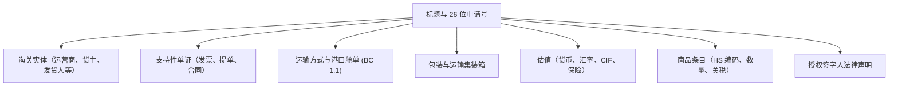

# CEISA 4.0 TPB 单证管理（djbc_ceisa_tpb）

**`djbc_ceisa_tpb`** 模块通过印度尼西亚海关与消费税总局（DJBC）的 **CEISA 4.0** 系统直接管理 **保税仓储设施（Tempat Penimbunan Berikat - TPB）** 海关申报的完整起草、验证、提交和跟踪生命周期。

---

## 设施范围与支持的 TPB 单证

本模块支持保税仓储设施（保税区、保税仓库和保税展览场所）的所有官方海关交易，覆盖 **10 种官方海关申报类型**：

| BC 编码 | 申报类型 | 用途与范围 |
|---|---|---|
| **BC 1.6** | 从 TPS 到 TPB 的转移 | 从海港/机场临时存储（TPS）到 TPB 区域的进口货物入境转移。 |
| **BC 2.3** | 进口入境到 TPB | 在关税暂停下，从国外直接入境到 TPB 的原材料、资本设备或消耗品。 |
| **BC 2.5** | 从 TPB 到国内区域的转移 | 在缴纳关税和税款后，将成品从 TPB 交付或销售到当地海关区域（TLDDP）。 |
| **BC 2.6.1** | 分包出境转移 | 将原材料或中间组件调度到国内区域或其他 TPB 设施的分包合作伙伴。 |
| **BC 2.6.2** | 分包入境退回 | 加工后的货物从分包商退回 TPB 场所。 |
| **BC 2.7** | TPB 间转移 | 保税区之间或不同保税设施运营商之间的货物移动和转移。 |
| **BC 2.8** | 资本货物 / 样品移除 | 从 TPB 出境转移机器、设备或商业样品的授权转移。 |
| **BC 3.3.1** | 特定出口结算 | TPB 设施出口履行的专门出境申报。 |
| **BC 4.0** | 国内入境到 TPB | 从国内市场到 TPB 的本地原材料或机械的入境采购，不征收增值税。 |
| **BC 4.1** | 从 TPB 到国内区域的退回 / 交付 | 将本地原产货物从 TPB 退回到本地区域的出境转移。 |

---

## 申报结构与表单解析

位于 **CEISA 连接器 > 海关 > TPB（CEISA Connector > Pabean > TPB）** 下的申报严格遵守官方 CEISA 4.0 JSON 数据模式：

### 1. 自动 26 位申请号（Nomor Aju）
系统自动编译标准化的 26 位海关申请号：

* `[6 位海关办公室代码]` + `[6 位公司代码]` + `[8 位日期 YYYYMMDD]` + `[6 位顺序索引]`。
* 示例：`040300-000123-20260910-000001`。

### 2. 海关实体（Entitas Pabean）
CEISA 4.0 利用分层实体分配，由系统自动排序和排序：

* **TPB 企业运营商（实体代码 `3`）**：优先顺序 1。
* **货主（实体代码 `7`）**。
* **发货人 / 国外供应商（实体代码 `9`）**。
* **收货人 / 买方（实体代码 `8`）**。
* 属性包括：16 位 NPWP、NIB、完整地址和区域运营许可证编号。

### 3. 支持性单证选项卡（Dokumen Pelengkap）
系统在确认和 API 调度期间自动组织单证优先级和系列编号：

* 商业 **发票（Invoice）**（代码 `380`）：必填，并自动优先为 Seri 1。
* 运输单证：**提单 / B/L**（代码 `705`）或 **空运单 / AWB**（代码 `740`），如提供则自动排序为 Seri 2。
* 其他附件：商业合同（代码 `315`）、装箱单（代码 `217`）和原产地证书（代码 `861`）。

### 4. 运输与港口舱单选项卡
* **BC 1.1** 出入境舱单编号、日期、位置和子位置，用于港口货物放行。
* 装货、中转和卸货港口。
* 船舶或航班详情以及国家旗帜登记。

### 5. 包装、集装箱与财务估值
* 集装箱规格：集装箱编号、ISO 尺寸（20 英尺、40 英尺、45 英尺）和集装箱类型。
* 包装单位和数量（纸箱、袋、托盘、桶）。
* 货币代码、每周 KMK 估值汇率（NDPBM）、FOB 值、运费、保险、CIF 值、毛重（Bruto）和净重（Netto）。

### 6. 商品详情选项卡
* 映射到 BTKI HS 编码的项目化产品行。
* 标准 CEISA 计量单位（UOM）对齐。
* 以印尼盾计的 CIF 值和适用的关税计算（进口关税、增值税、第 22 条所得税）。

---

## 特殊业务流程：TPB 分包业务（BC 2.6.1 与 BC 2.6.2）

本模块实现了外发分包与加工退回全流程自动化：

1. **BC 2.6.1（外发分包出境）**：外发原材料时享受关税担保待遇（减免代码 8 - Dijaminkan），并在随附单证中包含主管海关分包批文（单证代码 `911`）。
2. **BC 2.6.2（分包加工品入境退回）**：
    * **关联原单证**：选择原 BC 2.6.1 出境单证（`ref_doc_261_id`），系统自动联动原申请号与海关正式注册号；已使用单证自动隐藏，防止重复引用。
    * **自动拉取货物与原材料**：一键自动从原 BC 2.6.1 完整拉取商品、原材料明细与一致的担保税费，确保核销无差额。
    * **原材料许可证序号同步**：系统自动将随附单证中的批文序号（`seri_dokumen`）同步至原材料行的 `seriIjin`，避免 CEISA 报文校验驳回。
    * 详细指南请参阅：[TPB 分包业务 BC 2.6.1 与 BC 2.6.2 指南](subkontrak_bc261_bc262.md)。

---

## 提交流程与工作流

通过海关处理申报涉及 3 个阶段：

1. **草稿状态（Draft State）**：
    * 操作员输入装运参数或从现有 **采购订单（Purchase Orders）** 或 **拣货（Stock Pickings）** 拉取详情。
    * 所有字段均可自由编辑。
2. **确认状态（Confirm State）（模式验证）**：
    * 点击 **确认（Confirm）**。
    * 系统运行预飞完整性审计：
        * 验证商品、实体、支持性单证、包装和运输选项卡是否完整。
        * 验证必需的单证序列规则（发票和 B/L/AWB）。
        * 验证所需的海关实体角色。
3. **发送单证（Electronic Data Interchange）**：
    * 单击已确认申报上的 **发送单证（Send Document）**。
    * 完整的 JSON 模式有效负载将传输到 CEISA OpenAPI 端点。
    * 状态转变为 **已发送（Sent）**（*Terkirim*）。

---

## 海关响应、状态查询与报关单打印

提交后，操作员可直接从 TPB 报关单或 **状态与响应（Status & Respon）** 菜单查询海关状态更新并获取官方报关单打印件：

1. **状态与响应查询（`Cek Status & Respon` / `Tarik Status & Respon BC`）**：
    * 可直接点击 TPB 单证上的 **检查状态与响应（Cek Status & Respon）**，或通过 **CEISA 连接器 > CEISA 服务 > 状态与响应（CEISA Connector > Layanan CEISA > Status & Respon）** 点击 **拉取海关状态与响应（Tarik Status & Respon BC）** 并输入 26 位申请号（*Nomor Aju*）。
    * 自动记录至 **状态历史** 与 **响应历史** 的海关响应包括：
        * **SPPB（放行许可）**：允许货物从港口或设施正式放行的正式授权。
        * **NPP（登记号）**：确认申报已通过自动化模式审查并收到官方海关登记号。
        * **SPJM（红色通道通知）**：海关官员安排实物货物检查的通知。
        * **拒绝（Reject）**：拒绝通知，详细说明需要纠正和重新提交的数据错误。
    * **Chatter 自动附加响应 PDF 与内嵌预览**：CEISA 返回的官方响应 PDF 会自动附加到对应 TPB 单证（或 **状态与响应** 记录）的 **Chatter（消息栏）** 中，并在表单右侧预览面板直接展示。
    * **登记号条件（`Data tidak ditemukan`）**：仅当单证在海关系统中**已生成登记号（Nomor Pendaftaran）**后才可拉取到状态与响应数据；若尚未生成登记号，将提示 **`Data tidak ditemukan`**（未找到数据）。
2. **打印官方 BC 报关单（`Cetak Formulir Draft` 与 `Cetak Formulir Final`）**：
    * 点击 TPB 单证顶部的 **打印草稿表单（Cetak Formulir Draft）** 或 **打印正式表单（Cetak Formulir Final）**，即可从 CEISA 报表端点拉取官方 BC 报关单 PDF 并自动附加到单证 Chatter。
3. 所有响应历史记录均可通过单证上的 **状态响应（Status Respon）** 统计按钮查看。

---

> [!IMPORTANT]
> 在将申报传输到正式 CEISA 门户之前，请验证 TPB 运营商实体是否具有有效且在期的保税区令许可证。