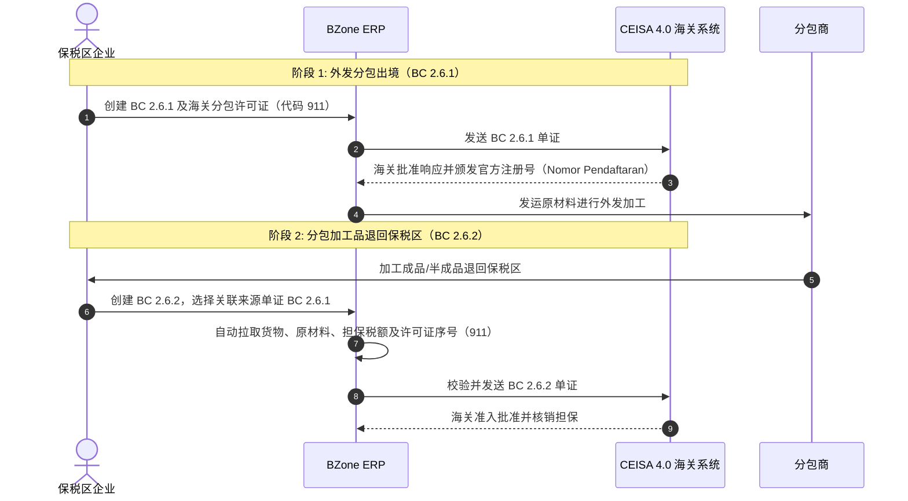

# TPB 分包业务指南：BC 2.6.1 与 BC 2.6.2

本文档说明 **`djbc_ceisa_tpb`** 模块中，关于保税区外发分包出境单证（**BC 2.6.1**）以及分包加工成品入境退回单证（**BC 2.6.2**）的操作业务流程、CEISA 4.0 海关监管要求与技术填报指南。

---

## 1. 保税区（TPB/KB）分包业务概念与全生命周期

在保税区（TPB / KB）日常运营中，企业获准将部分生产工序外包委托给第三方（关税区内其他地区 / TLDDP 或其他保税区内的分包商）。

该业务周期主要关联两份关键的海关申报单证：

| 单证 | 单证名称 | 核心特征与要求 |
|---|---|---|
| **BC 2.6.1** | 分包出境申报单 | 向分包商外发原材料或模具设备。应缴税款状态为**海关担保（减免/担保代码 8 - Dijaminkan）**。必须关联主管海关颁发的分包许可证（单证代码 `911`）。 |
| **BC 2.6.2** | 分包加工入境退回申报单 | 分包加工成品/半成品退回保税区。**必须准确关联原出境单证（BC 2.6.1）**并在原材料明细中关联**许可证序号（`seriIjin`）**以核销原出境担保。 |

---

## 2. 填写 BC 2.6.2（分包入境退回单证）

CEISA 4.0 系统对 BC 2.6.2 的报文数据校验极为严格：
1. **原单证注册号缺失或无效**（CEISA 拒绝仅提供申请号而未提供正式注册号的关联）。
2. **原材料许可证序号 [0] 报错**：`Gagal Kirim Data: Seri Ijin Bahan Baku [0] tidak ditemukan pada Dokumen Fasilitas/Ijin`。
3. **担保金额不一致**：退回原材料所申报的担保税费必须与出境时 BC 2.6.1 锁定的担保保持一致，否则无法核销。

在 BZone 系统的操作步骤如下：

### 步骤 1：选择来源 BC 2.6.1 单证并自动拉取货物明细

在 BC 2.6.2 的 **Header（表头）** 页面：

1. 找到 **Dokumen Referensi / Dokumen Asal（关联单证）** 区域：
   * **原 BC 2.6.1 单证 (`ref_doc_261_id`)**：选择先前已通过 BZone 成功发送（`state = sent`）的 BC 2.6.1 出境单证。
2. 系统将自动联动填充以下数据：
   * **原申请号 (`nomor_aju_asal`)**：BC 2.6.1 的 26 位申报号。
   * **原注册号 (`nomor_daftar_asal`)**：海关审批通过后下发的 6 位官方注册号。
   * **原注册日期 (`tanggal_daftar_asal`)**：BC 2.6.1 的海关注册日期。
   * **币种与汇率（Valuta & NDPBM）**：若未填写，自动同步来源单证的申报币种与关税汇率。
   * **随附单据 261**：自动在随附单证列表中添加/更新代码为 `261` 的单证记录。

> [!IMPORTANT]
> **一对一精准关联规则（防重复引用）：**
> * 一份出境 BC 2.6.1 单证只能由**一份入境 BC 2.6.2 单证**进行对应核销。
> * 已经被其他 BC 2.6.2 单证引用的 BC 2.6.1 单证，**将自动从下拉候选列表中隐藏**，防止重复引用造成海关核销冲突。
> * 数据库底层亦设置了唯一性约束校验（Constraint），防止人为重复保存相同原单证。

> [!TIP]
> **“从 BC 2.6.1 拉取货物与原材料”功能：**
> * 首次选择 BC 2.6.1 且货物表格为空时，系统**自动完整拉取所有货物及原材料明细**。
> * 您也可以在表头或 **Barang（货物）** 标签页随时点击 **“Tarik Barang & Bahan Baku dari BC 2.6.1”** 按钮重新拉取。
> * 页面会通过客户端操作平滑刷新数据，无需手动按浏览器 F5。

> [!NOTE]
> **税费与担保金额一致性规定（减免/担保代码 8）：**
> * BC 2.6.2 的核心监管目的在于**核销解除 BC 2.6.1 外发时建立的海关分包担保（Kode Fasilitas 8 - Dijaminkan）**。
> * 因此，原材料明细中的关税税率（进口关税 BM、增值税 PPN、所得税 PPh）以及担保金额**必须完全复制原 BC 2.6.1 的数据**。
> * 严格保持一致可防止因汇率波动或税则更新产生担保金额差额（Unbalanced Guarantee），避免海关核销失败。
> * 仅在来源 BC 2.6.1 确实缺少税率行数据时，系统才会从税则库（`ceisa.tarif`）拉取计算作为后备机制（Fallback）。

---

### 步骤 2：随附单证与自动序号编排

在 **Dokumen Pelengkap（随附单证）** 标签页中登记业务凭据：

* **分包海关批文（单证代码 `911`）**：主管海关颁发的分包准予通知书。
* **送货单 / 分包商出库单（Surat Jalan / Delivery Order）**：货物实际退运证明。
* **分包加工费发票（Subcontract Labor Invoice）**：加工劳务费发票（如有）。

> [!IMPORTANT]
> **随附单证序号自动连续编排 (`seri_dokumen`)：**
> * 表格清晰展示“No. Seri”列，系统按单证行顺序自动编排连续序号（**1, 2, 3, ...**）。
> * 该序号即为原材料明细关联许可凭证的基准编号。

---

### 步骤 3：原材料明细与 `seriIjin` 匹配（防止驳回）

每项入境货物均须在下方的 **Bahan Baku（原材料）** 中如实说明加工所耗费的原出境物料：

#### 解决“Seri Ijin Bahan Baku [0]”海关报错：
* CEISA 4.0 报文明确规定原材料节点的 `seriIjin` **不得为 0**。
* `seriIjin` 必须精确匹配随附单证中代码为 `911` 的海关批文对应的 `seri_dokumen` 序号。

#### BZone 自动化保障：
* 在随附单证中添加或确认 911 批文后，系统会自动将该批文序号下发至所有原材料行的 **Seri Ijin** 列。
* 表格直接展示该列，便于在提交前核查是否非 0。

---

## 3. BC 2.6.2 与 CEISA 4.0 数据映射矩阵

| BZone 界面字段 | CEISA 报文 JSON 节点 | 监管验证与规则说明 |
|---|---|---|
| **Dokumen BC 2.6.1 Asal** | `nomorAju`（原单关联） | 内部关联的 BC 2.6.1 原始出境单证。 |
| **Nomor Aju Asal** | `nomorAjuDokumenAsal` | 26 位原始出境单证申请号。 |
| **Nomor Daftar Asal** | `nomorDaftarDokumenAsal` | 海关回执所赋予的 6 位正式官方注册号。 |
| **Tanggal Daftar Asal**| `tanggalDaftarDokumenAsal`| 海关注册日期（格式：`YYYY-MM-DD`）。 |
| **Izin Subkontrak (911)**| `dokumen.kodeDokumen = "911"` | 处于有效期内的海关分包批文单证。 |
| **Seri Dokumen Izin** | `dokumen.seriDokumen` | 随附单证列表中的整数流水序号（1, 2, 3...）。 |
| **Seri Ijin Bahan Baku**| `bahanBaku.seriIjin` | 必须与 911 批文的 `dokumen.seriDokumen` 完全一致。 |

---

## 4. BC 2.6.2 发送前检查清单

在点击 **Confirm** 与 **Send Document** 发送至 CEISA 之前，请确认：

- [ ] **原单注册号（Nomor Daftar Asal）** 与 **原单注册日期（Tanggal Daftar Asal）** 已正确填入且非空。
- [ ] 随附单证中已包含有效的海关分包批文（代码 **911**）且具备有效序号。
- [ ] 原材料表格中每行的 **Seri Ijin** 列均已填充有效序号（绝不能为 `0`）。
- [ ] 退回核销的原材料数量未超出原 BC 2.6.1 单证的外发数量。
- [ ] 原材料担保税额与原 BC 2.6.1 担保记录完全契合。
