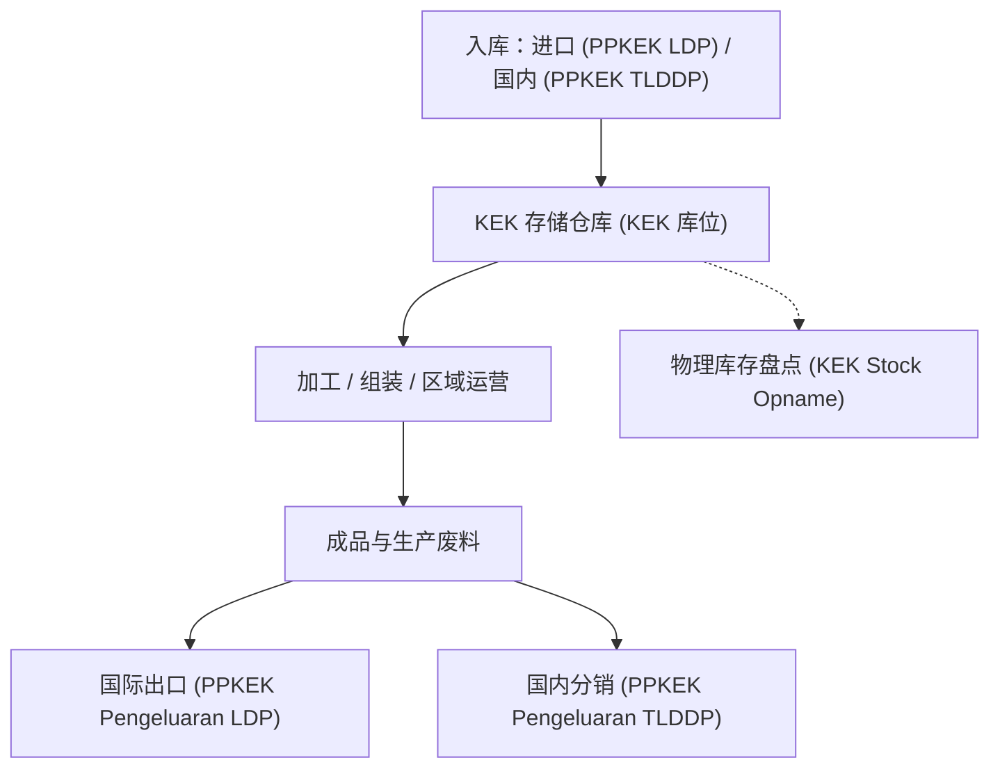

# 经济特区便利化（djbc_kek）

**`djbc_kek`** 模块专为满足 **经济特区（Kawasan Ekonomi Khusus - KEK）** 内区企业和商业实体的海关合规和库存报告（*IT 库存*）要求而设计，符合印度尼西亚海关与消费税总局（DJBC）法规。

---

## 法规框架与 KEK 概念

经济特区的管理受以下核心立法约束：

* **2021 年第 40 号政府条例（PP）** 关于经济特区的实施。
* **财政部长条例（PMK）No. 237/PMK.04/2020** 经 **PMK No. 33/PMK.10/2021** 修订，关于经济特区内的税收、海关和消费税待遇。

### KEK 财政激励与便利化：
1. **关税与消费税豁免**：适用于从海关区域外（*Luar Daerah Pabean* / LDP）进入的资本货物、原材料和运营供应品。
2. **税款不征**：对从海外或国内海关区域的其他部分（*TLDDP*）进入的符合条件的货物，增值税（VAT）和奢侈品销售税（PPnBM）暂停/不征收。
3. **集成海关申报**：使用通过国家单一提交系统（SINSW）登记的专用 **PPKEK（经济特区报关）** 单证。
4. **必备 IT 库存**：KEK 内的所有商业实体必须运行电子库存核算系统（*IT Inventory*），可供海关监管官员在线实时访问。

---

## 专用 KEK 海关单证（PPKEK）

`djbc_kek` 模块将仓库库存移动与官方 KEK 海关登记单证集成：

| 单证代码 | 单证标题 | 用途与描述 |
|---|---|---|
| **PPKEK Pemasukan LDP** | 海关区域外入境单证 | 通过关税豁免和增值税暂停将外国货物直接进口到 KEK 区域。 |
| **PPKEK Pemasukan TLDDP** | 其他国内海关区域入境单证 | 国内货物入境到 KEK，不征收增值税。 |
| **PPKEK Pengeluaran LDP** | 至海关区域外出境单证 | 从 KEK 出境的成品制成品进行国际出口。 |
| **PPKEK Pengeluaran TLDDP** | 至国内海关区域出境单证 | 将货物从 KEK 运至印度尼西亚国内市场，对所含进口成分结算进口关税和税款。 |
| **其他海关单证** | BC 2.0、BC 2.3、BC 2.7、BC 3.0、PPFTZ-02 | 法规允许的跨设施转移（保税区、KITE、自由贸易区或其他 SEZ）。 |

---

## KEK 主数据配置

在记录日常仓库作业之前，配置以下主数据：

### 1. 产品分类（`product.template` 与 `product.category`）
* 进入 **库存 > 产品 > 产品（Inventory > Products > Products）**。
* 在产品表单上，确保启用 **可用于 DJBC KEK（Can be Used for DJBC KEK）**（`djbc_kek_ok`）。
* 此设置也可以在 **产品类别（Product Category）**（`product.category`）层级自动设置。
* 勾选 **DJBC KEK（`djbc_kek`）** 复选框，以便该项目包含在 KEK IT 库存变动余额中。

### 2. 仓库库位分类（`stock.location`）
* 进入 **库存 > 配置 > 库位（Inventory > Configuration > Locations）**。
* 选择位于 KEK 边界内的存储库位。
* 在 **DJBC KEK 库位（`djbc_kek_location`）** 字段中，将值从 `None` 更改为 **KEK 产品库位（`kek`）**。
* 只有涉及标记为 KEK 标志的库位的库存移动才会在 KEK 海关库存报表中评估。

### 3. 仓库作业类型（`stock.picking.type`）
* 进入 **库存 > 配置 > 作业类型（Inventory > Configuration > Operations Types）**。
* 配置海关移动属性：
    * **DJBC 的 KEK 移动类型（DJBC's KEK Movement Type）**：指定海关方向：**入库（In）** 或 **出库（Out）**。
    * **DJBC 的 KEK 废料？（DJBC's KEK Scrap?）**：为 KEK 中的废料、废品或不合格移动启用。
    * **DJBC 的 KEK 调整？（DJBC's KEK Adjustment?）**：为物理计数差异调整启用。
    * **DJBC KEK 单证必填（DJBC KEK Doc Required）**：勾选后，系统强制要求拣货转移必须附加有效的海关单证参考才能标记为 *已完成（Done）*。

---

## 交易生命周期与 KEK 货物移动

KEK 中的库存运营涵盖完整的供应链生命周期：

1. **入库收货**：
   * 当物料到达 KEK 时，登记参考相关 PPKEK Pemasukan 单证（LDP 或 TLDDP）的收货拣货。
   * 验证收货会增加 KEK 库位上的库存，并将交易记录在 **入库货物报表（Inbound Goods Report）** 中。
2. **运营与转化**：
   * 区域内的货物移动在定义的存储和处理库位之间记录。
   * 转化后的成品反映累计的物料投入。
3. **出库调度与发货**：
   * 出口交付使用 **PPKEK Pengeluaran LDP** 登记。
   * 国内销售/交付使用 **PPKEK Pengeluaran TLDDP** 登记，对进口原材料含量进行评估。
   * 已验证的转移记录在 **出库货物报表（Outbound Goods Report）** 中。
4. **物理库存盘点**：
   * KEK 企业定期或每年进行物理库存盘点。
   * 盘点计数使用 `djbc_stock_opname` 模块记录，并在 **KEK 库存盘点报表（KEK Stock Opname Report）** 中报告。

---

## 4 份必备 KEK IT 库存报表

官方报表可通过 **海关报表 > 报表 > 经济特区（Laporan Bea Cukai > Reporting > Kawasan Ekonomi Khusus）** 访问：

| 编号 | 官方报表名称 | 描述与关键属性 |
|---|---|---|
| **1** | **入库货物报表（Laporan Pemasukan Barang）** | 入库海关入境（PPKEK Pemasukan LDP/TLDDP、BC）、收货拣货编号、单证日期、供应商/发货人、产品编码、描述、计量单位和数量的综合清单。 |
| **2** | **出库货物报表（Laporan Pengeluaran Barang）** | 出库海关入境（PPKEK Pengeluaran LDP/TLDDP、BC）、发货拣货编号、单证日期、收货人/买方、产品编码、描述、计量单位和数量的综合清单。 |
| **3** | **KEK 货物变动报表（Laporan Mutasi Barang KEK）** | 完整的海关库存对账：期初余额、入库、出库、调整、账面期末余额、物理库存盘点（*Stock Opname*）和差异。 |
| **4** | **KEK 库存盘点报表（Laporan Hasil Pencacahan）** | 按日期详细列示的物理盘点审计结果，包括产品编码、产品名称、产品类别、计量单位、实际物理计数和说明性备注。 |

---

## 报表生成流程

1. 进入 **海关报表 > 报表 > 经济特区（Laporan Bea Cukai > Reporting > Kawasan Ekonomi Khusus）**。
2. 选择所需的报表向导（例如 **KEK 货物变动报表（Laporan Mutasi Barang KEK）**）。
3. 在向导模式中：
    * 指定日期参数（**起始日期（From Date）** 和 **结束日期（To Date）**），或选择预定义的 **报表期间（Report Period）**。
    * 选择输出格式：**屏幕（Screen）**（*交互式 HTML 列表*）、官方 **Py3o ODT/PDF** 或 **Excel（XLSX）**。
4. 点击 **打印 / 预览（Print / Preview）** 生成可供海关检查的法规报表。

> [!NOTE]
> KEK 货物变动报表会自动过滤在配置为 `djbc_kek_location = 'kek'` 的仓库库位内标记为 `djbc_kek = True` 的产品的移动。