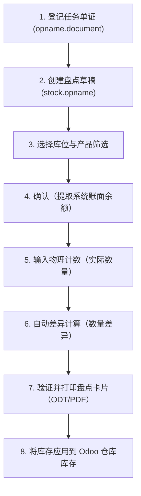

# 物理库存 / 库存盘点执行（djbc_stock_opname）

**`djbc_stock_opname`** 模块管理保税区、KITE 便利化和其他海关监管区域的物理库存盘点（*Stock Opname*）操作，以满足海关与消费税总局（DJBC）的合规要求。

---

## 法规合规与要求

根据印尼海关法规（如 **PER-02/BC/2019** 和 **PER-09/BC/2021**）：

1. 保税设施要求每个日历年度至少进行一次物理库存盘点（*stock opname*）。
2. 库存盘点活动可由当地海关办公室（KPPBC）的海关官员在官方 **任务函（Surat Tugas）** 下直接监督。
4. 物理盘点结果必须与 IT 库存账面余额对账，并记录在官方 **库存盘点官方报告（Berita Acara Stock Opname）** 中。

---

## 库存盘点操作流程

BZone 中的库存盘点流程由两个主要部分组成：

1. **盘点单证（`opname.document`）**：海关任务函和监督官员的登记。
2. **库存盘点执行（`stock.opname`）**：提取系统账面余额、输入实际计数、计算差异并应用最终库存调整。

---

## 1. 登记任务单证（Surat Tugas）

在启动仓库现场盘点活动之前，请登记海关办公室或管理层发出的任务函：

1. 打开 **海关报表 > 库存盘点（Laporan Bea Cukai > Stock Opname）**。
2. 点击 **新建 / 创建（New / Create）**。
3. 填写表单字段：
   * **任务函（Surat Tugas）**：官方任务函编号（例如 `ST-012/KPPBC.TMP.A/2025`）。
   * **日期（Tanggal）**：签发日期或计划盘点日期。
   * **官员姓名（Nama Pejabat）**：指定的海关官员 / 监督审计员姓名。
4. 点击 **保存（Save）**。

> [!NOTE]
> 任务参考和官员详细信息将自动链接到实物盘点工作表，并显示在打印的官方盘点卡片上。

---

## 2. 创建库存盘点工作表

登记任务单证后，启动库存计数工作表：

1. 打开 **库存 > 作业 > 调整 > 库存盘点（Inventory > Operations > Adjustments > Stock Opname）**。
2. 点击 **新建 / 创建（New / Create）**。
3. 填写表单详情：
   * **盘点库位（Inventoried Location）**：选择目标仓库库位（例如 `WH/Stock`）。
   * **任务函编号（Nomor Surat Tugas）**：选择已登记的任务单证。*负责人（Responsible）* 字段将自动填充官员姓名。
   * **盘点日期（Inventory Date）**：盘点的截止日期和时间。
   * **盘点对象（产品筛选）（Inventory of (Product Filter)）**：
     * **手动选择产品（*Partial*）**：逐个手动添加盘点行。
     * **仅一个产品（One product only）**：针对特定项目。
     * **一个产品类别（One product category）**：预填充所选类别下的所有活动产品（例如原材料或成品）。
   * **备注（Keterangan）**：运营备注（例如 `2025 财年年度盘点`）。

---

## 3. 检索系统余额并输入计数

1. 点击 **确认 / 开始（Confirm / Start）**。状态变为 **进行中（In Progress）**（`confirm`）。
2. 系统自动计算账面余额：
   * 查询 `stock.quant` 中的现有物理库存。
   * 考虑待处理在途移动。
   * 在盘点行（`stock.opname.line`）的 **理论数量（Theoretical Qty）** 列上填充。
3. 仓库盘点团队记录物理数量。
4. 将计数金额输入到 **实际数量（Real Qty）** 列：
   * 对于批次/序列跟踪的项目，请指定 **批次 / 序列号（Lot/Serial Number）**。
   * **库存数量（Qty Diff）** 列自动计算：
     `数量差异 = 实际数量 - 理论数量`

> [!TIP]
> 正差异表示盈余（物理超过系统记录），负差异表示短缺（物理少于系统记录）。

---

## 4. 验证与打印官方卡片

1. 确保所有盘点行都有有效的 *实际数量（Real Qty）* 值（不允许负数）。
2. 点击 **验证 / 批准（Validate / Approve）** 将状态推进到 **已验证（Validated）**（`done`）。
3. 要生成官方审计报表，点击 **打印 > 盘点卡片（Print > Stock Opname Card）**：
   * 生成基于 Py3o 的标准化单证（ODT/PDF）。
   * 包含公司标识、任务详情、库位、产品行、系统与物理数量、差异分析以及盘点团队和海关官员的签名部分。

---

## 5. 应用库存调整

在计数结果经过验证并由所有各方签字后：

1. 点击 **应用库存（Apply Inventory）**。
2. BZone 更新 Odoo 的核心库存：
    * 将 `stock.quant` 数量与 *实际数量（Real Qty）* 同步。
    * 将工作表标记为 *已盘点（Inventoried）*。
    * 生成调整库存移动，无缝反映在后续期间的 IT 库存变动报表中。

> [!WARNING]
> 无法解释或无记录的库存短缺可能引发海关审计，并根据适用的海关法律导致进口关税评估或行政处罚。