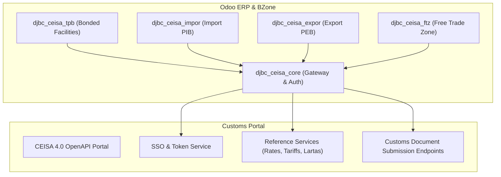

# CEISA 4.0 Foundation Integration (djbc_ceisa_core)

The **`djbc_ceisa_core`** module serves as the primary integration gateway connecting all BZone customs operations in Odoo with the Indonesian Directorate General of Customs and Excise (DJBC) **CEISA 4.0 (Customs-Excise Information System and Automation)** ecosystem via RESTful OpenAPI.

---

## Architecture & Core Role

This module acts as the central hub for authentication, national customs reference data synchronization, and end-to-end API audit logging across all specialized customs service modules:

### Dependent Service Modules:
* **`djbc_ceisa_tpb`**: Bonded Storage Facilities declarations (Bonded Zones, Bonded Warehouses, etc.).
* **`djbc_ceisa_impor`**: Import Goods Declarations (PIB / BC 2.0).
* **`djbc_ceisa_expor`**: Export Goods Declarations (PEB / BC 3.0).
* **`djbc_ceisa_ftz`**: Free Trade Zone Customs Declarations (PPFTZ).
* **`djbc_ceisa_barang_kiriman`**: Consignment Note Declarations.

---

## Credentials Configuration & Authentication

To enable communication with the Customs OpenAPI, administrators must set connection parameters under **CEISA Connector > Configuration > Settings**:

### 1. CEISA OpenAPI Parameters
* **Username**: User account identifier for the customs portal.
* **Password**: Password for the customs portal.
* **Bea Cukai API Key**: Unique API key generated under the user profile in the CEISA OpenAPI portal (`https://openapi.beacukai.go.id`).
* **CEISA API URL**: Official base API endpoint (e.g. `https://openapi.beacukai.go.id` for production).
* **Company Code (Kode Perusahaan)**: 6-digit company code issued by Indonesian Customs (used to construct the 26-digit Customs Submission Number / *Nomor Aju*).

### 2. OAuth2 Token Lifecycle Management
* Authentication uses the Bearer token protocol (`/v1/openapi-auth/user/login`).
* Access tokens are valid for 300 seconds (5 minutes) while refresh tokens remain valid for 24 hours.
* BZone autonomously monitors token expiration and triggers **Auto-Refresh** with a 30-second pre-expiration safety buffer.

---

## Reference Data Synchronization Services

`djbc_ceisa_core` includes automated wizards to fetch official master data directly from Customs servers:

### 1. Weekly Customs Exchange Rates (`ceisa.currency.rate`)
* Menu: **CEISA Connector > Layanan CEISA > Sinkronisasi Kurs**.
* Pulls weekly Ministry of Finance Decree (KMK) exchange rates for calculating Customs Value (NDPBM).
* Can be scheduled as an automated cron job every Wednesday when new rates take effect.

### 2. HS Codes & Duty Tariffs (`ceisa.tarif`)
* Menu: **CEISA Connector > Layanan CEISA > Sinkronisasi Tarif**.
* Fetches import duty rates, VAT, Luxury Goods Sales Tax, and Article 22 Income Tax for specific **8-digit** HS codes from the Indonesian Customs Tariff Book (BTKI).
* **HS Code Rule**: Always use the full **8-digit** national tariff code (lowest-level BTKI/AHTN code, not 2/4/6-digit category headers), as CEISA 4.0 Tariff and Lartas APIs only validate duties and restrictions at the 8-digit level.

### 3. Trade Restrictions & Prohibitions / Lartas (`ceisa.lartas`)
* Menu: **CEISA Connector > Layanan CEISA > Sinkronisasi Lartas**.
* Checks regulatory requirements (Ministry of Trade, Quarantine, BPOM permits) applicable prior to clearance based on the 8-digit HS code.

### 4. Manifest Integration (`ceisa.manifes`)
* Menu: **CEISA Connector > Layanan CEISA > Sinkronisasi Manifes**.
* Retrieves cargo manifest (BC 1.1) records from Temporary Storage Facilities (TPS) at air and sea ports by manifest bill and sub-bill numbers.

### 5. Standalone Status & Response Inquiry (`ceisa.status.respon`)
* Menu: **CEISA Connector > Layanan CEISA > Status & Respon**.
* Click **Tarik Status & Respon BC** from the list or form header of **Status & Respon**, and enter the **26-digit Submission Number (Nomor Aju)** in the wizard (`ceisa.status.respon.wizard`).
* The system queries the CEISA OpenAPI status endpoints and records:
    * **Status History (`ceisa.status.history`)**: Chronological customs processing statuses, Registration Number (`nomorDaftar`), Registration Date, and latest status badge.
    * **Response History (`ceisa.respon.history`)**: Official customs responses (SPPB, NPP, SPJM, Reject, etc.) with accurate `waktu_respon` (Datetime) timestamps and messages.
    * **Automated Chatter PDF Attachment & Inline Preview**: Whenever a CEISA response includes a PDF payload (either inline Base64 or a relative PDF download path), the system validates and attaches the PDF directly to the matched customs document's **Chatter** (TPB, Import, Export, or FTZ) or the **Status & Respon** record, with built-in side-by-side PDF preview (`o_attachment_preview`).
    * **API Log Sanitization**: Base64 PDF payloads are automatically stripped/summarized in `ir.api.log` to prevent database bloat.

---

## Master Data Alignment

Align internal Odoo master data prior to processing customs declarations:

1. **Product HS Codes (8 Digits)**:
    * Navigate to **Inventory > Products > Products** (or the **HS Code** master).
    * On the **CEISA / DJBC Information** tab, assign the correct **8-digit Pos Tarif / HS Code** (without 2-, 4-, or 6-digit parent headers) and standard CEISA UoM.
2. **Customs Partner Profiles**:
    * Navigate to **Contacts**.
    * On the **CEISA** tab, specify the partner's **16-digit NPWP**, **NIB (Business Identification Number)**, and relevant entity roles.
3. **UOM Standard Mapping**:
    * Map Odoo internal UoMs to CEISA standard international codes (e.g. `KGM` for kilograms, `PCE` for pieces, `LTR` for liters).

---

## API Logging & Audit Trails

Every outbound request payload and inbound response from CEISA is recorded for auditability:

* **API Log Menu**: Located at **CEISA Connector > Configuration > API Log**.
* Captured metrics include:
    * Endpoint URL accessed.
    * HTTP Status Code (200 OK, 400 Bad Request, 401 Unauthorized, 500 Server Error).
    * Request JSON Body and Response JSON Body.
    * Round-trip execution latency.
* Empowers operations and IT teams to swiftly troubleshoot submission rejections (*rejects*) or schema validation errors.

> [!TIP]
> Always verify your credentials by clicking the **Test Connection** button on the settings page before initiating your first live document submission.
