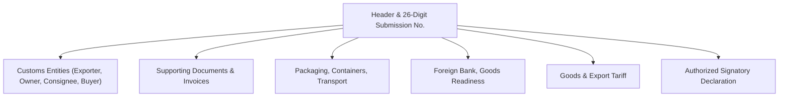

# CEISA Export Module (djbc_ceisa_expor)

The **`djbc_ceisa_expor`** module manages **Export Declaration Documents (PEB / BC 3.0)** and **BC 3.3** submissions to the CEISA 4.0 portal of DJBC. This document is a user guide for Exim Operations, Logistics, Customs Brokers (PPJK), and Company Customs Staff.

> [!IMPORTANT]
> Per the implementation in `__manifest__.py` and the `_default_kode_dokumen` default in `ceisa.export.document`, **this module only supports BC 3.0 and BC 3.3 documents** (reference codes `30` and `33`). For exports from Bonded Zones, use the [`djbc_ceisa_tpb`](../djbc_ceisa_tpb/pengelolaan_dokumen_tpb.md) module.

---

## 1. Module Scope & Document Types

| BC Code | Document Type | Purpose |
|---|---|---|
| **BC 3.0** | Export Declaration (PEB) | Definitive export from TLDDP (other locations within the customs area / general warehouses) to overseas destinations. |
| **BC 3.3** | PEB from Bonded Logistics Center (PLB) | Export of goods from a Bonded Logistics Center (PLB) to overseas destinations. |

> [!TIP]
> After a document is successfully submitted to CEISA and reaches the `Sent` state, Indonesian Customs will return an **NPE (Nomor Pendaftaran Ekspor)** that is used as the reference for port clearance.

---

## 2. Export Document Form Anatomy



---

## 3. Document Lifecycle

| State | Description | Available Actions |
|---|---|---|
| **Draft** | New document / being prepared. | Free editing, Add Item |
| **Confirm** | Data is internally valid. | **Send Document**, Set to Draft |
| **Sent** | Successfully transmitted to CEISA. | **Check Status & Response**, **Start Revision** |

> [!WARNING]
> Once the status becomes `Sent`, the server returns `tanggal_daftar` (registration date) which is auto-filled as the document registration date in CEISA. This field is read-only and serves as the basis for NPE tracking.

---

## 4. Step-by-Step Filling Procedure

Open the **DJBC CEISA > Export > Export Documents** menu and click **Create**.

### Step 1: Header Tab

* **26-Digit Submission Number** — Auto-generated when `kode_kantor` and `kode_dokumen` are selected.
* **Document Code** — Defaults to BC 3.0 if the user has permission. Choices are limited to `30` (BC 3.0) and `33` (BC 3.3).
* **Export Customs Office (`kode_kantor_ekspor`)** & **Loading Customs Office (`kode_kantor_muat`)** — Required for BC 3.0.
* **Loading Port (`kode_pel_muat`)**, **Export Port (`kode_pel_ekspor`)**, **Discharge Port (`kode_pel_bongkar`)**, **Destination Port (`kode_pel_tujuan`)** — Set according to document type (see table below).
* **Destination Country (`kode_negara_tujuan`)** — Select from the country master.
* **Payment Method** & **Trade Method** — Required for BC 3.0.
* **Insurance Code** — `LN` (Overseas) or `DN` (Domestic).
* **Bulk Flag** & **Oil & Gas Flag** — Set `1` (Yes) or `2` (No).
* **FOB, Freight, Insurance, CIF, NDPBM** — Export transaction values.

| Field | BC 3.0 | BC 3.3 |
|---|---|---|
| Export Customs Office | Required | – |
| Loading Customs Office | Required | – |
| Loading Port | Required | Required |
| Export Port | Required | – |
| Discharge Port | – | Required |
| Destination Port | Required | Required |
| CIF / Export Value | – | Required |
| Goods Readiness (PKB) | Required if Re-Export | – |

  

### Step 2: Entities Tab

The system auto-generates the entity lines on document creation:

| BC Type | Series & Entity Codes (order) |
|---|---|
| **BC 3.0** | 1: Exporter (`2`), 2: Owner (`7`), 3: Consignee (`8`), 4: Buyer (`6`) |
| **BC 3.3** | 1: Exporter (`2`), 2: Operator (`3`), 3: Buyer (`6`), 4: Consignee (`8`), 5: Owner (`7`) |

The **Exporter entity (code 2)** is auto-filled from `company.partner_id` for both BC 3.0 and BC 3.3.

  

### Step 3: Supporting Documents Tab

Use the CEISA reference codes for each supporting document (Invoice `380`, B/L `705`, AWB `740`, Packing List `217`, Contract `315`, Certificate of Origin `861`, and others). The system automatically arranges the series order when the document is confirmed.

  

### Step 4: Packaging, Transport, Container Tab

* **Packaging** — Fill the quantity and unit (CTN, PLT, PK, etc.).
* **Transport** — Choose the mode and transport vehicle/vessel name. For BC 3.3, also fill `kode_cara_angkut_plb` (transport mode to PLB).
* **Container** — 11-digit container number and size. The header field `jumlah_kontainer` is required (set `0` if no container is used).

  

### Step 5: Foreign Bank & Goods Readiness (PKB) Tab

* **Foreign Bank** — Fill the bank receiving the foreign exchange from the export.
* **Goods Readiness (PKB)** — This tab only appears and is required if the Export Type is **Re-Export** (reference code 5 / other re-exports). For **Regular Export (Ekspor Biasa)**, this tab is automatically hidden and not required.

  

### Step 6: Goods Details Tab

Select a product from the master → HS Code and CEISA unit are auto-filled. Enter **quantity**, **FOB price per unit**, and **FOB value** per item.

  

### Step 7: Signatory Tab

* **Signatory Name** (from `hr.employee`), **Position**, **City**, and **Disclaimer** (`1` for Yes).

---

## 5. Automatic Validation (`validate_before_send`)

Before submission, the system runs `validate_before_send()`:

| Universal Validation | Description |
|---|---|
| Submission Number | 26 digits per CEISA standard |
| Goods Lines | At least 1 item |
| Entities, Packaging, Transport, Foreign Bank | Must not be empty |
| Customs Office, Currency, NDPBM, Gross, Net Weight | Must not be empty |
| Supporting Document (Invoice) | Must not be empty |
| Entity code `2` (Exporter) or `3` (Operator) | Must exist |

| BC 3.0 Specific | Description |
|---|---|
| Goods Readiness (PKB) | At least 1 line required only if Export Type = Re-Export (not validated for Regular Export) |
| FOB / Goods Value | Must not be empty |
| Loading Port, Export Port, Destination Port, Export Customs Office, Loading Customs Office | Required |

| BC 3.3 Specific | Description |
|---|---|
| CIF / FOB / Goods Value | At least one must be filled |
| Loading Port, Discharge Port, Destination Port | Required |

If anything is missing, the system shows a list of fields that need to be completed.

---

## 6. Sending the Document to CEISA (Send Document)

1. Click **Confirm** — status changes to `Confirm`.
2. Click **Send Document** — the system POSTs to:
   ```
   POST {CEISA_BASE_URL}/openapi/document?isFinal=false&isRevision=false
   ```
3. The JSON payload is assembled by `_prepare_ceisa_export_data()` — with different structure for BC 3.0 and BC 3.3.
4. For **BC 3.0**, the body contains: `asalData`, `kodeDokumen`, dokumenInvoice, barang, entitas, pengangkut, kemasan, kontainer, bankDevisa, kesiapanBarang, and disclaimer.
5. For **BC 3.3**, the body adds: `kodeKantorEkspor`, `kodeKantorMuat`, `kodeNegaraTujuan`, `kodePelEkspor`, `kodePelBongkar`, `tanggalEkspor`, etc.
6. If the server returns `401`, the token is automatically refreshed and the request is retried.
7. Success → status `Sent`, `tanggal_daftar` is auto-filled, and `idHeader` is recorded in `ir.api.log` (via the **Api Log** button).
8. A notification email is sent to the user if `ceisa.send_email_on_success=True`.

> [!TIP]
> The `isFinal` parameter is controlled by the System Parameter `ceisa.is_final_dokumen` (default `false` = draft). Set `true` to finalize the document on first submission.

---

## 7. Revising a Document

The **Start Revision** button is only available for documents in `Sent` status. The system will:

1. Increment the `revision_count` and `seri` in the header.
2. Revert the status to `Draft`.
3. Set `is_revision = True` so the server receives `isRevision=true` on resubmission.

---

## 8. Helper Action: Pull TPS Data (Dev)

A **Get Kode TPS** button is available to call the endpoint `/openapi/gudangTPS/kodeKantor/{kode_kantor}` to sync the TPS master from the CEISA server. The result is recorded as an `ir.api.log` entry for audit purposes.

---

## 9. Key Terminology

| Term | Description |
|---|---|
| **PEB (BC 3.0)** | Pemberitahuan Ekspor Barang — the official customs declaration for export from TLDDP. |
| **BC 3.3** | PEB from PLB (Bonded Logistics Center). |
| **NPE** | Nomor Pendaftaran Ekspor — proof of registration in CEISA after submission. |
| **FOB** | Free on Board — value of goods at the loading port. |
| **Freight** | Transportation cost for export goods. |
| **Foreign Bank** | Bank where the exporter receives the foreign exchange from the export. |
| **Goods Readiness** | Declaration that goods are ready for inspection at the designated location. |
| **PLB** | Pusat Logistik Berikat — bonded zone for export logistics activities. |

---

> This document is a non-technical guide for the **`djbc_ceisa_expor`** module. For general imports, use the [`djbc_ceisa_impor`](../djbc_ceisa_impor/dokumentasi_impor.md) module. For exports / inter-TPB from a Bonded Zone, use the [`djbc_ceisa_tpb`](../djbc_ceisa_tpb/pengelolaan_dokumen_tpb.md) module.
