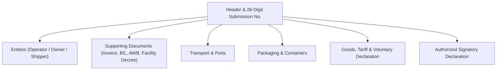

# CEISA FTZ Module (djbc_ceisa_ftz)

> **Last updated:** 22 Oktober 2026

The **`djbc_ceisa_ftz`** module manages customs documents for companies operating within Indonesia's **Free Trade Zone (FTZ) / Kawasan Perdagangan Bebas dan Pelabuhan Bebas (KPBPB)**. This document is a user guide for Exim Operations, Logistics, Customs Brokers (PPJK), and Company Customs Staff.

---

## 1. Who Should Use This Module?

This module is used by companies that hold an operating license in one of Indonesia's **KPBPB** areas:

| Zone | Location |
|---|---|
| **KPBPB Batam** | Batam Island, Riau Islands |
| **KPBPB Bintan** | Bintan Island, Riau Islands |
| **KPBPB Karimun** | Karimun Island, Riau Islands |
| **KPBPB Sabang** | Weh Island, Sabang, Aceh |

> [!NOTE]
> These zones are governed by **PP No. 10/2012 jo. PMK 42/PMK.04/2020** and have a **sui generis** (special) status — not a Bonded Zone and not a Freeport. They enjoy **duty-free, VAT-free, income tax-free, and excise-free** treatment for goods entering the zone from overseas that are used within the zone.

**Examples of companies that use this module:**

* Manufacturing factories in Batam whose raw materials come from Singapore, Japan, or China.
* Logistics companies in Tanjung Uncang (Batam) that handle transit cargo to/from overseas.
* Industrial estate operators in Bintan.
* Duty-free shops in Sabang.
* Subcontractors or warehouse tenants in KPBPB that receive/ship goods between zones.

> [!TIP]
> **Difference from Bonded Zone (module `djbc_kb` / `djbc_ceisa_tpb`):** A Bonded Zone is *inside* Indonesia with a "suspended TLDDP" status, while an FTZ is *treated as outside the customs area* for certain transactions. The document rules follow **PPFTZ (Pemberitahuan Pabean FTZ)**, not the standard PIB/PEB.

---

## 2. Module Scope & Document Types

Per the implementation in `serializers/` and the `kode_dokumen` domain, the module supports **4 PPFTZ document types** (plus a fallback to `512`):

| Code | Name | Purpose |
|---|---|---|
| **511** | **PPFTZ-01 from LDP** | Inbound goods from **Outside the Customs Area (LDP)** to KPBPB. |
| **513** | **PPFTZ-01 from TLDDP** | Inbound goods from **TLDDP** (mainland Indonesia outside KPBPB) to KPBPB. |
| **522** | **PPFTZ-02** | Outbound goods from KPBPB to **Bonded Zone / SEZ / other FTZ / facilitated zones**. |
| **531** | **PPFTZ-03** | Inbound from TLDDP to KPBPB (PMK 42/PMK.04/2020). |
| **512** | (fallback) | Internal zone document variant. |

> [!IMPORTANT]
> The numbering **511/512/513/522/531** is the internal CEISA code, **not BC 1.6 / 2.3 / 2.5** as used in Bonded Zones. Operational staff must distinguish them: **BC** for KB & TPB, **PPFTZ** for FTZ.

---

## 3. FTZ Document Form Anatomy



Each **serializer** (511/513/522/531) adds specific fields per the CEISA schema:

| Serializer | Main Additional Fields |
|---|---|
| `FTZ511Serializer` | `kodeKategoriBarangFtz`, `kodeTujuanPemasukan`, `kodeKategoriMasukFtz`, `namaTransaksiLainnyaFtz`, `nomorBc11`, `posBc11`, `tanggalTiba`, `biayaTambahan`, `biayaPengurang`, `tanggalBc11`. Goods: `barangSpekKhususes` (note the **plural +es**). |
| `FTZ513Serializer` | `kodeKategoriKeluarFtz`, `kodeTujuanPengeluaran`, `nomorBc11`, `posBc11`, `tanggalTiba`, `biayaTambahan`, `biayaPengurang`, `tanggalBc11`, **`status: '1'`** (root required). Goods: `kodePerhitungan` (`0`/`1`), `barangSpekKhusus` (singular). |
| `FTZ522Serializer` | `kodeJenisProsedur`, `kodeKategoriKeluarFtz`, `kodeNegaraTujuan`, `nilaiBarang`, `nilaiIncoterm`, `nilaiMaklon`, `flagCurah`, `tanggalBc11`, `jumlahTandaPengaman`. |
| `FTZ531Serializer` | `kodeKategoriBarangFtz`, `kodeKategoriKeluarFtz`, `kodeTujuanPemasukan`, `kodeTujuanPengeluaran`, **`status: '1'`** (root required). |

---

## 4. Document Lifecycle

| State | Description | Available Actions |
|---|---|---|
| **Draft** | New document / being prepared. | Free editing, Add Item |
| **Confirm** | Data is internally valid. | **Send Document**, Set to Draft |
| **Sent** | Successfully transmitted to CEISA. | Check Status & Response (via API Log), Start Revision |

---

## 5. Step-by-Step Filling Procedure

Open the **DJBC CEISA > FTZ > PPFTZ Documents** menu and click **Create**.

### Step 1: Header Tab

* **26-Digit Submission Number** — Auto-generated from `kode_kantor` (4 digits) + `kode_dokumen` (first 2 digits) + `company_code` (6 digits) + sequence. The system trims to exactly 26 characters.
* **Document Code** — Choose from `511`, `512`, `513`, `522`, `531` based on the transaction.
* **Document Type** (selection field) — Recommended to pick `511`, `513`, or `522` (used as fallback).
* **Customs Office** — Select according to the KPBPB region.
* **FTZ Goods Origin Code** & **Procedure Type Code** — Required to record the origin of goods.
* **Insurance Code** (`LN` / `DN`) — Required for 511 & 513.
* **Payment Method, Trade Method, Incoterm** — Required for 511 & 513.
* **Currency Code & NDPBM** — Auto-filled with the weekly KMK tax rate when a currency is selected.
* **BC 1.1 Sub-position** — Used to refer to the BC 1.1 manifest (matches `subpos_bc11`).
* **BC 1.1 Number, Position, Date** — For documents tied to a port manifest.

  

### Step 2: Entities Tab

Standard customs entities following the CEISA schema (codes `1`–`10`). Required fields for most entities: `alamatEntitas`, `kodeEntitas`, `kodeJenisApi` (01/02), `kodeJenisIdentitas` (2–6), `kodeNegara`, `kodeStatus`, `namaEntitas`, `nomorIdentitas`, `seriEntitas`.

> [!TIP]
> Serializers 511 & 513 accept multiple entities; serializer 531 accepts only **1 entity** with `kodeEntitas: '6'`. Serializer 522 has no `entitas` property at the root.

  

### Step 3: Supporting Documents Tab

Documents follow a **3-Element Tuple** (see `serializers/base.py:100-147`):

| Index | Type | Code |
|---|---|---|
| 0 | Facility Decree / Other Document | (optional) |
| 1 | House-BL or AWB | `705` or `740` |
| 2 | Invoice | `380` (required) |

Required fields on every document: `idDokumen`, `kodeDokumen`, `nomorDokumen`, `seriDokumen`, `tanggalDokumen`.

  

### Step 4: Transport, Packaging, Container Tab

* **Transport** — Vehicle/vessel name & number, country flag code (2-letter ISO capital), transport mode code.
* **Packaging** — Quantity, type (`CTN`, `PLT`, etc.), series, and brand.
* **Container** — 11-digit number, size (20/40/45), type.

  

### Step 5: Goods Tab

Select a product from the master → HS Code, CEISA unit, and specification details are auto-filled. Each serializer adds different fields:

* **511 & 513**: `kodeKondisiBarang`, `nilaiBarang`, `kodePerhitungan` (513 only), `barangSpekKhususes` (511) or `barangSpekKhusus` (513).
* **522**: `hargaPatokan`, `hargaPenyerahan`, `hargaSatuan`, `jumlahDilekatan`, `jumlahRealisasi`, `kapasitasSilinder`, `kodeDaerahAsal`, `nilaiBarang`, `nilaiDanaSawit`, `nilaiDevisa`, `persentaseImpor`, `seriBarangDokAsal`, `kodeBarang`, `seriIjin`, `tahunPembuatan`, `tarifCukai`, `hargaPerolehan`, `barangSpekKhusus`.
* **531**: `kodeDokumen`, `kodeKondisiBarang` only.

  

### Step 6: Voluntary Declaration Tab (Optional)

Use the `voluntary_declaration_ids` tab if there is a voluntary declaration related to the goods (e.g., goods subject to Export Duty / Palm Oil Fund / Excise).

### Step 7: Signatory Tab

* **Signature City** (from `res.city`).
* **Signatory Name** (from `hr.employee`).
* **Signatory Position** (from `hr.job`).
* **Signature Date**.

---

## 6. Automatic Validation

Before a document can be sent, the system runs 5 validation functions (similar to import/export modules):

| Function | Validation |
|---|---|
| `check_detail_dokumen` | 26-digit Submission Number, Customs Office, Loading/Transit/Destination Port, TPS, Currency, Payment Method, Tutup PU Code, Procedure Type, FTZ Goods Origin Code, Signatory. |
| `check_entitas` | At least 1 entity with required fields. |
| `check_dokumen_pelengkap` | Invoice `380` is required. |
| `check_kemasan_pengangkut` | Packaging and transport data are filled. |
| `check_barang` | Each item has HS Code, unit, packaging type. |

---

## 7. Sending the Document to CEISA (Send Document)

1. Click **Confirm** — status changes to `Confirm`.
2. Click **Send Document** — the system auto-selects the **serializer** based on `kode_dokumen` via the factory `get_ftz_serializer()` in `serializers/__init__.py`:
   * `511` → `FTZ511Serializer`
   * `513` → `FTZ513Serializer`
   * `522` → `FTZ522Serializer` (also `512` via fallback)
   * `531` → `FTZ531Serializer`
3. The JSON payload is sent to:
   ```
   POST {CEISA_BASE_URL}/openapi/document
   ```
4. Success → status `Sent`, payload recorded in `ir.api.log` (via the **Api Log** button).

> [!WARNING]
> Serializers 513 & 531 **must include the root field `status: '1'`** due to a DJBC schema anomaly that lists it as `required` even though it is not defined in `properties`. This is already handled by the respective serializers.

---

## 8. Serializer Strategy Pattern (Technical Note)

This module uses the **Strategy Pattern** via the `serializers/` folder:

* `base.py` → `BaseFTZSerializer` (shared helpers: date formatting, get_code, get_header_common, get_kemasan, get_kontainer, get_pengangkut, get_dokumen, get_entitas, get_barang_base).
* `serializer_511.py` → Specific to PPFTZ-01 LDP.
* `serializer_513.py` → Specific to PPFTZ-01 TLDDP.
* `serializer_522.py` → Specific to PPFTZ-02.
* `serializer_531.py` → Specific to PPFTZ-03.
* `__init__.py` → Factory dispatcher `get_ftz_serializer(doc)`.

> For development, see also [ARCHITECTURE_IMPROVEMENT_ROADMAP.md](file:///home/addons/bzone19/djbc_ceisa_ftz/ARCHITECTURE_IMPROVEMENT_ROADMAP.md) which contains historical bug notes and the serializer improvement plan.

---

## 9. Key Terminology

| Term | Description |
|---|---|
| **FTZ / KPBPB** | Free Trade Zone / Kawasan Perdagangan Bebas dan Pelabuhan Bebas — special customs area in Indonesia. |
| **PPFTZ** | Pemberitahuan Pabean FTZ — official document for transactions in the zone. |
| **LDP** | Luar Daerah Pabean — area outside Indonesia for customs purposes. |
| **TLDDP** | Tempat Lain Dalam Daerah Pabean — Indonesian mainland outside KPBPB. |
| **NDPBM** | Nilai Dasar Perhitungan Bea Masuk — weekly KMK tax exchange rate. |
| **BC 1.1** | Port/airport manifest document (referenced by `nomorBc11` & `posBc11`). |
| **VD** | Voluntary Declaration — voluntary declaration for certain goods. |
| **Facility Decree (SK)** | Facility decree that serves as a supporting document for FTZ. |

---

> This document is a non-technical guide for the **`djbc_ceisa_ftz`** module. For Bonded Zones (BC 1.6/2.3/2.5/2.6.1/2.6.2/2.7/4.0/4.1), use the [`djbc_ceisa_tpb`](../djbc_ceisa_tpb/pengelolaan_dokumen_tpb.md) module. For general imports, use the [`djbc_ceisa_impor`](../djbc_ceisa_impor/dokumentasi_impor.md) module. For exports, use the [`djbc_ceisa_expor`](../djbc_ceisa_expor/dokumentasi_expor.md) module.
