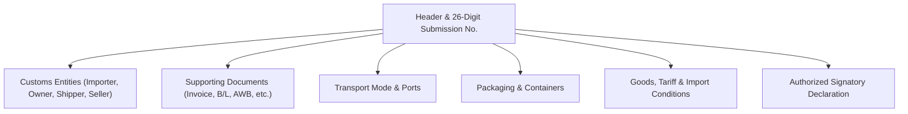

# CEISA Import Module (djbc_ceisa_impor)

> **Last updated:** 22 Oktober 2026

The **`djbc_ceisa_impor`** module manages **Import Declaration Documents (BC 2.0 / PIB)** and submits them to the CEISA 4.0 portal of the Indonesian Directorate General of Customs and Excise (DJBC). This document is a user guide for Exim Operations, Logistics, Customs Brokers (PPJK), and Company Customs Staff.

> [!IMPORTANT]
> Per the implementation in `__manifest__.py` and the `_check_user_kode_dokumen_permission` validation in the `ceisa.import.document` model, **this module only supports BC 2.0 documents** (reference code `20`). For BC 2.3 (import into Bonded Zone) and BC 2.7 (inter-TPB), use the [`djbc_ceisa_tpb`](../djbc_ceisa_tpb/pengelolaan_dokumen_tpb.md) module.

---

## 1. Module Scope & Document Type

| BC Code | Document Type | Purpose |
|---|---|---|
| **BC 2.0** | Import Declaration (PIB) | General import from outside the customs area (LDP) to a Temporary Storage Facility (TPS) at a seaport or airport, with the obligation to pay Import Duty, VAT, Article 22 Income Tax, and other applicable taxes (excise, Art 23, etc.). |

> [!TIP]
> This module produces the equivalent of the PIB document in the **CEISA 4.0** host-to-host application from DJBC. Make sure you have a valid **DJBC Company Code** and **Company NPWP** before starting data entry.

---

## 2. Import Document Form Anatomy

The BC 2.0 document is organized into several tabs following the CEISA standard:



---

## 3. Document Lifecycle

| State | Description | Available Actions |
|---|---|---|
| **Draft** | New document / being prepared. All fields freely editable. | Edit all fields, Add Item, Auto-Fill |
| **Confirm** | Data is internally valid. Status is locked for submission. | **Send to CEISA**, Set to Draft |
| **Sent** | Document has been successfully transmitted to CEISA and received an NPP. | **Check Status & Response**, **Start Revision** |

> [!WARNING]
> The **Confirm → Sent** transition only occurs if all `check_*` validations (see Section 5) pass. Otherwise, the system raises a **UserError** with a list of incomplete fields.

---

## 4. Step-by-Step Filling Procedure

Open the **DJBC CEISA > Import > Import Documents** menu and click **Create**.

### Step 1: Header Tab

* **26-Digit Submission Number (Nomor Aju)** — Auto-generated when you select **Customs Office** (`kode_kantor`) and **Document Code** (`kode_dokumen`). Pattern: `[4-digit office][2-digit BC][6-digit company code][14-digit sequence]`. Example: `0403002000012325101000012345`.
* **Customs Office** — Select according to the supervising office where the TPS is located.
* **Loading Port, Destination Port, TPS** — All required.
* **Tutup PU Code** — Must be one of: `11`, `12`, or `14`. Other codes are rejected by `check_detail_dokumen`.
* **Currency Code & NDPBM** — The weekly KMK tax rate is auto-filled when a currency is selected. See [exchange rate guide](../erpi_custom_rate/manajemen_kurs_pabean.md).

  

### Step 2: Entities Tab

When the document is created, the system **automatically generates 4 entity lines** following the BC 2.0 standard:

| Series | Code | Role | Auto-Fill |
|---|---|---|---|
| 1 | `1` | **Importer** | Yes, from `company.partner_id` |
| 2 | `7` | **Cargo Owner** | No |
| 3 | `9` | **Shipper** | No |
| 4 | `10` | **Seller** | No |

**Required** fields for the Importer entity: Name, Address, 16-digit NPWP, NIB, **API Type** (`01` APIU or `02` APIP), and **Identity Type** (codes 2/3/4/5/6).

**Required** fields for the Cargo Owner: Name, Address, Identity Number, and **Affiliation** (`AFL`, `CTR`, `FAM`, or `TAH`).

  

### Step 3: Supporting Documents Tab

Choose the supporting document type per the CEISA reference codes:

| Code | Document |
|---|---|
| `380` | Commercial Invoice |
| `705` | Bill of Lading (B/L) |
| `740` | Air Waybill (AWB) |
| `217` | Packing List |
| `861` | Certificate of Origin (SKA) |
| `261` | Sales Contract |
| `731` | Supporting Customs Document (e.g., BC 1.6 from TPS) |

  

### Step 4: Transport, Packaging, Container Tab

* **Transport Mode** — Choose mode (Sea / Air / Land) and the vehicle/vessel name.
* **Country Flag Code** — 2-letter ISO capital letters (e.g., `SG`, `CN`, `JP`, `US`).
* **Container Number** — 11 digits (4-letter prefix + 7 digits), include the size (`20` / `40` / `45` ft).
* **Quantity and Type of Packaging** — CEISA units such as `CTN` (carton), `PLT` (pallet), `BG` (bag), `DR` (drum).

  

### Step 5: Goods Tab (Item Details)

* Select **Product** from master → the system auto-fills **HS Code** (`pos_tarif`) and **CEISA Unit** from `product.product`.
* Enter **Quantity** and **CIF Value** per line.
* Select **Customs Valuation Method**: Method 1 to 6. If not Method 1, fill in the **Reason** in `alasan_metode_penentuan_nilai`.
* **Goods Tariff** tab is auto-filled after the HS Code is selected — see [Automatic Tariff from HS Code](#51-automatic-tariff-from-hs-code) below.
* **Special Specification** tab (for certain HS categories) and **Voluntary Declaration** can be filled as needed.

  

#### 5.1 Automatic Tariff from HS Code

Each time a **Product** or **Pos Tarif / HS** is selected, the system pulls the official
tariff from [CEISA Core](../djbc_ceisa_core/integrasi_ceisa_core.md) and fills the
**Goods Tariff** tab with 3 mandatory rows: **BM** → **PPH** → **PPN**.

##### Automatic fill triggers

| Action | Result |
| :--- | :--- |
| Select a **Product** in the Goods tab | HS Code follows `product.hs_code_id`, tariff is pulled immediately |
| Select / change **Pos Tarif / HS** | Pos Tarif updates, tariff is re-pulled |
| Clear **Pos Tarif / HS** | **All Goods Tariff rows are deleted** |
| Click **Tarik / Refresh Tarif CEISA** | Re-pulls from CEISA, bypassing the local cache |

> [!IMPORTANT]
> Setting **Pos Tarif / HS** manually on this line does **not** change the HS Code in the
> product master. The field is linked to `product.hs_code_id` — change it from the
> **Product** instead to keep master data consistent.

##### Customs valuation and duty calculation formulas

| Component | Calculation Formula | Description |
| :--- | :--- | :--- |
| **Goods CIF Value** | = FOB + Freight + Insurance *(or Unit Price x Quantity)* | Customs base in foreign currency |
| **Customs Value (DPP BM)** | = CIF x NDPBM (Tax Exchange Rate) | CIF in IDR (rounded) |
| **Import Duty (BM)** | = DPP BM x BM Tariff (%) | If advalorum, or = Quantity x Unit Tariff if specific |
| **Import Value Base (DPP Impor)** | = Customs Value (CIF IDR) + Import Duty | Tax base for Art. 22 Income Tax and Import VAT |
| **Art. 22 Income Tax (PPh)** | = DPP Impor x PPh Tariff (%) | 2.5% if Importer holds API/NIB; 7.5% if non-API |
| **Import VAT (PPN)** | = DPP Impor x VAT Tariff (%) | Current statutory rate (11% or per HS Code) |

> [!NOTE]
> When `kode_jenis_tarif` = `2` (per-unit tariff), calculation uses **Quantity x Unit Tariff** instead.

##### PPh Article 22 is determined automatically by API status

The PPh tariff is determined automatically based on company credentials:

1. `partner.kode_jenis_api` or `partner.nib` on company partner (`res.partner`)
2. `company.nib`
3. Document entity with Importer (`1`), Businessman (`3`), or Cargo Owner (`7`) role

| Company Credential Status | PPh Article 22 Tariff |
| :--- | :--- |
| Holds NIB or API type (API-U / API-P) | **2.5%** |
| Holds neither NIB nor API | **7.5%** |

> [!TIP]
> Holders of an exemption certificate (**SKB**) get **0%**. Manually adjust the tariff to 0% if holding an SKB.

##### Facility and payment allocation

* **PAID facility (`kode_fasilitas_tarif` = `1`)**: Amount goes to **Nilai Bayar** (Payable), and `Nilai Fasilitas` = 0.
* **Exempt / Suspended facilities (`kode_fasilitas_tarif` other than `1`)**: Amount goes to **Nilai Fasilitas**, and `Nilai Bayar` = 0, with tariff facility set to 100%.
* **Total Pungutan**: Sum of Nilai Bayar + Nilai Fasilitas across all tariff lines for that line item.

---

#### 5.2 Exchange Rate (NDPBM) Recompute and Pull Mechanism

Customs exchange rates (NDPBM) are officially issued weekly by the Ministry of Finance. BZONE provides full cascading synchronization:

1. **Auto-Fetch Rate from CEISA**:
   - Click the refresh button (**Tarik Kurs Terkini dari CEISA**) next to the NDPBM field on the Transaction tab.
   - The system retrieves the official active tax rate from the CEISA 4.0 server.
2. **Cascading Recomputation**:
   - Whenever NDPBM changes (via CEISA fetch or manual edit):
     - All child goods lines on the **Barang** tab update their `ndpbm`.
     - **Customs Value (CIF Rupiah)** is recomputed automatically.
     - All duties and taxes (**Import Duty, PPh 22, VAT, etc.**) are recalculated based on the new CIF Rupiah.
     - Empty tariff lines are automatically populated from the HS Code reference.
3. **Document-Level Totals Summary**:
   - Total **CIF** of the document auto-sums from all line item CIFs.
   - Below the goods table, the system displays a summary footer:
     - **Total BM** (Total Import Duty)
     - **Total PPN** (Total Import VAT)
     - **Total PPh** (Total Art. 22 Income Tax)
     - **Total Bayar Pungutan** (Total billing payable to State Treasury)
     - **Total Pungutan Fasilitas** (Total exempt/suspended charges)

---

#### 5.3 Customs Valuation Methods (BC 2.0 Column D.36)

Per **Customs Law No. 17/2006 Article 15** and **MoF Regulation PMK 144/PMK.04/2022**, each imported item requires a declared valuation method:

##### 1. Valuation Hierarchy

* **Method 1 (Transaction Value of Imported Goods)** *(System Default)*:
  - Standard for commercial imports based on the actual price paid or payable as stated on the Commercial Invoice.
* **Method 2 (Transaction Value of Identical Goods)**:
  - Used when no commercial transaction exists (e.g. gifts/samples), based on identical goods imported at or about the same time.
* **Method 3 (Transaction Value of Similar Goods)**:
  - Based on transaction value of similar goods.
* **Method 4 (Deductive Value Method)**:
  - Computed backwards from domestic sale price in Indonesia minus profit margin, local transport, and import duties.
* **Method 5 (Computed Value Method)**:
  - Computed forward from foreign manufacturing costs (materials, fabrication, plus standard producer profit).
* **Method 6 (Fallback Method)**:
  - Flexible, reasonable valuation derived from available data in Indonesia.

##### 2. Non-Method 1 Mandatory Reason Rule

* When selecting **Method 1**: Reason field is hidden and not required.
* When selecting other methods (**Method 2 to 6**): **Alasan Penentuan Nilai** is **Mandatory (Required)**. The system blocks submission if reason is omitted to avoid CEISA rejection.

Available Reason Codes:
* `KON`: Non-sale consignment goods.
* `CMA`: Non-sale gifts, promotional items, or samples.
* `ITM`: Goods imported by an intermediary who does not purchase the goods.
* `LES`: Non-sale leased goods.
* `HBH`: Non-sale donation or grant goods.
* `BTR`: Other non-sale transactions.
* `TTS`: Commercial sale but fails transaction value criteria (e.g. restrictive conditions or related party pricing).

---

### Step 6: Signatory Tab

* **Signature City** — Auto-filled from `company.partner_id.city_id` or `company.city_id`.
* **Signatory Name** — Select from `hr.employee` (auto-fills the **Job Position**).
* **Disclaimer** — Set to `1` (Yes) to declare approval.

---

## 5. Automatic Pre-Submission Validation

Before the status changes from **Draft → Confirm → Sent**, the system runs **5 validation functions** (`check_*` in `ceisa.import.document`):

| Function | Validation Performed |
|---|---|
| `check_detail_dokumen` | 26-digit Submission Number, Customs Office, Loading/Destination Port, TPS, Currency, Payment Method, Tutup PU Code (11/12/14), Import Type, Arrival Date / Signature Date, Signature City/Name/Position. |
| `check_entitas` | Importer (1) and Owner (7) entities are mandatory. Importer must have Name, Address, NPWP, NIB, API (01/02), and Identity Type. |
| `check_dokumen_pelengkap` | Minimum supporting documents (Invoice & B/L/AWB). |
| `check_kemasan_pengangkut` | Packaging and transport data are filled. |
| `check_barang` | Each item has HS Code, unit, value, and `jenis_kemasan`. |

If any of these fail, the document will not transition to `Confirm`. Use the **Confirm** button to trigger validation, then correct the flagged fields.

---

## 6. Sending the Document to CEISA (Send Document)

1. Click **Confirm** — status changes to `Confirm`.
2. Click **Send Document** — the system POSTs to the endpoint:
   ```
   POST {CEISA_BASE_URL}/openapi/document?isFinal=false&isRevision=false
   ```
3. The body is sent as **JSON** assembled by `_prepare_ceisa_import_data()` (containing header, entities, goods, goodsTarif, goodsDokumen, goodsPemilik, etc.).
4. If the server returns **401 Unauthorized**, the system automatically refreshes the token via `ceisa.auth.get_auth_headers(force=True)` and retries.
5. Successful response → status changes to `Sent`, the JSON payload is recorded in `ir.api.log` (via the **Api Log** button), and a notification email is sent to the user (if `ceisa.send_email_on_success=True`).

> [!TIP]
> The `isFinal` parameter is controlled by the System Parameter `ceisa.is_final_dokumen`. Default is `false` (draft). Set it to `true` if you want the document to be finalized on first submission.

---

## 7. Revising a Sent Document

The **Start Revision** button is only available for documents in `Sent` status. The system will:

1. Increment the `revision_count` and `seri` in the header.
2. Revert the status to `Draft`.
3. Set `is_revision = True` so the server receives `isRevision=true` on resubmission.

---

## 8. Key Terminology

| Term | Description |
|---|---|
| **PIB (BC 2.0)** | Pemberitahuan Impor Barang — the official customs declaration for general imports. |
| **NPP** | Nomor Pendaftaran Pabean — proof the document is registered in CEISA. |
| **SPPB** | Surat Persetujuan Pengeluaran Barang — release permit from the TPS. |
| **SPJM** | Surat Pemberitahuan Jalur Merah — notice for physical inspection. |
| **NDPBM** | Nilai Dasar Perhitungan Bea Masuk — weekly KMK tax exchange rate. |
| **FOB / CIF / Freight / Insurance** | Customs value components (see TPB guide for full formulas). |
| **HS Code** | 8-digit code based on BTKI (Indonesian Customs Tariff Book). |

---

> This document is a non-technical guide for the **`djbc_ceisa_impor`** module. For exports, refer to the [CEISA Export Documentation](../djbc_ceisa_expor/dokumentasi_expor.md). For TPB/BC 2.3/BC 4.0/BC 2.5 transactions, use the [`djbc_ceisa_tpb`](../djbc_ceisa_tpb/pengelolaan_dokumen_tpb.md) module.
