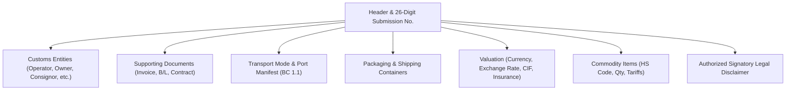

# CEISA 4.0 TPB Document Management (djbc_ceisa_tpb)

The **`djbc_ceisa_tpb`** module manages the complete lifecycle of drafting, validating, submitting, and tracking **Bonded Storage Facilities (Tempat Penimbunan Berikat - TPB)** customs declarations directly through the Indonesian Directorate General of Customs and Excise (DJBC) **CEISA 4.0** system.

---

## Scope of Facilities & Supported TPB Documents

This module supports all official customs transactions for Bonded Storage Facilities (Bonded Zones, Bonded Warehouses, and Bonded Exhibition Venues), covering **10 official customs declaration types**:

| BC Code | Declaration Type | Purpose & Scope |
|---|---|---|
| **BC 1.6** | Removal from TPS to TPB | Inbound transfer of imported cargo from seaport/airport Temporary Storage (TPS) into a TPB zone. |
| **BC 2.3** | Import Entry into TPB | Inbound entry of raw materials, capital equipment, or consumables directly from foreign origins under customs duty suspension. |
| **BC 2.5** | Removal from TPB to Domestic Area | Outbound domestic sale or delivery of finished goods from TPB to the local customs area (TLDDP) upon payment of duties and taxes. |
| **BC 2.6.1**| Subcontract Outbound Transfer | Dispatch of raw materials or intermediate components to subcontracting partners in domestic areas or other TPB facilities. |
| **BC 2.6.2**| Subcontract Inbound Return | Return of processed goods from subcontractors back into the TPB premises. |
| **BC 2.7** | Inter-TPB Transfer | Cargo movement and transfers between Bonded Zones or between different bonded facility operators. |
| **BC 2.8** | Removal of Capital Goods / Samples | Authorized outbound transfer of machinery, equipment, or commercial samples from TPB. |
| **BC 3.3.1**| Specific Export Settlement | Specialized outbound declarations for export fulfillment from TPB facilities. |
| **BC 4.0** | Domestic Entry into TPB | Inbound procurement of local raw materials or machinery from the domestic market into TPB with VAT non-collected. |
| **BC 4.1** | Return / Delivery from TPB to Domestic Area | Outbound transfer or return of domestic-origin goods from TPB back into local territory. |

---

## Declaration Structure & Form Anatomy

Declarations located under **CEISA Connector > Pabean > TPB** strictly adhere to the official CEISA 4.0 JSON data schema:

### 1. Automated 26-Digit Submission Number (Nomor Aju)
The system automatically compiles the standardized 26-digit Customs Submission Number:

* `[6-digit customs office code]` + `[6-digit company code]` + `[8-digit date YYYYMMDD]` + `[6-digit sequential index]`.
* Example: `040300-000123-20260910-000001`.

### 2. Customs Entities (Entitas Pabean)
CEISA 4.0 utilizes tiered entity assignments automatically sorted and sequenced by the system:

* **TPB Enterprise Operator** (Entity Code `3`): Prioritized as Sequence 1.
* **Cargo Owner** (Entity Code `7`).
* **Shipper / Foreign Supplier** (Entity Code `9`).
* **Consignee / Buyer** (Entity Code `8`).
* Attributes include: 16-digit NPWP, NIB, full address, and zone operational permit numbers.

### 3. Supporting Documents Tab (Dokumen Pelengkap)
The system automatically organizes document priority and series numbering during confirmation and API dispatch:

* Commercial **Invoice** (Code `380`): Mandatory and automatically prioritized as Seri 1.
* Transport document: **Bill of Lading / B/L** (Code `705`) or **Air Waybill / AWB** (Code `740`) automatically ordered as Seri 2 if provided.
* Additional attachments: Commercial Contracts (Code `315`), Packing Lists (Code `217`), and Certificates of Origin (Code `861`).

### 4. Transport & Port Manifest Tab
* **BC 1.1** Inward/Outward Manifest numbers, dates, pos, and sub-pos for port cargo release.
* Ports of Loading, Transit, and Discharge.
* Vessel or flight details and country flag registrations.

### 5. Packaging, Containers & Financial Valuation
* Container specifications: Container number, ISO size (20ft, 40ft, 45ft), and container type.
* Package units and count (Cartons, Bags, Pallets, Drums).
* Currency codes, weekly KMK valuation exchange rate (NDPBM), FOB value, Freight, Insurance, CIF value, Gross Weight (Bruto), and Net Weight (Netto).

### 6. Item Details Tab
* Itemized product lines mapped to BTKI HS Codes.
* Standard CEISA unit of measure (UOM) alignments.
* CIF value in Indonesian Rupiah and applicable duty calculations (Import Duty, VAT, Article 22 Income Tax).

---

## Submission Lifecycle & Workflow

Processing declarations through Customs involves 3 stages:

1. **Draft State**:
    * Operators input shipment parameters or pull details from existing **Purchase Orders** or **Stock Pickings**.
    * All fields remain freely editable.
2. **Confirm State (Schema Validation)**:
    * Click **Confirm**.
    * The system runs pre-flight integrity audits:
        * Verifies that Items, Entities, Supporting Docs, Packaging, and Transport tabs are complete.
        * Validates mandatory document sequence rules (Invoice and B/L/AWB).
        * Validates required customs entity roles.
3. **Send Document (Electronic Data Interchange)**:
    * Click **Send Document** on confirmed declarations.
    * The full JSON schema payload is transmitted to the CEISA OpenAPI endpoint.
    * State transitions to **Sent** (*Terkirim*).

---

## Customs Responses & Status Inquiries

Once submitted, operators can query Customs status updates using the **Cek Status & Respon** action:

* Click **Cek Status & Respon**: BZone queries the CEISA API for updates matching the specific 26-digit Submission Number.
* Received customs responses:
    * **SPPB (Release Permit)**: Formal authorization allowing cargo release from port or facility.
    * **NPP (Registration Number)**: Confirmation that the declaration has cleared automated schema review and received an official customs registry number.
    * **SPJM (Red Channel Notice)**: Notice scheduling physical cargo inspection by customs officers.
    * **Reject**: Rejection notification detailing data errors that require correction and resubmission.
* All response histories are stored and viewable via the **Status Respon** stat button.

---

> [!IMPORTANT]
> Verify that the TPB operator entity has a valid, active Bonded Zone decree permit before transmitting declarations to the live CEISA portal.
