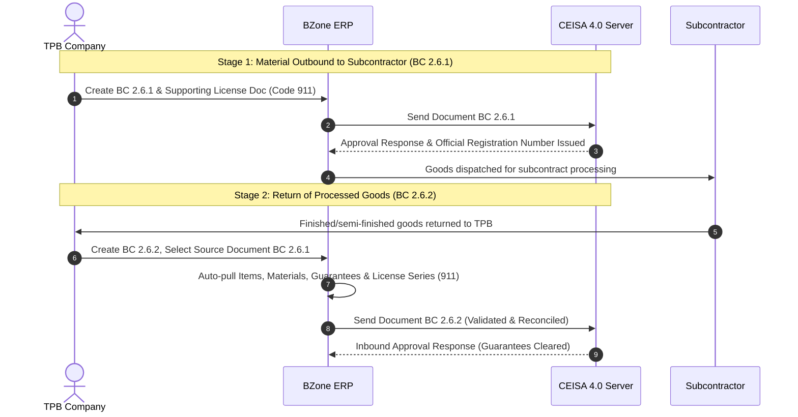

# TPB Subcontracting Guide: BC 2.6.1 & BC 2.6.2

This document explains the operational workflow, CEISA 4.0 customs regulatory provisions, and technical guide for filling subcontract outbound documents (**BC 2.6.1**) and subcontract inbound return documents (**BC 2.6.2**) in the **`djbc_ceisa_tpb`** module.

---

## 1. Bonded Zone Subcontracting Concept & Lifecycle

In Bonded Zone (TPB / KB) operations, companies are permitted to subcontract part of their production process to third parties (subcontractors in other Domestic Customs Areas / TLDDP or other Bonded Zones).

This cycle involves two closely linked customs documents:

| Document | Description | Key Characteristics |
|---|---|---|
| **BC 2.6.1** | Subcontract Outbound Goods | Outbound raw materials/capital goods to subcontractor. Customs duties are **Guaranteed (Facility Code 8)**. Must reference Customs Subcontract License (Document Code `911`). |
| **BC 2.6.2** | Subcontract Inbound Return | Return of processed goods. **Must reference Source Document (BC 2.6.1)** and **Facility License Series (`seriIjin`)** on raw material details to discharge the guarantee. |

---

## 2. Preparing BC 2.6.2 (Subcontract Return)

BC 2.6.2 has strict schema validations on CEISA 4.0:
1. **Source Registration Number missing or invalid** (CEISA rejects source references containing only submission numbers without registration numbers).
2. **Raw Material License Series [0] Error**: `Failed to Send Data: Raw Material License Series [0] not found in Facility/License Documents`.
3. **Guarantee Discrepancies**: Guarantee amounts on materials must match the amount pledged on the outbound BC 2.6.1.

Follow these steps in BZone:

### Step 1: Selecting Source BC 2.6.1 Document & Auto-Populating Items

On the **Header** tab of BC 2.6.2:

1. Locate the **Reference Document / Source Document** section:
   * **Source BC 2.6.1 Document (`ref_doc_261_id`)**: Select the outbound BC 2.6.1 document that was previously submitted (`state = sent`) through BZone.
2. The system automatically retrieves:
   * **Source Submission No. (`nomor_aju_asal`)**: 26-digit BC 2.6.1 submission number.
   * **Source Registration No. (`nomor_daftar_asal`)**: Official registration number issued by Customs server.
   * **Source Registration Date (`tanggal_daftar_asal`)**: Registration date of BC 2.6.1.
   * **Currency & NDPBM**: Syncs currency code and exchange rate from source if unpopulated.
   * **Complementary Document 261**: Automatically registers/updates complementary document code `261`.

> [!IMPORTANT]
> **One-to-One Reference Rule (Anti-Duplication):**
> * One outbound BC 2.6.1 document can only be accounted for by **one inbound BC 2.6.2 document**.
> * BC 2.6.1 documents already referenced by another active BC 2.6.2 document are **automatically hidden from the dropdown**.
> * Database constraints enforce this rule to prevent duplicate guarantee clearing attempts.

> [!TIP]
> **"Pull Items & Materials from BC 2.6.1" Feature:**
> * When you select a BC 2.6.1 document and the Items table is empty, BZone **automatically pulls all item and raw material lines** from that BC 2.6.1.
> * You can also click **"Tarik Barang & Bahan Baku dari BC 2.6.1"** on the Header or **Barang** tab to refresh items at any time.
> * The screen reloads dynamically in place without requiring browser refresh (F5).

> [!NOTE]
> **Customs Duty & Guarantee Regulations (Facility Code 8):**
> * BC 2.6.2 discharges the **subcontract guarantee** pledged under BC 2.6.1.
> * Therefore, tariff rates (BM, VAT/PPN, Income Tax/PPh) and guaranteed values on raw materials are **copied identically from the source BC 2.6.1**.
> * Re-calculating using current exchange rates or latest HS code rates risks creating guarantee discrepancies (*unbalanced guarantees*), causing customs rejection.
> * Tariff calculation from HS Code masters (`ceisa.tarif`) only runs as a fallback if the source BC 2.6.1 document has no tariff lines recorded.

---

### Step 2: Complementary Documents & Automatic Series Numbering

On the **Dokumen Pelengkap** tab, register required supporting documents:

* **Subcontract License (Code `911`)**: Approval from the supervising Customs office.
* **Delivery Order / Subcontractor Shipping Note**: Proof of goods delivery.
* **Subcontract Labor Invoice**: If applicable.

> [!IMPORTANT]
> **Automatic Document Series Numbering (`seri_dokumen`):**
> * Series numbers are sequentially assigned (**1, 2, 3, ...**) based on row position.
> * This series number links complementary documents to items and facility licenses.

---

### Step 3: Raw Materials Tab & `seriIjin` Mapping

For each finished item returning, raw material lines define the materials consumed during subcontracting:

#### Resolving "Seri Ijin Bahan Baku [0]":
* CEISA requires that `seriIjin` on raw materials **must not be 0**.
* The value must match the `seri_dokumen` of the subcontract license (code `911`) listed under Complementary Documents.

#### BZone Automation:
* Selecting license document `911` automatically cascades its series number into all raw material lines.
* The column is clearly visible on the table to verify before submission.

---

## 3. CEISA 4.0 Data Reference Matrix

| BZone Field | CEISA JSON Payload | Validation Rules |
|---|---|---|
| **Dokumen BC 2.6.1 Asal** | `nomorAju` (source reference) | Internal reference to original outbound document. |
| **Nomor Aju Asal** | `nomorAjuDokumenAsal` | 26-digit original outbound submission number. |
| **Nomor Daftar Asal** | `nomorDaftarDokumenAsal` | 6-digit official registration number from Customs response. |
| **Tanggal Daftar Asal**| `tanggalDaftarDokumenAsal`| Customs registration date (`YYYY-MM-DD`). |
| **Izin Subkontrak (911)**| `dokumen.kodeDokumen = "911"` | Valid subcontract facility permit document. |
| **Seri Dokumen Izin** | `dokumen.seriDokumen` | Integer sequence (1, 2, 3...) in complementary documents. |
| **Seri Ijin Bahan Baku**| `bahanBaku.seriIjin` | Must match `dokumen.seriDokumen` of license `911`. |

---

## 4. Pre-Submission Checklist for BC 2.6.2

Before confirming and transmitting BC 2.6.2:

- [ ] **Nomor Daftar Asal** and **Tanggal Daftar Asal** are filled and verified against BC 2.6.1 approval.
- [ ] Subcontract License (code **911**) is registered under Complementary Documents with a valid series number.
- [ ] **Seri Ijin** on each raw material line is non-zero and points to license 911.
- [ ] Raw material quantities returning do not exceed the quantities issued in BC 2.6.1.
- [ ] Guaranteed duty amounts correspond directly to the source BC 2.6.1 guarantee.
