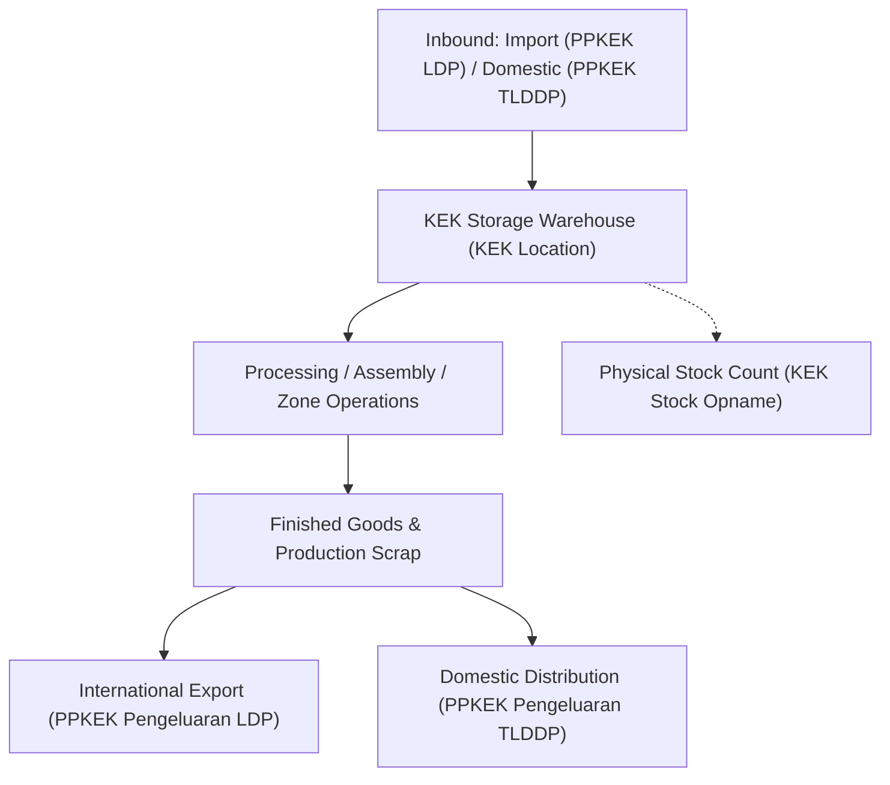

# Special Economic Zone Facility (djbc_kek)

The **`djbc_kek`** module is specifically designed to meet customs compliance and inventory reporting (*IT Inventory*) requirements for Zone Enterprises and Business Entities operating within **Special Economic Zones (Kawasan Ekonomi Khusus - KEK)** pursuant to Indonesian Directorate General of Customs and Excise (DJBC) regulations.

---

## Regulatory Framework & KEK Concept

The administration of Special Economic Zones is governed by the following core legislation:

* **Government Regulation (PP) No. 40 of 2021** on the Implementation of Special Economic Zones.
* **Minister of Finance Regulation (PMK) No. 237/PMK.04/2020** as amended by **PMK No. 33/PMK.10/2021** concerning Tax, Customs, and Excise Treatment in Special Economic Zones.

### KEK Fiscal Incentives & Facilities:
1. **Customs Duty & Excise Exemption**: Applies to the entry of capital goods, raw materials, and operational supplies directly from outside the customs territory (*Luar Daerah Pabean* / LDP).
2. **Tax Non-Collection**: Value Added Tax (VAT) and Sales Tax on Luxury Goods (PPnBM) are suspended/not collected on eligible goods entering from overseas or from other parts of the domestic customs area (*TLDDP*).
3. **Integrated Customs Declarations**: Utilizes the dedicated **PPKEK (Pemberitahuan Pabean Kawasan Ekonomi Khusus)** document registered through the national Single Submission system (SINSW).
4. **Mandatory IT Inventory**: All business entities in the KEK must operate an electronic inventory accounting system (*IT Inventory*) accessible online in real-time by customs supervisory officers.

---

## Dedicated KEK Customs Documents (PPKEK)

The `djbc_kek` module integrates warehouse inventory movements with official KEK customs registration documents:

| Document Code | Document Title | Purpose & Description |
|---|---|---|
| **PPKEK Pemasukan LDP** | Entry Document from Outside Customs Area | Direct import of foreign goods into the KEK zone with customs duty exemption and VAT suspended. |
| **PPKEK Pemasukan TLDDP** | Entry Document from Other Domestic Customs Territory | Inbound delivery of domestic goods into KEK without VAT collection. |
| **PPKEK Pengeluaran LDP** | Outbound Document to Outside Customs Area | Outbound shipment of manufactured finished products from KEK for international export. |
| **PPKEK Pengeluaran TLDDP** | Outbound Document to Domestic Customs Territory | Delivery of goods from KEK into the domestic Indonesian market, with settlement of import duties and taxes on embedded imported components. |
| **Additional Customs Docs** | BC 2.0, BC 2.3, BC 2.7, BC 3.0, PPFTZ-02 | Cross-facility transfers (Bonded Zones, KITE, Free Trade Zones, or other SEZs) as permitted by regulations. |

---

## Master Data Configuration for KEK

Configure the following master data before recording day-to-day warehouse operations:

### 1. Product Classification (`product.template` & `product.category`)
* Navigate to **Inventory > Products > Products**.
* On the product form, ensure **Can be Used for DJBC KEK** (`djbc_kek_ok`) is enabled.
* This setting can also be automated at the **Product Category** (`product.category`) level.
* Check the **DJBC KEK** (`djbc_kek`) checkbox so that this item is included in KEK IT Inventory mutation balances.

### 2. Warehouse Location Classification (`stock.location`)
* Navigate to **Inventory > Configuration > Locations**.
* Select the storage location situated within the KEK boundary.
* In the **DJBC KEK Lokasi** (`djbc_kek_location`) field, change the value from `None` to **Lokasi Product KEK** (`kek`).
* Only stock movements involving locations marked with this KEK flag are evaluated in KEK customs inventory reports.

### 3. Warehouse Operation Types (`stock.picking.type`)
* Navigate to **Inventory > Configuration > Operations Types**.
* Configure the customs movement attributes:
    * **DJBC's KEK Movement Type**: Specify the customs direction: **In** (Inbound) or **Out** (Outbound).
    * **DJBC's KEK Scrap?**: Enable for scrap, waste, or reject movements in the KEK.
    * **DJBC's KEK Adjustment?**: Enable for physical count variance adjustments.
    * **DJBC KEK Doc Required**: When checked, the system enforces that picking transfers must have a valid customs document reference attached before they can be marked *Done*.

---

## Transaction Lifecycle & KEK Goods Movement

Inventory operations in KEK encompass the full supply chain lifecycle:

1. **Inbound Receipts**:
    * When materials arrive at KEK, register the receipt picking referencing the relevant PPKEK Pemasukan document (LDP or TLDDP).
    * Validating the receipt increments inventory on the KEK location and records the transaction in the **Inbound Goods Report**.
2. **Operations & Transformation**:
    * Goods movements within the zone are recorded across defined storage and processing locations.
    * Converted finished products reflect accumulated material inputs.
3. **Outbound Dispatch & Deliveries**:
    * Export deliveries are registered with **PPKEK Pengeluaran LDP**.
    * Domestic sales/deliveries are registered with **PPKEK Pengeluaran TLDDP**, triggering duties/taxes assessment on imported raw material content.
    * Validated transfers are recorded in the **Outbound Goods Report**.
4. **Physical Stock Counts**:
    * Periodically or annually, KEK enterprises execute physical inventory counts.
    * Count counts are recorded using the `djbc_stock_opname` module and reported in the **KEK Stock Opname Report**.

---

## 4 Mandatory KEK IT Inventory Reports

Official regulatory reports are accessible via **Laporan Bea Cukai > Reporting > Kawasan Ekonomi Khusus**:

| No | Official Report Name | Description & Key Attributes |
|---|---|---|
| **1** | **Inbound Goods Report (Laporan Pemasukan Barang)** | Comprehensive list of inbound customs entries (PPKEK Pemasukan LDP/TLDDP, BC), receipt picking numbers, document dates, suppliers/senders, product codes, descriptions, UoM, and quantities. |
| **2** | **Outbound Goods Report (Laporan Pengeluaran Barang)** | Comprehensive list of outbound customs entries (PPKEK Pengeluaran LDP/TLDDP, BC), delivery picking numbers, document dates, consignees/buyers, product codes, descriptions, UoM, and quantities. |
| **3** | **KEK Goods Mutation Report (Laporan Mutasi Barang KEK)** | Complete customs stock reconciliation: Opening Balance, Inbound, Outbound, Adjustments, Book Ending Balance, Physical Stock Count (*Stock Opname*), and Discrepancy. |
| **4** | **KEK Stock Opname Report (Laporan Hasil Pencacahan)** | Itemized physical count audit results by date, detailing product codes, product names, product categories, UoM, real physical counts, and explanatory remarks. |

---

## Report Generation Procedure

1. Go to **Laporan Bea Cukai > Reporting > Kawasan Ekonomi Khusus**.
2. Select the desired report wizard (e.g., **Laporan Mutasi Barang KEK**).
3. In the wizard modal:
    * Specify the date parameters (**From Date** and **To Date**), or select a predefined **Report Period**.
    * Choose the output format: **Screen** (*Interactive HTML List*), official **Py3o ODT/PDF**, or **Excel (XLSX)**.
4. Click **Print / Preview** to generate the regulatory report ready for customs inspection.

> [!NOTE]
> The KEK Goods Mutation Report automatically filters movements for products marked with `djbc_kek = True` within warehouse locations configured as `djbc_kek_location = 'kek'`.
