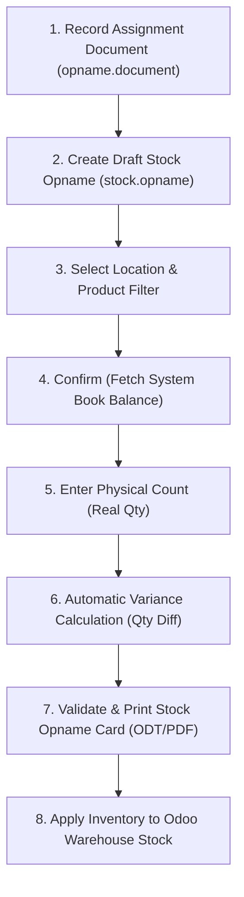

# Physical Inventory / Stock Opname Execution (djbc_stock_opname)

The **`djbc_stock_opname`** module manages physical inventory counting (*Stock Opname*) operations in Bonded Zones, KITE facilities, and other customs-supervised areas to meet the regulatory compliance requirements of the Directorate General of Customs and Excise (DJBC).

---

## Regulatory Compliance & Requirements

According to Indonesian customs regulations (such as **PER-02/BC/2019** and **PER-09/BC/2021**):

1. Bonded facilities are required to perform a physical inventory count (*stock opname*) at least **once every calendar year**.
2. Stock opname activities may be supervised directly by Customs Officers from the local Customs Office (KPPBC) under an official **Assignment Letter (*Surat Tugas*)**.
3. Physical count results must be reconciled against the IT Inventory book balance and documented in an official **Stock Opname Official Report (*Berita Acara Stock Opname*)**.

---

## Stock Opname Operational Workflow

The stock opname process in BZone consists of two main components:

1. **Opname Document (`opname.document`)**: Registration of customs assignment letters and supervising officers.
2. **Stock Opname Execution (`stock.opname`)**: Extracting system book balances, entering actual counts, calculating variances, and applying final inventory adjustments.

---

## 1. Registering Assignment Documents (Surat Tugas)

Before initiating counting activities on the warehouse floor, register the assignment letter from the customs office or management:

1. Open **Laporan Bea Cukai > Stock Opname**.
2. Click **New / Create**.
3. Complete the form fields:
   * **Surat Tugas**: Official assignment letter number (e.g. `ST-012/KPPBC.TMP.A/2025`).
   * **Tanggal**: Issuance date or scheduled opname date.
   * **Nama Pejabat**: Name of the designated Customs Officer / supervising auditor.
4. Click **Save**.

> [!NOTE]
> The assignment reference and officer details will automatically link to the physical inventory worksheet and appear on the printed official stock opname card.

---

## 2. Creating the Stock Opname Worksheet

Once the assignment document is registered, initiate the inventory count worksheet:

1. Open **Inventory > Operations > Adjustments > Stock Opname**.
2. Click **New / Create**.
3. Complete the form details:
   * **Inventoried Location**: Select the target warehouse location (e.g. `WH/Stock`).
   * **Nomor Surat Tugas**: Select the registered assignment document. The *Responsible* field will automatically populate with the officer's name.
   * **Inventory Date**: Cut-off date and time for the count.
   * **Inventory of (Product Filter)**:
     * **Select products manually (*Partial*)**: Add count lines manually product by product.
     * **One product only**: Target a specific item.
     * **One product category**: Prepopulate all active products under a selected category (e.g. Raw Materials or Finished Goods).
   * **Keterangan**: Operational notes (e.g. `Annual Stock Opname Fiscal Year 2025`).

---

## 3. Retrieving System Balances & Entering Counts

1. Click **Confirm / Start**. The status changes to **In Progress** (`confirm`).
2. The system automatically computes book balances:
   * Queries existing physical stock from `stock.quant`.
   * Accounts for pending in-transit moves.
   * Populates the **Theoretical Qty** column on inventory lines (`stock.opname.line`).
3. Warehouse counting teams record physical quantities.
4. Enter the counted amounts into the **Real Qty** column:
   * For lot/serial tracked items, specify the **Lot/Serial Number**.
   * The **Inventory Qty (Qty Diff)** column calculates automatically:
     `Qty Diff = Real Qty - Theoretical Qty`

> [!TIP]
> A positive variance indicates a surplus (physical exceeds system records), while a negative variance indicates a shortage (physical is less than system records).

---

## 4. Validation & Printing Official Cards

1. Ensure all inventory lines have valid *Real Qty* values (negative quantities are disallowed).
2. Click **Validate / Approve** to advance status to **Validated** (`done`).
3. To generate the official audit report, click **Print > Stock Opname Card**:
   * Generates a standardized Py3o-based document (ODT/PDF).
   * Contains company identity, assignment details, location, product lines, system vs. physical quantities, variance analysis, and signature sections for the counting team and customs officers.

---

## 5. Applying Inventory Adjustments

After count results are validated and signed by all parties:

1. Click **Apply Inventory**.
2. BZone updates Odoo's core inventory:
    * Synchronizes `stock.quant` quantities with *Real Qty*.
    * Marks the worksheet as *Inventoried*.
    * Generates adjustment stock moves that reflect seamlessly in IT Inventory mutation reports for subsequent periods.

> [!WARNING]
> Unexplained or undocumented inventory shortages may trigger customs audits and lead to import duty assessments or administrative fines under applicable customs laws.
