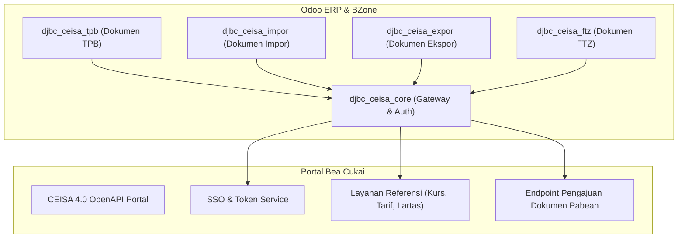

# Integrasi Fondasi CEISA 4.0 (djbc_ceisa_core)

> **Terakhir diperbarui:** 22 Oktober 2026

Modul **`djbc_ceisa_core`** adalah lapisan integrasi utama (*core gateway*) yang menghubungkan seluruh operasional kepabeanan BZone di Odoo dengan ekosistem **CEISA 4.0 (Customs-Excise Information System and Automation)** Direktorat Jenderal Bea dan Cukai (DJBC) Republik Indonesia via RESTful OpenAPI.

---

## Arsitektur & Peran CEISA Core

Modul ini bertindak sebagai jembatan tunggal untuk autentikasi terpusat, sinkronisasi master referensi kepabeanan nasional, dan pencatatan jejak audit (*API logging*) untuk semua modul layanan pabean turunan:

### Modul Layanan yang Bergantung pada CEISA Core:
* **`djbc_ceisa_tpb`**: Dokumen Pabean Tempat Penimbunan Berikat (Kawasan Berikat, Gudang Berikat, dsb.).
* **`djbc_ceisa_impor`**: Pemberitahuan Impor Barang (PIB / BC 2.0).
* **`djbc_ceisa_expor`**: Pemberitahuan Ekspor Barang (PEB / BC 3.0).
* **`djbc_ceisa_ftz`**: Pemberitahuan Pabean Free Trade Zone (PPFTZ).
* **`djbc_ceisa_barang_kiriman`**: Dokumen Consignment Note / Barang Kiriman.

---

## Konfigurasi Kredensial & Autentikasi CEISA

Untuk mengaktifkan koneksi ke portal Bea Cukai, administrator wajib mengisi parameter koneksi pada menu **CEISA Connector > Configuration > Settings**:

### 1. Parameter Akun CEISA OpenAPI
* **Username**: Nama pengguna akun portal pengguna jasa Bea Cukai.
* **Password**: Kata sandi portal Bea Cukai.
* **Bea Cukai API Key**: Kunci API unik yang di-generate melalui menu profil pengguna di portal CEISA OpenAPI (`https://openapi.beacukai.go.id`).
* **CEISA API URL**: Alamat endpoint API resmi (misal: `https://openapi.beacukai.go.id` untuk produksi).
* **Company Code (Kode Perusahaan)**: 6 digit kode perusahaan resmi yang diterbitkan Bea Cukai (digunakan dalam pembentukan 26 digit Nomor Pengajuan / Nomor Aju dokumen pabean).

### 2. Mekanisme Token OAuth2
* Sistem menggunakan alur autentikasi token Bearer (`/v1/openapi-auth/user/login`).
* Token akses berlaku selama 300 detik (5 menit) dan token penyegaran (*refresh token*) berlaku 24 jam.
* BZone secara cerdas mengelola masa aktif token dan melakukan **Auto-Refresh** otomatis dengan buffer pengaman 30 detik sebelum token kedaluwarsa.

---

## Layanan Sinkronisasi Master Referensi

Modul `djbc_ceisa_core` menyediakan wizard sinkronisasi data referensi resmi langsung dari server Bea Cukai:

### 1. Sinkronisasi Kurs Mingguan KMK (`ceisa.currency.rate`)
* Menu: **CEISA Connector > Layanan CEISA > Sinkronisasi Kurs**.
* Menarik kurs valuta asing resmi Keputusan Menteri Keuangan (KMK) untuk perhitungan Nilai Dasar Penghitungan Bea Masuk (NDPBM).
* Dapat dijalankan terjadwal (*automated cron*) setiap hari Rabu saat pembaruan kurs KMK mingguan dirilis.

### 2. Sinkronisasi Pos Tarif & Bea Masuk (`ceisa.tarif`)
* Menu: **CEISA Connector > Layanan CEISA > Sinkronisasi Tarif**.
* Menarik tarif Bea Masuk (BM), PPN, PPnBM, dan PPh Pasal 22 untuk HS Code 8 digit atau 10 digit spesifik dari Buku Tarif Kepabeanan Indonesia (BTKI).

### 3. Pengecekan Aturan Larangan & Pembatasan / Lartas (`ceisa.lartas`)
* Menu: **CEISA Connector > Layanan CEISA > Sinkronisasi Lartas**.
* Mengetahui izin instansi teknis (Kementerian Perdagangan, Karantina, BPOM, dsb.) yang dipersyaratkan sebelum barang impor/ekspor dimasukkan atau dikeluarkan.

### 4. Sinkronisasi Manifes TPS (`ceisa.manifes`)
* Menu: **CEISA Connector > Layanan CEISA > Sinkronisasi Manifes**.
* Menarik data inward/outward manifest (BC 1.1) dari Tempat Penimbunan Sementara (TPS) pelabuhan laut atau udara berdasarkan nomor pos dan subpos.

---

## Sinkronisasi Master Data Pendukung

Sebelum membuat dokumen pabean, pastikan master data internal Odoo telah dipetakan:

1. **Kode Pos Tarif Produk (HS Code)**:
    * Buka menu **Inventory > Products > Products**.
    * Pada tab **CEISA**, tentukan **Pos Tarif / HS Code** produk dan satuan CEISA standar.
2. **Identitas Mitra Bisnis (Partner Kepabeanan)**:
    * Buka master kontak pelanggan atau vendor (**Contacts**).
    * Pada tab **CEISA**, lengkapi **NPWP (16 digit)**, **NIB (Nomor Induk Berusaha)**, dan **Kode Entitas** pabean yang relevan.
3. **Standarisasi Satuan Ukuran (UOM CEISA)**:
    * Seluruh satuan ukuran di Odoo dipetakan ke kode satuan internasional CEISA (misal: `KGM` untuk kilogram, `PCE` untuk pieces, `LTR` untuk liter).

---

## Pemantauan & Jejak Audit (API Logging)

Setiap pertukaran data (request payload dan response payload) antara BZone dan CEISA tercatat secara permanen:

* **Menu API Log**: Akses melalui **CEISA Connector > Configuration > API Log**.
* Menyimpan informasi lengkap:
    * Endpoint URL yang diakses.
    * HTTP Status Code (200 OK, 400 Bad Request, 401 Unauthorized, 500 Server Error).
    * Request JSON Body dan Response JSON Body.
    * Waktu pemrosesan (*Execution Duration*).
* Memudahkan tim IT dan operasional dalam melakukan analisis kendala jika terdapat penolakan (*reject*) dari sistem Bea Cukai.

> [!TIP]
> Lakukan pengujian koneksi awal dengan menekan tombol **Test Connection** pada pengaturan CEISA sebelum memulai pengajuan dokumen transaksi pabean perdana.
