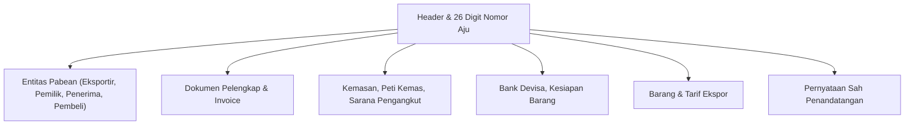

# Modul CEISA Ekspor (djbc_ceisa_expor)

Modul **`djbc_ceisa_expor`** mengelola dokumen **Pemberitahuan Ekspor Barang (PEB) / BC 3.0** dan **BC 3.3** ke portal CEISA 4.0 milik DJBC. Dokumen ini adalah panduan pengguna bagi tim Operasional Exim, Logistik, PPJK, dan Staf Kepabeanan.

> [!IMPORTANT]
> Sesuai implementasi pada `__manifest__.py` dan default `_default_kode_dokumen` di model `ceisa.export.document`, **modul ini hanya mendukung dokumen BC 3.0 dan BC 3.3** (kode referensi `30` dan `33`). Untuk transaksi ekspor dari Kawasan Berikat, gunakan modul [`djbc_ceisa_tpb`](../djbc_ceisa_tpb/pengelolaan_dokumen_tpb.md).

---

## 1. Cakupan Modul & Jenis Dokumen

| Kode BC | Jenis Dokumen | Peruntukan |
|---|---|---|
| **BC 3.0** | Pemberitahuan Ekspor Barang (PEB) | Ekspor definitif dari TLDDP ( Tempat Lain Dalam Daerah Pabean / gudang umum) ke luar negeri. |
| **BC 3.3** | PEB dari Pusat Logistik Berikat (PLB) | Ekspor barang dari Pusat Logistik Berikat (Bonded Logistics Center) ke luar negeri. |

> [!TIP]
> Setelah dokumen berhasil dikirim ke CEISA dan berstatus `Sent`, Bea Cukai akan mengembalikan **NPE (Nomor Pendaftaran Ekspor)** yang menjadi acuan untuk proses clearance di pelabuhan muat.

---

## 2. Anatomi Formulir Dokumen Ekspor



---

## 3. Alur Kerja (Lifecycle) Dokumen

| State | Deskripsi | Aksi yang Tersedia |
|---|---|---|
| **Draft** | Dokumen baru/dalam penyusunan. | Edit bebas, Add Item |
| **Confirm** | Data sudah valid internal. | **Send Document**, Set to Draft |
| **Sent** | Berhasil dikirim ke CEISA. | **Cek Status & Respon**, **Mulai Revisi** |

> [!WARNING]
> Saat status `Sent`, server mengembalikan `tanggal_daftar` yang otomatis terisi sebagai tanggal pendaftaran dokumen di CEISA. Field ini di-*readonly* dan menjadi dasar pelacakan NPE.

---

## 4. Tata Cara Pengisian Langkah-demi-Langkah

Buka menu **DJBC CEISA > Ekspor > Ekspor Documents** lalu klik **Create**.

### Langkah 1: Tab Header

* **Nomor Aju 26 Digit** — Otomatis terbentuk saat `kode_kantor` dan `kode_dokumen` dipilih.
* **Kode Dokumen** — Default ke BC 3.0 jika user memiliki izin. Pilihan terbatas pada `30` (BC 3.0) dan `33` (BC 3.3).
* **Kantor Pabean Ekspor (`kode_kantor_ekspor`)** & **Kantor Pabean Muat (`kode_kantor_muat`)** — Wajib untuk BC 3.0.
* **Pelabuhan Muat (`kode_pel_muat`)**, **Pelabuhan Ekspor (`kode_pel_ekspor`)**, **Pelabuhan Bongkar (`kode_pel_bongkar`)**, **Pelabuhan Tujuan (`kode_pel_tujuan`)** — Sesuaikan dengan jenis dokumen (lihat tabel bawah).
* **Negara Tujuan (`kode_negara_tujuan`)** — Pilih dari master negara.
* **Kode Cara Bayar** & **Kode Cara Dagang** — Wajib untuk BC 3.0.
* **Kode Asuransi** — `LN` (Luar Negeri) atau `DN` (Dalam Negeri).
* **Flag Curah** & **Flag Migas** — Pilih `1` (Ya) atau `2` (Tidak).
* **FOB, Freight, Asuransi, CIF, NDPBM** — Nilai transaksi ekspor.

| Field | BC 3.0 | BC 3.3 |
|---|---|---|
| Kantor Pabean Ekspor | Wajib | – |
| Kantor Pabean Muat | Wajib | – |
| Pelabuhan Muat | Wajib | Wajib |
| Pelabuhan Ekspor | Wajib | – |
| Pelabuhan Bongkar | – | Wajib |
| Pelabuhan Tujuan | Wajib | Wajib |
| CIF / Nilai Ekspor | – | Wajib |
| Kesiapan Barang (PKB) | Wajib jika Re-Ekspor | – |

  

### Langkah 2: Tab Entitas

Sistem otomatis generate entitas saat dokumen dibuat:

| Jenis BC | Seri & Kode Entitas (urutan) |
|---|---|
| **BC 3.0** | 1: Eksportir (`2`), 2: Pemilik (`7`), 3: Penerima (`8`), 4: Pembeli (`6`) |
| **BC 3.3** | 1: Eksportir (`2`), 2: Pengusaha (`3`), 3: Pembeli (`6`), 4: Penerima (`8`), 5: Pemilik (`7`) |

Entitas **Eksportir (kode 2)** otomatis terisi dari `company.partner_id` jika menggunakan BC 3.0 atau BC 3.3.

  

### Langkah 3: Tab Dokumen Pelengkap

Gunakan kode referensi CEISA untuk setiap dokumen pelengkap (Invoice `380`, B/L `705`, AWB `740`, Packing List `217`, Kontrak `315`, SKA `861`, dan dokumen lainnya). Sistem akan otomatis menyusun urutan seri saat dokumen dikonfirmasi.

  

### Langkah 4: Tab Kemasan, Pengangkut, Kontainer

* **Kemasan** — Isi jumlah dan satuan (CTN, PLT, PK, dll.).
* **Pengangkut** — Pilih moda dan nama sarana angkut. Pada BC 3.3, isi juga `kode_cara_angkut_plb` (cara pengangkutan ke PLB).
* **Kontainer** — Nomor kontainer 11 digit dan ukuran. Field header `jumlah_kontainer` wajib diisi (isi `0` jika tanpa kontainer).

  

### Langkah 5: Tab Bank Devisa & Kesiapan Barang (PKB)

* **Bank Devisa** — Isi data bank yang menerima devisa hasil ekspor.
* **Kesiapan Barang (PKB)** — Tab ini hanya muncul dan wajib diisi jika Jenis Ekspor yang dipilih adalah **Re-Ekspor** (kode referensi 5 / Re-Ekspor lainnya). Untuk **Ekspor Biasa**, tab ini otomatis tersembunyi dan tidak dibutuhkan.

  

### Langkah 6: Tab Detail Barang

Pilih produk dari master → HS Code & satuan CEISA otomatis terisi. Isi **jumlah, harga FOB per unit**, dan **nilai FOB** per item.

  

### Langkah 7: Tab Penandatangan

* **Nama Tanda Tangan** (dari `hr.employee`), **Jabatan**, **Kota**, dan **Disclaimer** (`1` untuk Ya).

---

## 5. Validasi Otomatis (`validate_before_send`)

Sebelum pengiriman, sistem menjalankan `validate_before_send()`:

| Validasi Universal | Keterangan |
|---|---|
| Nomor Aju | 26 digit standar CEISA |
| Rincian Barang | Minimal 1 item |
| Entitas, Kemasan, Pengangkut, Bank Devisa | Tidak boleh kosong |
| Kantor Pabean, Valuta, NDPBM, Bruto, Netto | Tidak boleh kosong |
| Dokumen Pelengkap (Invoice) | Tidak boleh kosong |
| Entitas kode `2` (Eksportir) atau `3` (Pengusaha) | Wajib ada |

| Validasi Spesifik BC 3.0 | Keterangan |
|---|---|
| Kesiapan Barang (PKB) | Wajib diisi minimal 1 baris hanya jika Jenis Ekspor = Re-Ekspor (untuk Ekspor biasa tidak divalidasi) |
| FOB / Nilai Barang | Tidak boleh kosong |
| Pelabuhan Muat, Pelabuhan Ekspor, Pelabuhan Tujuan, Kantor Pabean Ekspor, Kantor Pabean Muat | Wajib |

| Validasi Spesifik BC 3.3 | Keterangan |
|---|---|
| CIF/FOB/Nilai Barang | Minimal salah satu |
| Pelabuhan Muat, Pelabuhan Bongkar, Pelabuhan Tujuan | Wajib |

Jika ada yang kosong, sistem akan menampilkan daftar field yang wajib dilengkapi.

---

## 6. Mengirim Dokumen ke CEISA (Send Document)

1. Klik **Confirm** — status berubah ke `Confirm`.
2. Klik **Send Document** — sistem POST ke endpoint:
   ```
   POST {CEISA_BASE_URL}/openapi/document?isFinal=false&isRevision=false
   ```
3. JSON payload disusun oleh `_prepare_ceisa_export_data()` — berbeda strukturnya untuk BC 3.0 dan BC 3.3.
4. Pada **BC 3.0** body berisi: `asalData`, `kodeDokumen`, dokumenInvoice, barang, entitas, pengangkut, kemasan, kontainer, bankDevisa, kesiapanBarang, dan disclaimer.
5. Pada **BC 3.3** body berisi tambahan: `kodeKantorEkspor`, `kodeKantorMuat`, `kodeNegaraTujuan`, `kodePelEkspor`, `kodePelBongkar`, `tanggalEkspor`, dll.
6. Jika server mengembalikan `401`, token otomatis di-refresh dan request diulang.
7. Sukses → status `Sent`, `tanggal_daftar` terisi otomatis, dan `idHeader` dicatat di `ir.api.log` (tombol **Api Log**).
8. Email notifikasi dikirim ke user jika `ceisa.send_email_on_success=True`.

> [!TIP]
> Parameter `isFinal` dikontrol lewat System Parameter `ceisa.is_final_dokumen` (default `false` = draft). Set `true` jika Anda ingin dokumen langsung final.

---

## 7. Revisi Dokumen

Tombol **Mulai Revisi** hanya tersedia untuk dokumen berstatus `Sent`. Sistem akan:

1. Menaikkan `revision_count` dan `seri` di header.
2. Mengubah status kembali ke `Draft`.
3. Menandai `is_revision = True` agar server mengirim `isRevision=true` saat submit ulang.

---

## 8. Tombol Pembantu: Tarik Data TPS (Dev)

Tersedia tombol **Get Kode TPS** (memanggil endpoint `/openapi/gudangTPS/kodeKantor/{kode_kantor}`) untuk menyinkronkan master TPS dari server CEISA. Hasilnya dicatat sebagai `ir.api.log` sehingga bisa ditelusuri.

---

## 9. Daftar Istilah Penting

| Istilah | Penjelasan |
|---|---|
| **PEB (BC 3.0)** | Pemberitahuan Ekspor Barang — dokumen pabean resmi untuk ekspor dari TLDDP. |
| **BC 3.3** | PEB dari PLB (Pusat Logistik Berikat). |
| **NPE** | Nomor Pendaftaran Ekspor — bukti dokumen terdaftar di CEISA setelah dikirim. |
| **FOB** | Free on Board — nilai barang di pelabuhan muat. |
| **Freight** | Biaya pengangkutan barang ekspor. |
| **Bank Devisa** | Bank tempat eksportir menerima pembayaran devisa hasil ekspor. |
| **Kesiapan Barang** | Deklarasi bahwa barang sudah siap periksa di lokasi yang ditentukan. |
| **PLB** | Pusat Logistik Berikat — kawasan berikat khusus untuk aktivitas logistik ekspor. |

---

> Dokumen ini adalah panduan non-teknis untuk modul **`djbc_ceisa_expor`**. Untuk impor umum, gunakan modul [`djbc_ceisa_impor`](../djbc_ceisa_impor/dokumentasi_impor.md). Untuk ekspor/antar TPB dari kawasan berikat, gunakan modul [`djbc_ceisa_tpb`](../djbc_ceisa_tpb/pengelolaan_dokumen_tpb.md).
