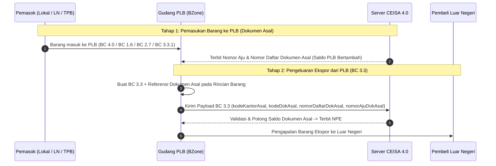
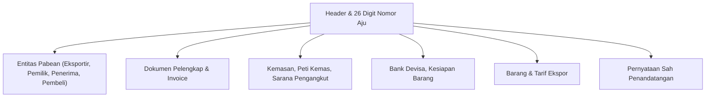

# Modul CEISA Ekspor (djbc_ceisa_expor)

Modul **`djbc_ceisa_expor`** mengelola dokumen **Pemberitahuan Ekspor Barang (PEB) / BC 3.0** dan **BC 3.3** ke portal CEISA 4.0 milik DJBC. Dokumen ini adalah panduan pengguna bagi tim Operasional Exim, Logistik, PPJK, dan Staf Kepabeanan.

> [!IMPORTANT]
> Sesuai implementasi pada `__manifest__.py` dan default `_default_kode_dokumen` di model `ceisa.export.document`, **modul ini hanya mendukung dokumen BC 3.0 dan BC 3.3** (kode referensi `30` dan `33`). Untuk transaksi ekspor dari Kawasan Berikat, gunakan modul [`djbc_ceisa_tpb`](../djbc_ceisa_tpb/pengelolaan_dokumen_tpb.md).

---

## 1. Cakupan Modul & Jenis Dokumen

| Kode BC | Jenis Dokumen | Peruntukan |
|---|---|---|
| **BC 3.0** | Pemberitahuan Ekspor Barang (PEB) | Ekspor definitif dari TLDDP (Tempat Lain Dalam Daerah Pabean / gudang umum) ke luar negeri. |
| **BC 3.3** | PEB dari Pusat Logistik Berikat (PLB) | Ekspor barang yang ditimbun di Pusat Logistik Berikat (Bonded Logistics Center) ke luar negeri. |

> [!TIP]
> Setelah dokumen berhasil dikirim ke CEISA dan berstatus `Sent`, Bea Cukai akan mengembalikan **NPE (Nomor Pendaftaran Ekspor)** yang menjadi acuan untuk proses clearance di pelabuhan muat.

### Konsep & Relasi Dokumen Pabean Asal pada BC 3.3 (Mirip BC 2.6.1 & BC 2.6.2)

Berbeda dengan BC 3.0 yang mengekspor barang langsung dari gudang umum/TLDDP, **BC 3.3** digunakan untuk mengeluarkan barang dari **Pusat Logistik Berikat (PLB)** ke luar negeri. Karena PLB merupakan tempat penimbunan berikat (transit/logistik), setiap barang yang berada di dalam PLB **pasti masuk lebih dulu menggunakan dokumen pemasukan pabean**.

Secara konsep kepabeanan, mekanisme ini **serupa dengan hubungan BC 2.6.1 dan BC 2.6.2 pada TPB** (di mana dokumen penyelesaian wajib merujuk ke dokumen asalnya untuk memotong kuota/saldo stok berikat):



| Asal Pemasukan Barang ke PLB | Kode Dokumen Asal (`kodeDokAsal`) | Keterangan |
|---|---|---|
| **Dari Lokal (TLDDP)** | **`40`** (BC 4.0) | Pemasukan barang asal tempat lain dalam daerah pabean ke PLB. |
| **Dari Luar Negeri (Impor)** | **`16`** (BC 1.6) | Pemasukan barang asal luar daerah pabean ke PLB. |
| **Dari PLB / Kawasan Berikat Lain** | **`27`** (BC 2.7) | Pemindahan barang antar Tempat Penimbunan Berikat. |
| **Konsolidasi Barang Ekspor** | **`331`** (BC 3.3.1 / P3BET) | Penggabungan/konsolidasi barang ekspor melalui PLB. |

Oleh karena itu, pada skema JSON CEISA 4.0 untuk **BC 3.3**, setiap item `barang` wajib mencantumkan identitas **Dokumen Pabean Asal** (`kodeKantorAsal`, `kodeDokAsal`, `nomorDaftarDokAsal`, `tanggalDaftarDokAsal`, `nomorAjuDokAsal`, dan `seriBarangDokAsal`) selain mencantumkan dokumen asalnya pada tab **Dokumen Pelengkap**.

---

## 2. Anatomi Formulir Dokumen Ekspor



---

## 3. Alur Kerja (Lifecycle) Dokumen

| State | Deskripsi | Aksi yang Tersedia |
|---|---|---|
| **Draft** | Dokumen baru/dalam penyusunan. | Edit bebas, Add Item |
| **Confirm** | Data sudah valid internal. | **Send Document**, Set to Draft |
| **Sent** | Berhasil dikirim ke CEISA. | **Cek Status & Respon**, **Mulai Revisi** |

> [!WARNING]
> Saat status `Sent`, server mengembalikan `tanggal_daftar` yang otomatis terisi sebagai tanggal pendaftaran dokumen di CEISA. Field ini di-*readonly* dan menjadi dasar pelacakan NPE.

---

## 4. Tata Cara Pengisian Langkah-demi-Langkah

Buka menu **DJBC CEISA > Ekspor > Ekspor Documents** lalu klik **Create**.

### Langkah 1: Tab Header & Informasi PLB

* **Nomor Aju 26 Digit** — Otomatis terbentuk saat `kode_kantor` dan `kode_dokumen` dipilih.
* **Kode Dokumen** — Default ke BC 3.0 jika user memiliki izin. Pilihan terbatas pada `30` (BC 3.0) dan `33` (BC 3.3).
* **Kantor Pabean Ekspor (`kode_kantor_ekspor`)** & **Kantor Pabean Muat (`kode_kantor_muat`)** — Wajib untuk BC 3.0.
* **Informasi PLB (Khusus BC 3.3)**:
  * **Pengusaha PLB (`pengusaha_plb_id`)** — Partner penyelenggara/pengusaha PLB (otomatis menyinkronkan Entitas Kode `3`).
  * **Kantor Asal (`kode_kantor_muat`)** — Kantor pabean pengawas/muat PLB (otomatis terisi dari `kode_kantor` jika kosong, dikirim sebagai `kodeKantorMuat` di header serta otomatis mengisi `kodeKantorAsal` pada setiap baris barang).
  * **Kode Lokasi Gudang PLB Asal (`kode_gudang_asal` — H.25)** — Kode gudang/TPS asal di dalam PLB (misal `GM01`).
  * **Cara Pengangkutan ke PLB (`kode_cara_angkut_plb`)** — Moda angkut saat barang masuk ke PLB.
  * **Daerah Asal Barang (`daerah_asal_id` — H.28)** — Kabupaten/kota daerah asal barang.
* **Pelabuhan Muat (`kode_pel_muat`)**, **Pelabuhan Ekspor (`kode_pel_ekspor`)**, **Pelabuhan Bongkar (`kode_pel_bongkar`)**, **Pelabuhan Tujuan (`kode_pel_tujuan`)** — Sesuaikan dengan jenis dokumen (lihat tabel bawah).
* **Negara Tujuan (`kode_negara_tujuan`)** — Pilih dari master negara.
* **Kode Cara Bayar** & **Kode Cara Dagang** — Pilih sesuai transaksi ekspor.
* **Kode Asuransi** — `LN` (Luar Negeri) atau `DN` (Dalam Negeri).
* **Flag Curah** & **Flag Migas** — Pilih `1` (Ya) atau `2` (Tidak). (`Flag Migas` dan `Flag Barkir` otomatis disembunyikan untuk BC 3.3).
* **FOB, Freight, Asuransi, CIF, NDPBM** — Nilai transaksi ekspor.
* **Jenis Pengangkutan (`kode_jenis_pengangkutan`)** — Pilih metode pengangkutan (F.21) dari referensi `ceisa.ref.pengangkut` (misal `1 - SATU SARANA ANGKUT`).
* **Tanggal Pemeriksaan (`tanggal_periksa`)** — Wajib diisi untuk dokumen BC 3.0 (format `YYYY-MM-DD`, default otomatis tanggal hari ini) sesuai spesifikasi skema mandatory CEISA 4.0.

| Field | BC 3.0 | BC 3.3 |
|---|---|---|
| Kantor Pabean Ekspor (`kode_kantor_ekspor`) | Wajib | – |
| Kantor Pabean Muat / Kantor Asal (`kode_kantor_muat`) | Wajib | Wajib (Otomatis dari Kantor Pabean) |
| Pengusaha PLB, Kode Gudang Asal, Cara Angkut PLB, Daerah Asal | – | Wajib |
| Pelabuhan Muat | Wajib | Wajib |
| Pelabuhan Ekspor | Wajib | – |
| Pelabuhan Bongkar | – | Wajib |
| Pelabuhan Tujuan | Wajib | Wajib |
| Nilai FOB (`fob`) | Wajib jika Re-Ekspor | Wajib (> 0) |
| Bank Devisa (`bank_devisa_ids`) | Wajib | Opsional |
| Kesiapan Barang (PKB) | Wajib jika Re-Ekspor | – |

  

### Langkah 2: Tab Entitas

Sistem otomatis generate entitas saat dokumen dibuat:

| Jenis BC | Seri & Kode Entitas (urutan) |
|---|---|
| **BC 3.0** | 1: Eksportir (`2`), 2: Pemilik (`7`), 3: Penerima (`8`), 4: Pembeli (`6`) |
| **BC 3.3** | 1: Eksportir (`2`), 2: Pengusaha (`3`), 3: Pembeli (`6`), 4: Penerima (`8`), 5: Pemilik (`7`) |

Entitas **Eksportir (kode 2)** otomatis terisi dari `company.partner_id` jika menggunakan BC 3.0 atau BC 3.3.

  

### Langkah 3: Tab Dokumen Pelengkap

Gunakan kode referensi CEISA untuk setiap dokumen pelengkap (Invoice `380`, B/L `705`, AWB `740`, Packing List `217`, Kontrak `315`, SKA `861`, dan dokumen lainnya). Sistem akan otomatis menyusun urutan seri saat dokumen dikonfirmasi.

  

### Langkah 4: Tab Kemasan, Pengangkut, Kontainer

* **Kemasan** — Isi jumlah dan satuan (CTN, PLT, PK, dll.).
* **Pengangkut** — Pilih moda Cara Pengangkutan (`kode_cara_angkut` — F.17) dan nama sarana angkut. Pada BC 3.3, isi juga `kode_cara_angkut_plb` (cara pengangkutan ke PLB).
* **Kontainer** — Nomor kontainer 11 digit dan ukuran. Field header `jumlah_kontainer` wajib diisi (isi `0` jika tanpa kontainer).

  

### Langkah 5: Tab Bank Devisa & Kesiapan Barang (PKB)

* **Bank Devisa** — Isi data bank yang menerima devisa hasil ekspor.
* **Kesiapan Barang (PKB)** — Tab ini hanya muncul dan wajib diisi jika Jenis Ekspor yang dipilih adalah **Re-Ekspor** (kode referensi 5 / Re-Ekspor lainnya). Untuk **Ekspor Biasa**, tab ini otomatis tersembunyi dan tidak dikirim ke CEISA agar tidak memicu status PKB di portal CEISA. Panduan detail regulasi & teknis dapat dibaca di [Ketentuan Ekspor Biasa, PKB & Pengangkutan](ketentuan_ekspor_biasa_dan_pkb.md).

  

### Langkah 6: Tab Detail Barang & Dokumen Pabean Asal (BC 3.3)

Pilih produk dari master → HS Code & satuan CEISA otomatis terisi. Isi **jumlah, harga FOB per unit**, dan **nilai FOB** per item.

Khusus untuk dokumen **BC 3.3**, pada form detail barang maupun kolom opsional tabel barang tersedia bagian **Dokumen Pabean Asal (BC 3.3)** untuk mereferensikan dokumen pemasukan barang ke PLB:

| Field di BZone | Key JSON `barang[]` CEISA | Keterangan & Otomatisasi |
|---|---|---|
| **Kantor Asal (`kode_kantor_asal`)** | `kodeKantorAsal` | Kantor Pabean tempat dokumen asal didaftarkan. **Otomatis terisi** dari field `Kantor Asal` (`kode_kantor_muat`) atau `Kantor Pabean` (`kode_kantor`) pada header dokumen. |
| **Kode Dokumen Asal (`kode_dok_asal`)** | `kodeDokAsal` | Jenis dokumen pemasukan ke PLB (`40`, `16`, `27`, `331`, dll). **Otomatis terisi** dari baris Dokumen Pelengkap Lainnya (`doc_lainnya_ids`) jika sudah diinput di tab Dokumen. |
| **Nomor Daftar Dokumen Asal (`nomor_daftar_dok_asal`)** | `nomorDaftarDokAsal` | 6 digit nomor pendaftaran dokumen asal (misal `014743`). **Otomatis terisi** dari nomor dokumen pada Dokumen Pelengkap Lainnya. |
| **Tanggal Daftar Dokumen Asal (`tanggal_daftar_dok_asal`)** | `tanggalDaftarDokAsal` | Tanggal pendaftaran dokumen asal (`YYYY-MM-DD`). **Otomatis terisi** dari tanggal dokumen pada Dokumen Pelengkap Lainnya. |
| **Nomor Aju Dokumen Asal (`nomor_aju_dok_asal`)** | `nomorAjuDokAsal` | 26 digit Nomor Pengajuan dokumen pabean asal (tanpa tanda hubung). |
| **Seri Barang Dokumen Asal (`seri_barang_dok_asal`)** | `seriBarangDokAsal` | Nomor urut seri barang pada dokumen pabean asal (default mengikuti nomor seri barang). |

> [!IMPORTANT]
> **Mengapa Field `kodeKantorAsal` Harus Ada di Level Barang pada BC 3.3?**
> Pada portal CEISA 4.0 untuk dokumen BC 3.3, informasi **Kantor Asal**, **Dokumen Asal**, **Nomor/Tanggal Daftar Asal**, dan **Nomor Aju Asal** disimpan di dalam masing-masing objek pada array `barang[]` (bukan hanya di header). Jika `kodeKantorAsal` pada level `barang[]` tidak dikirim, maka kolom Kantor Asal pada tampilan detail barang di portal CEISA akan terlihat kosong.

  

### Langkah 7: Tab Penandatangan

* **Nama Tanda Tangan** (dari `hr.employee`), **Jabatan**, **Kota**, dan **Disclaimer** (`1` untuk Ya).

---

## 5. Validasi Otomatis (`validate_before_send`)

Sebelum pengiriman, sistem menjalankan `validate_before_send()`:

| Validasi Universal | Keterangan |
|---|---|
| Nomor Aju | 26 digit standar CEISA |
| Rincian Barang | Minimal 1 item (Pos Tarif, Uraian, Jumlah & Satuan, Kemasan, Negara Asal, Merk) |
| Entitas, Kemasan, Pengangkut | Tidak boleh kosong |
| Kantor Pabean, Valuta, NDPBM, Negara Tujuan | Tidak boleh kosong |
| Dokumen Pelengkap (Invoice) | Tidak boleh kosong |
| Entitas kode `2` (Eksportir) atau `3` (Pengusaha) | Wajib ada lengkap dengan Jenis & Nomor Identitas |

| Validasi Spesifik BC 3.0 | Keterangan |
|---|---|
| Bank Devisa (`bank_devisa_ids`) | Wajib diisi minimal 1 baris |
| Tanggal Pemeriksaan & Kesiapan Barang (PKB) | `tanggal_periksa` dan `kesiapan_ids` wajib diisi |
| Spesifikasi Lain, Tipe, Ukuran Barang | Wajib terisi pada setiap baris barang |
| Pelabuhan Muat, Pelabuhan Ekspor, Pelabuhan Tujuan, Kantor Pabean Ekspor, Kantor Pabean Muat | Wajib |
| Rekonsiliasi FOB | Total FOB barang wajib sama dengan nilai FOB transaksi di header |

| Validasi Spesifik BC 3.3 | Keterangan |
|---|---|
| Nilai FOB Barang (`fob`) | Wajib terisi dan lebih besar dari `0` pada setiap baris barang (`cif`, `hargaEkspor`, dan `nilaiBarang` diperbolehkan `0`) |
| Pelabuhan Muat, Pelabuhan Bongkar, Pelabuhan Tujuan | Wajib |
| Informasi PLB Header | Cara Pengangkutan ke PLB (`kode_cara_angkut_plb`), Kode Lokasi Gudang PLB Asal (`kode_gudang_asal`), dan Daerah Asal Barang (`daerah_asal_id`) wajib diisi |
| Entitas Wajib PLB | Wajib memiliki Entitas kode `2` (Eksportir) dan kode `3` (Pengusaha PLB) |

Jika ada yang kosong, sistem akan menampilkan daftar field yang wajib dilengkapi.

---

## 6. Mengirim Dokumen ke CEISA (Send Document)

1. Klik **Confirm** — status berubah ke `Confirm`.
2. Klik **Send Document** — sistem POST ke endpoint:
   ```
   POST {CEISA_BASE_URL}/openapi/document?isFinal=false&isRevision=false
   ```
3. JSON payload disusun oleh `_prepare_ceisa_export_data()` — berbeda strukturnya untuk BC 3.0 dan BC 3.3.
4. Pada **BC 3.0** body berisi: `asalData`, `kodeDokumen`, `dokumen`, `barang`, `entitas`, `pengangkut`, `kemasan`, `kontainer`, `bankDevisa`, `kesiapanBarang`, dan `disclaimer`.
5. Pada **BC 3.3**:
   * **Header** berisi: `kodeKantor`, `kodeKantorMuat` (otomatis fallback ke `kodeKantor`), `kodeGudangAsal`, `kodeCaraAngkutPlb`, `kodeDaerahAsal`, `kodePelMuat`, `kodePelBongkar`, `kodePelTujuan`, `tanggalAju`, `tanggalMasuk`, `tanggalMuat`, `tanggalTtd`, dan `seri` (`0` untuk dokumen baru).
   * **Rincian `barang[]`** berisi atribut dokumen pabean asal PLB: `kodeKantorAsal`, `kodeDokAsal`, `nomorDaftarDokAsal`, `seriBarangDokAsal`, `tanggalDaftarDokAsal`, dan `nomorAjuDokAsal`. Field `barangTarif` hanya dikirim apabila terdapat tarif pungutan > 0.
   * **Rincian `entitas[]`** hanya menyertakan `kodeNegara` pada entitas luar negeri (Pembeli `6` dan Penerima `8`).
6. Jika server mengembalikan `401`, token otomatis di-refresh dan request diulang.
7. Sukses → status `Sent`, `tanggal_daftar` terisi otomatis, dan `idHeader` dicatat di `ir.api.log` (tombol **Api Log**).
8. Email notifikasi dikirim ke user jika `ceisa.send_email_on_success=True`.

> [!TIP]
> Parameter `isFinal` dikontrol lewat System Parameter `ceisa.is_final_dokumen` (default `false` = draft). Set `true` jika Anda ingin dokumen langsung final.

---

## 7. Revisi Dokumen

Tombol **Mulai Revisi** hanya tersedia untuk dokumen berstatus `Sent`. Sistem akan:

1. Menaikkan `revision_count` dan `seri` di header.
2. Mengubah status kembali ke `Draft`.
3. Menandai `is_revision = True` agar server mengirim `isRevision=true` saat submit ulang.

---

## 8. Tombol Pembantu: Tarik Data TPS (Dev)

Tersedia tombol **Get Kode TPS** (memanggil endpoint `/openapi/gudangTPS/kodeKantor/{kode_kantor}`) untuk menyinkronkan master TPS dari server CEISA. Hasilnya dicatat sebagai `ir.api.log` sehingga bisa ditelusuri.

---

## 9. Daftar Istilah Penting

| Istilah | Penjelasan |
|---|---|
| **PEB (BC 3.0)** | Pemberitahuan Ekspor Barang — dokumen pabean resmi untuk ekspor dari TLDDP. |
| **BC 3.3** | PEB dari PLB (Pusat Logistik Berikat). |
| **NPE** | Nomor Pendaftaran Ekspor — bukti dokumen terdaftar di CEISA setelah dikirim. |
| **FOB** | Free on Board — nilai barang di pelabuhan muat. |
| **Freight** | Biaya pengangkutan barang ekspor. |
| **Bank Devisa** | Bank tempat eksportir menerima pembayaran devisa hasil ekspor. |
| **Kesiapan Barang** | Deklarasi bahwa barang sudah siap periksa di lokasi yang ditentukan. |
| **PLB** | Pusat Logistik Berikat — kawasan berikat khusus untuk aktivitas logistik ekspor. |

---

> Dokumen ini adalah panduan non-teknis untuk modul **`djbc_ceisa_expor`**. Untuk impor umum, gunakan modul [`djbc_ceisa_impor`](../djbc_ceisa_impor/dokumentasi_impor.md). Untuk ekspor/antar TPB dari kawasan berikat, gunakan modul [`djbc_ceisa_tpb`](../djbc_ceisa_tpb/pengelolaan_dokumen_tpb.md).
