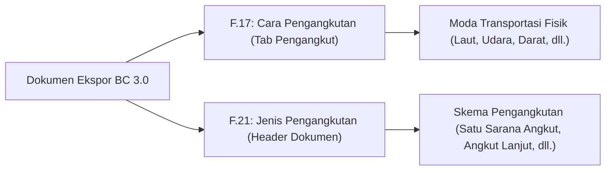

# Ketentuan Ekspor Biasa vs Kesiapan Barang (PKB) & Jenis Pengangkutan

Dokumen ini menjelaskan ketentuan kepabeanan dan panduan pengisian dokumen **BC 3.0 (Pemberitahuan Ekspor Barang / PEB)** di B-Zone terkait penanganan **Pemberitahuan Kesiapan Barang (PKB)** pada Ekspor Biasa maupun Re-Ekspor, serta perbedaan **Cara Pengangkutan** dan **Jenis Pengangkutan**.

---

## 1. Regulasi & Konsep Kepabeanan (BC 3.0)

Berdasarkan peraturan Direktorat Jenderal Bea dan Cukai (PER-09/BC/2021 dan ketentuan tatalaksana ekspor):

| Jenis Ekspor | Karakteristik Jalur | Kewajiban Kesiapan Barang (PKB) di Awal |
|---|---|---|
| **Ekspor Biasa (Kode 1)** | Default **Jalur Hijau** (langsung terbit NPE tanpa pemeriksaan fisik di tempat penimbunan eksportir). | **TIDAK PERLU**. Pengajuan PEB dikirim tanpa jadwal PKB. PKB baru diperlukan apabila Bea Cukai menerbitkan respon **PPB** (Pemberitahuan Pemeriksaan Barang / Jalur Merah). |
| **Re-Ekspor (Kode 5)** | Wajib pemeriksaan fisik pabean sebelum barang dimuat ke sarana pengangkut. | **WAJIB**. Eksportir wajib mengisi data PIC, lokasi barang siap periksa, dan jadwal pemeriksaan barang pada saat pengajuan dokumen. |
| **Ekspor Fasilitas Khusus** | Menyesuaikan profil risiko dan skema fasilitas impor sementara/KITE. | Menyesuaikan penetapan pemeriksaan pabean. |

> [!IMPORTANT]
> **Prinsip Utama:** Pada dokumen BC 3.0, kolom **Tanggal Pemeriksaan** di bagian Header tetap wajib terisi (secara otomatis terisi tanggal pengajuan) karena merupakan kolom wajib dari portal CEISA 4.0. Pengisian tanggal di Header tersebut **tidak memicu pemeriksaan fisik (PKB)** selama Jenis Ekspor yang dipilih adalah **Ekspor Biasa** dan tab **Kesiapan Barang (PKB)** dikosongkan.

---

## 2. Cara Kerja Otomatis di B-Zone

Untuk memastikan dokumen pengajuan ekspor sesuai dengan aturan CEISA 4.0 dan tidak menimbulkan antrean PKB yang tidak perlu, sistem B-Zone menerapkan pengaturan otomatis berikut:

### A. Deteksi Otomatis Jenis Ekspor

* **Ekspor Biasa (`1 - BIASA`):** Sistem secara otomatis mengenali bahwa dokumen tidak memerlukan pengajuan PKB di awal.
* **Re-Ekspor (`5 - RE-EKSPOR`):** Sistem secara otomatis mengaktifkan alur wajib pengisian **Kesiapan Barang (PKB)**.

### B. Panduan Pengisian Kolom pada Formulir BC 3.0

* **Tanggal Pemeriksaan (Header):**
    * Wajib terisi untuk seluruh dokumen BC 3.0 (otomatis terisi tanggal hari ini) agar pengajuan tidak ditolak oleh validasi portal CEISA 4.0.
* **Kantor Pemeriksaan (Header):**
    * Diisi sesuai Kantor Pabean yang mengawasi gudang atau pabrik (contoh: `051000` — KPPBC TMP Cikarang).
* **Lokasi Penimbunan / Pemuatan — F.30 (Header):**
    * Wajib diisi untuk seluruh dokumen BC 3.0 sesuai lokasi barang (contoh: `6` — TPB / Kawasan Berikat).
* **Tab Kesiapan Barang (PKB):**
    * **Khusus Re-Ekspor:** Tab ini ditampilkan dan wajib dilengkapi (nama PIC, nomor telepon, alamat lokasi siap periksa, nomor kontainer, serta tanggal dan waktu kesiapan barang).
    * **Untuk Ekspor Biasa:** Tab ini tidak perlu diisi. Sistem otomatis mengabaikan data PKB saat mengirim dokumen ke CEISA.

### C. Perbedaan Pengiriman Data ke CEISA 4.0

Saat Anda menekan tombol **Kirim ke CEISA**, sistem secara otomatis menyesuaikan data yang dikirimkan:

* **Pada Ekspor Biasa:**
    * Kolom tanggal pemeriksaan di Header tetap dikirim untuk memenuhi syarat wajib CEISA 4.0.
    * Data rincian **Kesiapan Barang (PKB) tidak disertakan**, sehingga dokumen tidak masuk ke antrean pemeriksaan fisik (PKB) dan dapat langsung memperoleh **NPE (Nota Pelayanan Ekspor)**.
* **Pada Re-Ekspor:**
    * Kolom tanggal pemeriksaan beserta seluruh rincian **Kesiapan Barang (PKB)** dikirimkan secara lengkap ke CEISA untuk penjadwalan pemeriksaan fisik oleh petugas Bea dan Cukai.

---

## 3. Referensi Pengangkutan: Cara Angkut vs Jenis Pengangkutan

Pada formulir PEB BC 3.0 terdapat dua kolom pengangkutan dengan fungsi yang berbeda:

### 1. Cara Pengangkutan (F.17)

* **Lokasi di Formulir:** Tab **Pengangkut**
* **Fungsi:** Menyatakan moda transportasi fisik yang digunakan untuk mengangkut barang ekspor:
    * `1` — LAUT
    * `2` — KERETA API
    * `3` — DARAT
    * `4` — UDARA
    * `5` — POS
    * `6` — MULTIMODA
    * `7` — INSTALASI / PIPA
    * `8` — PERAIRAN
    * `9` — LAINNYA

### 2. Jenis Pengangkutan (F.21)

* **Lokasi di Formulir:** Bagian **Header Dokumen Ekspor**
* **Fungsi:** Menyatakan skema atau metode pengangkutan barang ekspor:
    * `1` — SATU SARANA ANGKUT
    * `2` — INSTALASI / PIPA / TRANSMISI
    * `3` — ANGKUT LANJUT
    * `4` — ANGKUT LANJUT MULTIMODA
    * `5` — BARANG BAWAAN PENUMPANG / AWAK SARANA PENGANGKUT
    * `6` — SARANA ANGKUT LAINNYA

---

## 4. Ringkasan Panduan Operasional (Agar Ekspor Biasa Langsung Terbit NPE)

Agar dokumen ekspor normal (Kawasan Berikat maupun Umum) langsung masuk **Jalur Hijau** dan menerbitkan **NPE** tanpa tertahan di proses PKB, pastikan langkah berikut:

1. **Jenis Ekspor:** Pilih **`1 - EKSPOR BIASA`** (bukan `2 - BERKALA` atau `5 - RE-EKSPOR`).
2. **Tanggal Pemeriksaan (Header):** Biarkan tetap terisi sesuai tanggal pengajuan / hari ini.
3. **Kantor Pemeriksaan (Header):** Pastikan terisi kode Kantor Pabean pengawas pabrik/gudang (misal `051000`).
4. **Tab Kesiapan Barang (PKB):** Kosongkan (tidak perlu diisi pada Ekspor Biasa).
5. **Hasil di CEISA:** Dokumen akan langsung mendapatkan **Respon 3015 (Nota Pelayanan Ekspor / NPE)** tanpa melalui antrean pemeriksaan fisik (PKB).
