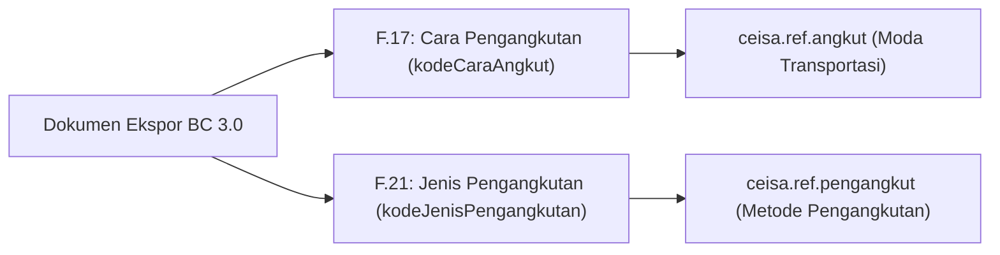

# Ketentuan Ekspor Biasa vs Kesiapan Barang (PKB) & Jenis Pengangkutan

Dokumen ini menjelaskan ketentuan kepabeanan dan aturan teknis pada modul **`djbc_ceisa_expor`** (BC 3.0 / PEB) terkait penanganan **Pemberitahuan Kesiapan Barang (PKB)** pada Ekspor Biasa serta referensi **Jenis Pengangkutan**.

---

## 1. Regulasi & Konsep Kepabeanan (BC 3.0)

Berdasarkan peraturan Direktorat Jenderal Bea dan Cukai (PER-09/BC/2021 dan PMK terkait tatalaksana ekspor):

| Jenis Ekspor | Karakteristik Jalur | Kewajiban Kesiapan Barang (PKB) di Awal |
|---|---|---|
| **Ekspor Biasa (Kode 1)** | Default **Jalur Hijau** (langsung terbit NPE tanpa pemeriksaan fisik di tempat penimbunan eksportir). | **TIDAK PERLU**. Pengajuan PEB dikirim tanpa jadwal PKB. PKB baru relevan jika Bea Cukai menerbitkan respon **PPB** (Pemberitahuan Pemeriksaan Barang / Jalur Merah). |
| **Re-Ekspor (Kode 5)** | Wajib pemeriksaan fisik pabean sebelum barang dimuat ke sarana pengangkut. | **WAJIB**. Eksportir wajib menyampaikan data PIC, lokasi barang siap periksa, dan tanggal PKB pada saat pengajuan dokumen. |
| **Ekspor Fasilitas Khusus** | Menyesuaikan profil risiko dan skema fasilitas impor sementara/KITE. | Menyesuaikan penetapan pemeriksaan pabean. |

> [!IMPORTANT]
> **Prinsip Utama:** Pada **Ekspor Biasa**, sistem **TIDAK BOLEH** mengirimkan data `tanggalPeriksa` atau isi child array `kesiapanBarang` ke API CEISA. Jika data ini terkirim, mesin otomasi CEISA 4.0 akan menginterpretasikan bahwa eksportir meminta pemeriksaan fisik, sehingga status/tab **PKB akan muncul aktif di portal CEISA**.

---

## 2. Mekanisme & Logika Teknis di B-Zone

Untuk memastikan dokumen Ekspor Biasa tidak memicu timbulnya PKB di portal CEISA, B-Zone menerapkan kontrol berikut:

### A. Otomasi Deteksi Re-Ekspor (`is_re_ekspor`)
Model `ceisa.export.document` memiliki compute field `is_re_ekspor`:
* Bernilai `True` jika `kode_dokumen` adalah BC 3.0 (`30`) dan `kode_jenis_ekspor` bernilai kode `5` atau mengandung kata *re-ekspor* / *re-export*.
* Bernilai `False` jika memilih **Ekspor Biasa (Kode 1)** atau jenis ekspor non-pemeriksaan lainnya.

### B. Kontrol Tampilan Form (UI)
* **Field Header `tanggal_periksa` (Tanggal Pemeriksaan) & `kode_kantor_periksa` (Kantor Pemeriksaan):**
  * Disembunyikan dan **tidak wajib** jika `is_re_ekspor = False`.
  * Hanya muncul dan **wajib** diisi jika `is_re_ekspor = True`.
* **Field Header `kode_lokasi` (Lokasi Penimbunan/Pemuatan F.30):**
  * Tetap **wajib** untuk semua BC 3.0 (mandatori dari skema CEISA 4.0), namun **tidak memicu PKB** karena hanya mencatat kategori lokasi barang (misal `2` = Gudang Eksportir, `4` = TPS, `6` = TPB).
* **Tab Kesiapan Barang (PKB):**
  * Otomatis tersembunyi jika dokumen adalah Ekspor Biasa. Seluruh field detail PKB (seperti `lokasi_siap_periksa`, PIC, telepon, waktu periksa) tidak dapat diinput dan tidak dikirim.
  * Jika user sempat mengisi baris kesiapan lalu mengubah jenis ekspor ke Ekspor Biasa, sistem otomatis mengosongkan baris tersebut via onchange.

### C. Serializer Payload API CEISA (`_prepare_ceisa_export_data`)
Saat menyusun JSON untuk endpoint `POST /openapi/document`:
```python
# Field tanggalPeriksa di-takeout sepenuhnya dari payload jika bukan Re-Ekspor / tidak diisi
if self.is_re_ekspor and self.tanggal_periksa:
    data['tanggalPeriksa'] = self.tanggal_periksa.strftime('%Y-%m-%d')

# kesiapanBarang mengembalikan [] jika not is_re_ekspor
data['kesiapanBarang'] = self.get_kesiapan_barang()
```
Dengan format di atas:
* **Ekspor Biasa:** `tanggalPeriksa` **sama sekali TIDAK disertakan** (di-takeout dari payload JSON) dan `kesiapanBarang` kosong `[]`, sehingga di portal CEISA dokumen diproses normal sebagai ekspor umum tanpa memicu antrean PKB.
* **Re-Ekspor:** `tanggalPeriksa` dan rincian `kesiapanBarang` (PIC, nomor telpon, lokasi siap periksa, kontainer, tanggal PKB, waktu siap periksa) terkirim lengkap sesuai skema JSON CEISA 4.0.

---

## 3. Referensi Pengangkutan: Cara Angkut vs Jenis Pengangkutan

Pada formulir PEB BC 3.0 terdapat dua elemen pengangkutan yang berbeda fungsi:



### 1. Cara Pengangkutan (F.17 — `kodeCaraAngkut`)
* Model Odoo: **`ceisa.ref.angkut`**
* Terletak di tab child **Pengangkut** (`ceisa.export.pengangkut`).
* Menyatakan moda transportasi fisik:
  * `1` — LAUT
  * `2` — KERETA API
  * `3` — DARAT
  * `4` — UDARA
  * `5` — POS
  * `6` — MULTIMODA
  * `7` — INSTALASI / PIPA
  * `8` — PERAIRAN
  * `9` — LAINNYA

### 2. Jenis Pengangkutan (F.21 — `kodeJenisPengangkutan`)
* Model Odoo: **`ceisa.ref.pengangkut`**
* Terletak di **Header Dokumen Ekspor** (field `kode_jenis_pengangkutan`).
* Menyatakan skema pengangkutan barang ekspor:
  * `1` — SATU SARANA ANGKUT
  * `2` — INSTALASI/PIPA/TRANSMISI
  * `3` — ANGKUT LANJUT
  * `4` — ANGKUT LANJUT MULTIMODA
  * `5` — BARANG BAWAAN PENUMPANG / AWAK SARKUT
  * `6` — SARANA ANGKUT LAINNYA

---

## 4. Panduan Operasional & Troubleshooting

### Kasus: Mengapa di Web CEISA Masih Muncul PKB Padahal Sudah Pilih Ekspor Biasa?

Jika pengguna menemukan dokumen yang di B-Zone dipilih Ekspor Biasa namun di portal CEISA tetap muncul tab/status PKB, lakukan pengecekan berikut:

1. **Dokumen Dibuat/Dikirim Sebelum Pembaruan:**
   * Jika dokumen dikirim sebelum tanggal 20 Oktober 2026, data `tanggalPeriksa` atau `kesiapanBarang` telah terlanjur masuk ke database Bea Cukai.
   * **Solusi:** Buat dokumen **Draft Baru** di B-Zone dengan jenis Ekspor Biasa, konfirmasi, dan kirim ulang dengan Nomor Aju baru.
2. **Pastikan Jenis Ekspor Benar:**
   * Pastikan field **Jenis Ekspor** pada header bernilai **`1 - EKSPOR BIASA`**, bukan jenis Re-Ekspor.
3. **Cek Tanggal Periksa:**
   * Pada form B-Zone, pastikan field *Tanggal Pemeriksaan* tidak muncul/tidak terisi untuk Ekspor Biasa.
