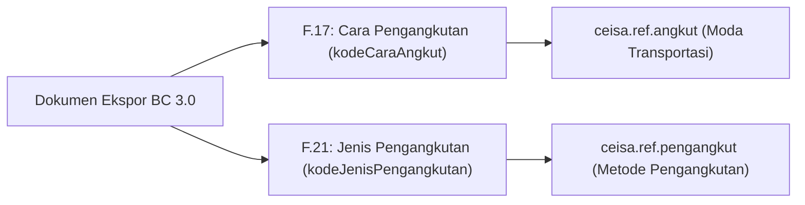

# Ketentuan Ekspor Biasa vs Kesiapan Barang (PKB) & Jenis Pengangkutan

Dokumen ini menjelaskan ketentuan kepabeanan dan aturan teknis pada modul **`djbc_ceisa_expor`** (BC 3.0 / PEB) terkait penanganan **Pemberitahuan Kesiapan Barang (PKB)** pada Ekspor Biasa serta referensi **Jenis Pengangkutan**.

---

## 1. Regulasi & Konsep Kepabeanan (BC 3.0)

Berdasarkan peraturan Direktorat Jenderal Bea dan Cukai (PER-09/BC/2021 dan PMK terkait tatalaksana ekspor):

| Jenis Ekspor | Karakteristik Jalur | Kewajiban Kesiapan Barang (PKB) di Awal |
|---|---|---|
| **Ekspor Biasa (Kode 1)** | Default **Jalur Hijau** (langsung terbit NPE tanpa pemeriksaan fisik di tempat penimbunan eksportir). | **TIDAK PERLU**. Pengajuan PEB dikirim tanpa jadwal PKB. PKB baru relevan jika Bea Cukai menerbitkan respon **PPB** (Pemberitahuan Pemeriksaan Barang / Jalur Merah). |
| **Re-Ekspor (Kode 5)** | Wajib pemeriksaan fisik pabean sebelum barang dimuat ke sarana pengangkut. | **WAJIB**. Eksportir wajib menyampaikan data PIC, lokasi barang siap periksa, dan tanggal PKB pada saat pengajuan dokumen. |
| **Ekspor Fasilitas Khusus** | Menyesuaikan profil risiko dan skema fasilitas impor sementara/KITE. | Menyesuaikan penetapan pemeriksaan pabean. |

> [!IMPORTANT]
> **Prinsip Utama:** Pada dokumen BC 3.0, field header `tanggalPeriksa` adalah **elemen wajib (mandatory)** di JSON Schema CEISA 4.0 (jika tidak dikirim akan ditolak dengan error `CODE: 1028`). Field ini merekam tanggal rencana kesiapan/periksa (default tanggal pengajuan) dan **tidak memicu PKB**. Pemicu PKB/PPB diatur melalui profil risiko kepabeanan dan data detail kesiapan barang (`kesiapanBarang`). Pada **Ekspor Biasa**, child array `kesiapanBarang` cukup dikirim kosong `[]`.

---

## 2. Mekanisme & Logika Teknis di B-Zone

Untuk memastikan dokumen pengajuan ekspor sesuai dengan skema CEISA 4.0 dan tidak menimbulkan antrean PKB yang tidak perlu, B-Zone menerapkan kontrol berikut:

### A. Otomasi Deteksi Re-Ekspor (`is_re_ekspor`)
Model `ceisa.export.document` memiliki compute field `is_re_ekspor`:
* Bernilai `True` jika `kode_dokumen` adalah BC 3.0 (`30`) dan `kode_jenis_ekspor` bernilai kode `5` atau mengandung kata *re-ekspor* / *re-export*.
* Bernilai `False` jika memilih **Ekspor Biasa (Kode 1)** atau jenis ekspor non-pemeriksaan lainnya.

### B. Kontrol Tampilan Form (UI)
* **Field Header `tanggal_periksa` (Tanggal Pemeriksaan):**
  * Ditampilkan dan **wajib** untuk seluruh dokumen BC 3.0 (default otomatis tanggal hari ini) sesuai ketentuan skema mandatory CEISA 4.0.
* **Field Header `kode_kantor_periksa` (Kantor Pemeriksaan):**
  * Diisi sesuai kantor pabean yang mengawasi gudang/pabrik (misal `051000` KPPBC Cikarang).
* **Field Header `kode_lokasi` (Lokasi Penimbunan/Pemuatan F.30):**
  * Tetap **wajib** untuk semua BC 3.0 (mandatori dari skema CEISA 4.0), misal `6` = TPB / Kawasan Berikat.
* **Tab Kesiapan Barang (PKB):**
  * Ditampilkan khusus jika `is_re_ekspor = True` atau jika memang memerlukan entry rincian kesiapan barang.
  * Pada Ekspor Biasa, tab ini tidak perlu diisi dan child array `kesiapanBarang` tidak disertakan dalam payload agar tidak memicu PKB di CEISA.

### C. Serializer Payload API CEISA (`_prepare_ceisa_export_data`)
Saat menyusun JSON untuk endpoint `POST /openapi/document`:
```python
# Field tanggalPeriksa wajib di header BC 3.0 (format YYYY-MM-DD)
data['tanggalPeriksa'] = self.tanggal_periksa.strftime('%Y-%m-%d') if self.tanggal_periksa else ''

# Child kesiapanBarang HANYA disertakan jika Re-Ekspor (is_re_ekspor)
if self.is_re_ekspor:
    kesiapan = self.get_kesiapan_barang()
    if kesiapan:
        data['kesiapanBarang'] = kesiapan
```
Dengan format di atas:
* **Ekspor Biasa:** `tanggalPeriksa` terkirim memenuhi skema mandatory CEISA 4.0, sedangkan child `kesiapanBarang` **tidak disertakan** sehingga CEISA tidak memicu form/antrean PKB kosong.
* **Re-Ekspor:** `tanggalPeriksa` dan rincian `kesiapanBarang` (PIC, nomor telpon, lokasi siap periksa, kontainer, tanggal PKB, waktu siap periksa) terkirim lengkap sesuai skema JSON CEISA 4.0.

---

## 3. Referensi Pengangkutan: Cara Angkut vs Jenis Pengangkutan

Pada formulir PEB BC 3.0 terdapat dua elemen pengangkutan yang berbeda fungsi:



### 1. Cara Pengangkutan (F.17 — `kodeCaraAngkut`)
* Model Odoo: **`ceisa.ref.angkut`**
* Terletak di tab child **Pengangkut** (`ceisa.export.pengangkut`).
* Menyatakan moda transportasi fisik:
  * `1` — LAUT
  * `2` — KERETA API
  * `3` — DARAT
  * `4` — UDARA
  * `5` — POS
  * `6` — MULTIMODA
  * `7` — INSTALASI / PIPA
  * `8` — PERAIRAN
  * `9` — LAINNYA

### 2. Jenis Pengangkutan (F.21 — `kodeJenisPengangkutan`)
* Model Odoo: **`ceisa.ref.pengangkut`**
* Terletak di **Header Dokumen Ekspor** (field `kode_jenis_pengangkutan`).
* Menyatakan skema pengangkutan barang ekspor:
  * `1` — SATU SARANA ANGKUT
  * `2` — INSTALASI/PIPA/TRANSMISI
  * `3` — ANGKUT LANJUT
  * `4` — ANGKUT LANJUT MULTIMODA
  * `5` — BARANG BAWAAN PENUMPANG / AWAK SARKUT
  * `6` — SARANA ANGKUT LAINNYA

---