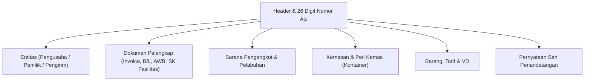

# Modul CEISA FTZ (djbc_ceisa_ftz)

> **Terakhir diperbarui:** 22 Oktober 2026

Modul **`djbc_ceisa_ftz`** mengelola dokumen kepabeanan untuk perusahaan yang beroperasi di **Kawasan Perdagangan Bebas dan Pelabuhan Bebas (KPBPB) / Free Trade Zone (FTZ)**. Dokumen ini adalah panduan pengguna bagi tim Operasional Exim, Logistik, PPJK, dan Staf Kepabeanan.

---

## 1. Untuk Perusahaan Apa Modul Ini?

Modul FTZ digunakan oleh perusahaan yang memiliki izin beroperasi di salah satu kawasan berstatus **KPBPB** di Indonesia, yaitu:

| Kawasan | Lokasi |
|---|---|
| **KPBPB Batam** | Pulau Batam, Kepulauan Riau |
| **KPBPB Bintan** | Pulau Bintan, Kepulauan Riau |
| **KPBPB Karimun** | Pulau Karimun, Kepulauan Riau |
| **KPBPB Sabang** | Pulau Weh, Sabang, Aceh |

> [!NOTE]
> Secara hukum, kawasan-kawasan ini diatur dalam **PP No. 10/2012 jo. PMK 42/PMK.04/2020** dan bersifat **sui generis** (khusus) — bukan Kawasan Berikat (KB) dan bukan Freeport. Mereka menikmati **fasilitas pembebasan bea masuk, PPN, PPh, dan cukai** untuk barang yang masuk dari luar negeri dan digunakan di dalam kawasan.

**Contoh perusahaan yang menggunakan modul ini:**

* Pabrik/manufaktur di Batam yang bahan bakunya dari Singapura/Jepang/Tiongkok.
* Perusahaan logistik di Tanjung Uncang (Batam) yang mengelola barang transit ke/dari luar negeri.
* Operator kawasan & kawasan industri di Bintan.
* Toko bebas bea (*duty-free shop*) di Sabang.
* Subkontraktor atau penyewa gudang di KPBPB yang menerima/mengirim barang antar kawasan.

> [!TIP]
> **Beda dengan Kawasan Berikat (modul `djbc_kb` / `djbc_ceisa_tpb`):** KB berada di dalam negeri dengan status "TLDDP yang ditangguhkan", sedangkan FTZ berada di **wilayah yang diperlakukan seperti luar daerah pabean** untuk transaksi tertentu. Aturan dokumennya mengikuti **PPFTZ (Pemberitahuan Pabean FTZ)**, bukan PIB/PEB biasa.

---

## 2. Cakupan Modul & Jenis Dokumen

Sesuai implementasi pada `serializers/` dan domain `kode_dokumen`, modul ini mendukung **4 jenis dokumen PPFTZ** (plus fallback ke `512`):

| Kode | Nama | Peruntukan |
|---|---|---|
| **511** | **PPFTZ-01 dari LDP** | Pemasukan barang dari **Luar Daerah Pabean (LDP)** ke KPBPB. |
| **513** | **PPFTZ-01 dari TLDDP** | Pemasukan barang dari **TLDDP** (daratan Indonesia di luar KPBPB) ke KPBPB. |
| **522** | **PPFTZ-02** | Pengeluaran barang dari KPBPB ke **Kawasan Berikat / KEK / FTZ lain / kawasan berfasilitas**. |
| **531** | **PPFTZ-03** | Pemasukan dari TLDDP ke KPBPB (PMK 42/PMK.04/2020). |
| **512** | (fallback) | Varian dokumen internal kawasan. |

> [!IMPORTANT]
> Penomoran **511/512/513/522/531** adalah kode internal CEISA, **bukan BC 1.6 / 2.3 / 2.5** seperti di Kawasan Berikat. Staf operasional harus membedakan keduanya: **BC** untuk KB & TPB, **PPFTZ** untuk FTZ.

---

## 3. Anatomi Formulir Dokumen FTZ



Tiap-tiap **serializer** (511/513/522/531) menambahkan field-field khusus sesuai skema CEISA:

| Serializer | Field Tambahan Utama |
|---|---|
| `FTZ511Serializer` | `kodeKategoriBarangFtz`, `kodeTujuanPemasukan`, `kodeKategoriMasukFtz`, `namaTransaksiLainnyaFtz`, `nomorBc11`, `posBc11`, `tanggalTiba`, `biayaTambahan`, `biayaPengurang`, `tanggalBc11`. Barang: `barangSpekKhususes` (perhatikan **plural +es**). |
| `FTZ513Serializer` | `kodeKategoriKeluarFtz`, `kodeTujuanPengeluaran`, `nomorBc11`, `posBc11`, `tanggalTiba`, `biayaTambahan`, `biayaPengurang`, `tanggalBc11`, **`status: '1'`** (wajib root). Barang: `kodePerhitungan` (`0`/`1`), `barangSpekKhusus` (singular). |
| `FTZ522Serializer` | `kodeJenisProsedur`, `kodeKategoriKeluarFtz`, `kodeNegaraTujuan`, `nilaiBarang`, `nilaiIncoterm`, `nilaiMaklon`, `flagCurah`, `tanggalBc11`, `jumlahTandaPengaman`. |
| `FTZ531Serializer` | `kodeKategoriBarangFtz`, `kodeKategoriKeluarFtz`, `kodeTujuanPemasukan`, `kodeTujuanPengeluaran`, **`status: '1'`** (wajib root). |

---

## 4. Alur Kerja (Lifecycle) Dokumen

| State | Deskripsi | Aksi yang Tersedia |
|---|---|---|
| **Draft** | Dokumen baru/dalam penyusunan. | Edit bebas, Add Item |
| **Confirm** | Data sudah valid internal. | **Send Document**, Set to Draft |
| **Sent** | Berhasil dikirim ke CEISA. | Cek Status & Respon (via API Log), Mulai Revisi |

---

## 5. Tata Cara Pengisian Langkah-demi-Langkah

Buka menu **DJBC CEISA > FTZ > PPFTZ Documents** lalu klik **Create**.

### Langkah 1: Tab Header

* **Nomor Aju 26 Digit** — Terbentuk otomatis dari `kode_kantor` (4 digit) + `kode_dokumen` (2 digit pertama) + `company_code` (6 digit) + sequence. Sistem akan memotong agar pas 26 karakter.
* **Kode Dokumen** — Pilih salah satu dari `511`, `512`, `513`, `522`, `531` sesuai jenis transaksi.
* **Document Type** (selection field) — Disarankan pilih `511`, `513`, atau `522` (digunakan sebagai fallback).
* **Kantor Pabean** — Pilih sesuai wilayah KPBPB.
* **Kode Asal Barang FTZ** & **Kode Jenis Prosedur** — Wajib untuk pencatatan asal barang.
* **Kode Asuransi** (`LN` / `DN`) — Wajib untuk 511 & 513.
* **Kode Cara Bayar, Cara Dagang, Incoterm** — Wajib untuk 511 & 513.
* **Kode Valuta & NDPBM** — Otomatis terisi kurs KMK mingguan saat valuta dipilih.
* **Subpos BC 1.1** — Digunakan untuk merujuk ke manifes BC 1.1 (sesuai `subpos_bc11`).
* **Nomor BC 1.1, Pos BC 1.1, Tanggal BC 1.1** — Untuk dokumen yang terkait manifes pelabuhan.

  

### Langkah 2: Tab Entitas

Entitas pabean standar sesuai skema CEISA (kode `1`–`10`). Field yang wajib untuk hampir semua entitas: `alamatEntitas`, `kodeEntitas`, `kodeJenisApi` (01/02), `kodeJenisIdentitas` (2–6), `kodeNegara`, `kodeStatus`, `namaEntitas`, `nomorIdentitas`, `seriEntitas`.

> [!TIP]
> Serializer 511 & 513 menerima banyak entitas; serializer 531 hanya **1 entitas** dengan `kodeEntitas: '6'`. Serializer 522 tidak memiliki properti `entitas` di root schema.

  

### Langkah 3: Tab Dokumen Pelengkap

Dokumen mengikuti **Tuple 3 Elemen** (lihat `serializers/base.py:100-147`):

| Index | Tipe | Kode |
|---|---|---|
| 0 | Surat Keputusan / Dokumen Lainnya | (opsional) |
| 1 | House-BL atau AWB | `705` atau `740` |
| 2 | Invoice | `380` (wajib) |

Field wajib pada setiap dokumen: `idDokumen`, `kodeDokumen`, `nomorDokumen`, `seriDokumen`, `tanggalDokumen`.

  

### Langkah 4: Tab Pengangkut, Kemasan, Kontainer

* **Pengangkut** — Nama & nomor sarana, kode bendera negara 2 huruf ISO kapital, kode cara angkut.
* **Kemasan** — Jumlah, jenis (`CTN`, `PLT`, dll.), seri, dan merk.
* **Kontainer** — Nomor 11 digit, ukuran (20/40/45), tipe.

  

### Langkah 5: Tab Barang

Pilih produk dari master → HS Code, satuan CEISA, dan detail spesifikasi otomatis terisi. Tiap serializer menambahkan field berbeda:

* **511 & 513**: `kodeKondisiBarang`, `nilaiBarang`, `kodePerhitungan` (khusus 513), `barangSpekKhususes` (511) atau `barangSpekKhusus` (513).
* **522**: `hargaPatokan`, `hargaPenyerahan`, `hargaSatuan`, `jumlahDilekatkan`, `jumlahRealisasi`, `kapasitasSilinder`, `kodeDaerahAsal`, `nilaiBarang`, `nilaiDanaSawit`, `nilaiDevisa`, `persentaseImpor`, `seriBarangDokAsal`, `kodeBarang`, `seriIjin`, `tahunPembuatan`, `tarifCukai`, `hargaPerolehan`, `barangSpekKhusus`.
* **531**: `kodeDokumen`, `kodeKondisiBarang` saja.

  

### Langkah 6: Tab Voluntary Declaration (Opsional)

Gunakan tab `voluntary_declaration_ids` jika ada deklarasi sukarela yang terkait barang (misal: barang yang terkena tarif Bea Keluar / Dana Sawit / Cukai).

### Langkah 7: Tab Penandatangan

* **Kota Tanda Tangan** (dari `res.city`).
* **Nama Tanda Tangan** (dari `hr.employee`).
* **Jabatan Tanda Tangan** (dari `hr.job`).
* **Tanggal Tanda Tangan**.

---

## 6. Validasi Otomatis

Sebelum dokumen bisa dikirim, sistem menjalankan 5 fungsi validasi (mirip modul impor/ekspor):

| Fungsi | Validasi |
|---|---|
| `check_detail_dokumen` | Nomor Aju 26 digit, Kantor Pabean, Pelabuhan Muat/Transit/Tujuan, TPS, Valuta, Cara Bayar, Kode Tutup PU, Jenis Prosedur, Kode Asal Barang FTZ, Tanda Tangan. |
| `check_entitas` | Setidaknya 1 entitas dengan field-field wajib. |
| `check_dokumen_pelengkap` | Invoice `380` wajib ada. |
| `check_kemasan_pengangkut` | Data kemasan & pengangkut terisi. |
| `check_barang` | Setiap barang memiliki HS Code, satuan, jenis kemasan. |

---

## 7. Mengirim Dokumen ke CEISA (Send Document)

1. Klik **Confirm** — status berubah ke `Confirm`.
2. Klik **Send Document** — sistem memilih **serializer** otomatis berdasarkan `kode_dokumen` lewat factory `get_ftz_serializer()` di `serializers/__init__.py`:
   * `511` → `FTZ511Serializer`
   * `513` → `FTZ513Serializer`
   * `522` → `FTZ522Serializer` (juga `512` via fallback)
   * `531` → `FTZ531Serializer`
3. Payload JSON dikirim ke endpoint:
   ```
   POST {CEISA_BASE_URL}/openapi/document
   ```
4. Sukses → status `Sent`, payload dicatat di `ir.api.log` (tombol **Api Log**).

> [!WARNING]
> Serializer 513 & 531 **wajib menyertakan field root `status: '1'`** karena anomali skema DJBC yang mencantumkannya di daftar `required` meski tidak didefinisikan di `properties`. Ini sudah ditangani oleh masing-masing serializer.

---

## 8. Serializer Strategy Pattern (Catatan Teknis)

Modul ini menggunakan **Strategy Pattern** lewat folder `serializers/`:

* `base.py` → `BaseFTZSerializer` (helper umum: format tanggal, get_code, get_header_common, get_kemasan, get_kontainer, get_pengangkut, get_dokumen, get_entitas, get_barang_base).
* `serializer_511.py` → Khusus PPFTZ-01 LDP.
* `serializer_513.py` → Khusus PPFTZ-01 TLDDP.
* `serializer_522.py` → Khusus PPFTZ-02.
* `serializer_531.py` → Khusus PPFTZ-03.
* `__init__.py` → Factory dispatcher `get_ftz_serializer(doc)`.

> Untuk pengembangan, lihat juga [ARCHITECTURE_IMPROVEMENT_ROADMAP.md](file:///home/addons/bzone19/djbc_ceisa_ftz/ARCHITECTURE_IMPROVEMENT_ROADMAP.md) yang memuat catatan bug historis dan rencana perbaikan serializer.

---

## 9. Daftar Istilah Penting

| Istilah | Penjelasan |
|---|---|
| **FTZ / KPBPB** | Free Trade Zone / Kawasan Perdagangan Bebas dan Pelabuhan Bebas — wilayah yang diperlakukan khusus di bidang kepabeanan. |
| **PPFTZ** | Pemberitahuan Pabean FTZ — dokumen resmi untuk transaksi di kawasan. |
| **LDP** | Luar Daerah Pabean — wilayah di luar Indonesia untuk tujuan pabean. |
| **TLDDP** | Tempat Lain Dalam Daerah Pabean — wilayah Indonesia di luar KPBPB. |
| **NDPBM** | Nilai Dasar Perhitungan Bea Masuk — kurs pajak mingguan KMK. |
| **BC 1.1** | Dokumen manifes pelabuhan/bandara (dirujuk oleh `nomorBc11` & `posBc11`). |
| **VD** | Voluntary Declaration — deklarasi sukarela untuk barang tertentu. |
| **SK Fasilitas** | Surat Keputusan fasilitas yang menjadi dokumen pelengkap FTZ. |

---

> Dokumen ini adalah panduan non-teknis untuk modul **`djbc_ceisa_ftz`**. Untuk Kawasan Berikat (BC 1.6/2.3/2.5/2.6.1/2.6.2/2.7/4.0/4.1), gunakan modul [`djbc_ceisa_tpb`](../djbc_ceisa_tpb/pengelolaan_dokumen_tpb.md). Untuk impor umum, gunakan [`djbc_ceisa_impor`](../djbc_ceisa_impor/dokumentasi_impor.md). Untuk ekspor, gunakan [`djbc_ceisa_expor`](../djbc_ceisa_expor/dokumentasi_expor.md).
