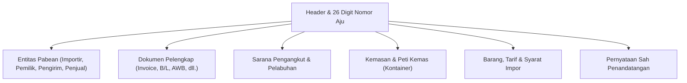

# Modul CEISA Impor (djbc_ceisa_impor)

Modul **`djbc_ceisa_impor`** mengelola dokumen **Pemberitahuan Impor Barang (PIB) / BC 2.0** dan mengirimkannya ke portal CEISA 4.0 milik Direktorat Jenderal Bea dan Cukai (DJBC). Dokumen ini adalah panduan pengguna bagi tim Operasional Exim, Logistik, PPJK, dan Staf Kepabeanan.

> [!IMPORTANT]
> Sesuai implementasi pada `__manifest__.py` dan validasi `_check_user_kode_dokumen_permission` di model `ceisa.import.document`, **modul ini hanya mendukung dokumen BC 2.0** (kode referensi `20`). Untuk dokumen BC 2.3 (impor ke Kawasan Berikat) dan BC 2.7 (antar TPB), gunakan modul [`djbc_ceisa_tpb`](../djbc_ceisa_tpb/pengelolaan_dokumen_tpb.md).

---

## 1. Cakupan Modul & Jenis Dokumen

| Kode BC | Jenis Dokumen | Peruntukan |
|---|---|---|
| **BC 2.0** | Pemberitahuan Impor Barang (PIB) | Impor umum dari luar daerah pabean (LDP) ke Tempat Penimbunan Sementara (TPS) di pelabuhan/bandara, dengan kewajiban membayar Bea Masuk, PPN, PPh Pasal 22, dan pajak-pajak lain (cukai, PPh Pasal 23, dll). |

> [!TIP]
> Modul ini menghasilkan dokumen yang sama dengan konsep PIB di aplikasi **CEISA 4.0** versi *host-to-host* DJBC. Pastikan Anda memiliki **Company Code DJBC** dan **NPWP perusahaan** yang valid sebelum mulai input.

---

## 2. Anatomi Formulir Dokumen Impor

Dokumen BC 2.0 disusun ke dalam beberapa tab sesuai standar CEISA:



---

## 3. Alur Kerja (Lifecycle) Dokumen

| State | Deskripsi | Aksi yang Tersedia |
|---|---|---|
| **Draft** | Dokumen baru/dalam penyusunan. Field bisa diedit bebas. | Edit semua field, Add Item, Auto-Fill |
| **Confirm** | Data sudah valid internal. Status akan dikunci untuk dikirim. | **Send to CEISA**, Set to Draft |
| **Sent** | Dokumen sudah berhasil dikirim ke server CEISA dan mendapat NPP. | **Cek Status & Respon**, **Mulai Revisi** |

> [!WARNING]
> Transisi **Confirm → Sent** hanya dapat dilakukan jika seluruh validasi `check_*` (lihat Bagian 5) terpenuhi. Jika gagal, sistem akan menampilkan **UserError** berisi daftar field yang belum lengkap.

---

## 4. Tata Cara Pengisian Langkah-demi-Langkah

Buka menu **DJBC CEISA > Impor > Import Documents** lalu klik **Create**.

### Langkah 1: Tab Header

* **Nomor Aju 26 Digit** — Otomatis terisi saat Anda memilih **Kantor Pabean** (`kode_kantor`) dan **Kode Dokumen** (`kode_dokumen`). Pola: `[4 digit kantor][2 digit BC][6 digit company code][14 digit sequence]`. Contoh: `0403002000012325101000012345`.
* **Kantor Pabean** — Pilih sesuai Kantor Pengawasan tempat TPS berada.
* **Pelabuhan Muat, Pelabuhan Tujuan, TPS** — Wajib dipilih.
* **Kode Tutup PU** — Wajib diisi dengan salah satu kode: `11`, `12`, atau `14`. Kode lain akan ditolak oleh validasi `check_detail_dokumen`.
* **Kode Valuta & NDPBM** — Otomatis terisi kurs pajak KMK mingguan saat valuta dipilih. Lihat [panduan kurs](../erpi_custom_rate/manajemen_kurs_pabean.md).

  

### Langkah 2: Tab Entitas

Saat dokumen dibuat, sistem **otomatis generate 4 baris entitas** sesuai standar BC 2.0:

| Seri | Kode | Peran | Auto-Fill |
|---|---|---|---|
| 1 | `1` | **Importir** | Ya, dari `company.partner_id` |
| 2 | `7` | **Pemilik Barang** | Tidak |
| 3 | `9` | **Pengirim (Shipper)** | Tidak |
| 4 | `10` | **Penjual (Seller)** | Tidak |

Field yang **wajib** diisi untuk entitas Importir: Nama, Alamat, NPWP 16 digit, NIB, **Jenis API** (`01` APIU atau `02` APIP), dan **Jenis Identitas** (kode 2/3/4/5/6).

Field yang **wajib** untuk Pemilik Barang: Nama, Alamat, Nomor Identitas, dan **Hubungan Afiliasi** (`AFL`, `CTR`, `FAM`, atau `TAH`).

  

### Langkah 3: Tab Dokumen Pelengkap

Pilih jenis dokumen pelengkap sesuai kode referensi CEISA:

| Kode | Dokumen |
|---|---|
| `380` | Commercial Invoice (Faktur Dagang) |
| `705` | Bill of Lading (B/L) |
| `740` | Air Waybill (AWB) |
| `217` | Packing List |
| `861` | Surat Keterangan Asal (SKA) |
| `261` | Kontrak/Sales Contract |
| `731` | Dokumen Pabean Pendukung (mis. BC 1.6 dari TPS) |

  

### Langkah 4: Tab Pengangkut, Kemasan, Kontainer

* **Moda Angkut** — Pilih moda (Laut / Udara / Darat) dan nama sarana.
* **Kode bendera negara** — 2 huruf ISO kapital (contoh: `SG`, `CN`, `JP`, `US`).
* **Nomor kontainer** — 11 digit (4 huruf prefix + 7 digit angka), sertakan ukuran (`20`/`40`/`45` ft).
* **Jumlah & jenis kemasan** — Satuan CEISA seperti `CTN` (carton), `PLT` (pallet), `BG` (bag), `DR` (drum).

  

### Langkah 5: Tab Barang (Detail Barang)

* Pilih **Produk** dari master → sistem otomatis mengambil **HS Code** (`pos_tarif`) dan **Satuan CEISA** dari `product.product`.
* Isi **Jumlah Satuan** dan **Nilai CIF** per baris.
* Pilih **Cara Penentuan Nilai Pabean**: Metode 1 s.d. 6. Jika bukan Metode 1, wajib mengisi **Alasan** pada `alasan_metode_penentuan_nilai`.
* Tab **Barang Tarif** (BM, PPN, PPh, Cukai) di-generate otomatis setelah HS Code diisi (lihat [Referensi CEISA](panduan_pengisian_ceisa.md) untuk hitung otomatis dari modul TPB).
* Tab **Spesifikasi Khusus** (jika HS Code termasuk kategori tertentu) dan **Voluntary Declaration** dapat diisi sesuai kebutuhan.

  

### Langkah 6: Tab Penandatangan

* **Kota Tanda Tangan** — Otomatis terisi dari `company.partner_id.city_id` atau `company.city_id`.
* **Nama Tanda Tangan** — Pilih dari `hr.employee` (otomatis mengisi **Jabatan**).
* **Disclaimer** — Pilih `1` (Ya) untuk menyatakan persetujuan.

---

## 5. Validasi Otomatis Sebelum Pengiriman

Sebelum status berubah dari **Draft → Confirm → Sent**, sistem menjalankan **5 fungsi validasi** (`check_*` pada model `ceisa.import.document`):

| Fungsi | Validasi yang Diperiksa |
|---|---|
| `check_detail_dokumen` | Nomor Aju 26 digit, Kantor Pabean, Pelabuhan Muat/Tujuan, TPS, Valuta, Cara Bayar, Kode Tutup PU (11/12/14), Jenis Impor, Tanggal Tiba/Tanda Tangan, Kota/Nama/Jabatan Penandatangan. |
| `check_entitas` | Entitas Importir (1) & Pemilik (7) wajib ada. Importir harus memiliki Nama, Alamat, NPWP, NIB, API (01/02), dan Jenis Identitas. |
| `check_dokumen_pelengkap` | Kelengkapan dokumen pelengkap minimal (Invoice & B/L/AWB). |
| `check_kemasan_pengangkut` | Data kemasan & pengangkut terisi. |
| `check_barang` | Setiap barang memiliki HS Code, satuan, nilai, dan `jenis_kemasan` terisi. |

Jika salah satu gagal, dokumen tidak akan berubah ke `Confirm`. Gunakan tombol **Confirm** untuk trigger validasi, lalu perbaiki field yang ditandai.

---

## 6. Mengirim Dokumen ke CEISA (Send Document)

1. Klik tombol **Confirm** — status berubah ke `Confirm`.
2. Klik tombol **Send Document** — sistem POST ke endpoint:
   ```
   POST {CEISA_BASE_URL}/openapi/document?isFinal=false&isRevision=false
   ```
3. Body dikirim sebagai **JSON** yang disusun oleh `_prepare_ceisa_import_data()` (berisi header, entitas, barang, barangTarif, barangDokumen, barangPemilik, dll).
4. Jika server mengembalikan **401 Unauthorized**, sistem otomatis refresh token via `ceisa.auth.get_auth_headers(force=True)` lalu retry.
5. Respon sukses → status berubah ke `Sent`, payload JSON dicatat di `ir.api.log` (tombol **Api Log**), dan email notifikasi dikirim ke user (jika `ceisa.send_email_on_success=True`).

> [!TIP]
> Parameter `isFinal` dikontrol lewat System Parameter `ceisa.is_final_dokumen`. Default-nya `false` (draft). Ubah ke `true` jika Anda ingin dokumen langsung final saat dikirim.

---

## 7. Revisi Dokumen yang Sudah Terkirim

Tombol **Mulai Revisi** hanya muncul untuk dokumen berstatus `Sent`. Sistem akan:

1. Menaikkan `revision_count` dan `seri` di header.
2. Mengubah status kembali ke `Draft`.
3. Menandai `is_revision = True` agar server mengirim `isRevision=true` saat submit ulang.

---

## 8. Daftar Istilah Penting

| Istilah | Penjelasan |
|---|---|
| **PIB (BC 2.0)** | Pemberitahuan Impor Barang — dokumen pabean resmi untuk impor umum. |
| **NPP** | Nomor Pendaftaran Pabean — bukti dokumen terdaftar di CEISA. |
| **SPPB** | Surat Persetujuan Pengeluaran Barang — izin pengeluaran dari TPS. |
| **SPJM** | Surat Pemberitahuan Jalur Merah — notifikasi pemeriksaan fisik. |
| **NDPBM** | Nilai Dasar Perhitungan Bea Masuk — kurs pajak mingguan KMK. |
| **FOB / CIF / Freight / Asuransi** | Komponen nilai pabean (lihat panduan TPB untuk rumus lengkap). |
| **HS Code** | Kode 8 digit berdasarkan BTKI (Buku Tarif Kepabeanan Indonesia). |

---

> Dokumen ini adalah panduan non-teknis untuk modul **`djbc_ceisa_impor`**. Untuk modul ekspor, silakan merujuk ke [dokumentasi ekspor CEISA](../djbc_ceisa_expor/dokumentasi_expor.md). Untuk transaksi TPB/BC 2.3/BC 4.0/BC 2.5, gunakan modul [`djbc_ceisa_tpb`](../djbc_ceisa_tpb/pengelolaan_dokumen_tpb.md).
