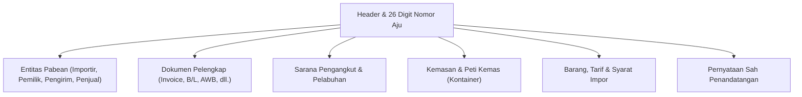

# Modul CEISA Impor (djbc_ceisa_impor)

> **Terakhir diperbarui:** 22 Oktober 2026

Modul **`djbc_ceisa_impor`** mengelola dokumen **Pemberitahuan Impor Barang (PIB) / BC 2.0** dan mengirimkannya ke portal CEISA 4.0 milik Direktorat Jenderal Bea dan Cukai (DJBC). Dokumen ini adalah panduan pengguna bagi tim Operasional Exim, Logistik, PPJK, dan Staf Kepabeanan.

> [!IMPORTANT]
> Sesuai implementasi pada `__manifest__.py` dan validasi `_check_user_kode_dokumen_permission` di model `ceisa.import.document`, **modul ini hanya mendukung dokumen BC 2.0** (kode referensi `20`). Untuk dokumen BC 2.3 (impor ke Kawasan Berikat) dan BC 2.7 (antar TPB), gunakan modul [`djbc_ceisa_tpb`](../djbc_ceisa_tpb/pengelolaan_dokumen_tpb.md).

---

## 1. Cakupan Modul & Jenis Dokumen

| Kode BC | Jenis Dokumen | Peruntukan |
|---|---|---|
| **BC 2.0** | Pemberitahuan Impor Barang (PIB) | Impor umum dari luar daerah pabean (LDP) ke Tempat Penimbunan Sementara (TPS) di pelabuhan/bandara, dengan kewajiban membayar Bea Masuk, PPN, PPh Pasal 22, dan pajak-pajak lain (cukai, PPh Pasal 23, dll). |

> [!TIP]
> Modul ini menghasilkan dokumen yang sama dengan konsep PIB di aplikasi **CEISA 4.0** versi *host-to-host* DJBC. Pastikan Anda memiliki **Company Code DJBC** dan **NPWP perusahaan** yang valid sebelum mulai input.

---

## 2. Anatomi Formulir Dokumen Impor

Dokumen BC 2.0 disusun ke dalam beberapa tab sesuai standar CEISA:



---

## 3. Alur Kerja (Lifecycle) Dokumen

| State | Deskripsi | Aksi yang Tersedia |
|---|---|---|
| **Draft** | Dokumen baru/dalam penyusunan. Field bisa diedit bebas. | Edit semua field, Add Item, Auto-Fill |
| **Confirm** | Data sudah valid internal. Status akan dikunci untuk dikirim. | **Send to CEISA**, Set to Draft |
| **Sent** | Dokumen sudah berhasil dikirim ke server CEISA dan mendapat NPP. | **Cek Status & Respon**, **Mulai Revisi** |

> [!WARNING]
> Transisi **Confirm → Sent** hanya dapat dilakukan jika seluruh validasi `check_*` (lihat Bagian 5) terpenuhi. Jika gagal, sistem akan menampilkan **UserError** berisi daftar field yang belum lengkap.

---

## 4. Tata Cara Pengisian Langkah-demi-Langkah

Buka menu **DJBC CEISA > Impor > Import Documents** lalu klik **Create**.

### Langkah 1: Tab Header

* **Nomor Aju 26 Digit** — Otomatis terisi saat Anda memilih **Kantor Pabean** (`kode_kantor`) dan **Kode Dokumen** (`kode_dokumen`). Pola: `[4 digit kantor][2 digit BC][6 digit company code][14 digit sequence]`. Contoh: `0403002000012325101000012345`.
* **Kantor Pabean** — Pilih sesuai Kantor Pengawasan tempat TPS berada.
* **Pelabuhan Muat, Pelabuhan Tujuan, TPS** — Wajib dipilih.
* **Kode Tutup PU** — Wajib diisi dengan salah satu kode: `11`, `12`, atau `14`. Kode lain akan ditolak oleh validasi `check_detail_dokumen`.
* **Kode Valuta & NDPBM** — Otomatis terisi kurs pajak KMK mingguan saat valuta dipilih. Lihat [panduan kurs](../erpi_custom_rate/manajemen_kurs_pabean.md).

  

### Langkah 2: Tab Entitas

Saat dokumen dibuat, sistem **otomatis generate 4 baris entitas** sesuai standar BC 2.0:

| Seri | Kode | Peran | Auto-Fill |
|---|---|---|---|
| 1 | `1` | **Importir** | Ya, dari `company.partner_id` |
| 2 | `7` | **Pemilik Barang** | Tidak |
| 3 | `9` | **Pengirim (Shipper)** | Tidak |
| 4 | `10` | **Penjual (Seller)** | Tidak |

Field yang **wajib** diisi untuk entitas Importir: Nama, Alamat, NPWP 16 digit, NIB, **Jenis API** (`01` APIU atau `02` APIP), dan **Jenis Identitas** (kode 2/3/4/5/6).

Field yang **wajib** untuk Pemilik Barang: Nama, Alamat, Nomor Identitas, dan **Hubungan Afiliasi** (`AFL`, `CTR`, `FAM`, atau `TAH`).

  

### Langkah 3: Tab Dokumen Pelengkap

Pilih jenis dokumen pelengkap sesuai kode referensi CEISA:

| Kode | Dokumen |
|---|---|
| `380` | Commercial Invoice (Faktur Dagang) |
| `705` | Bill of Lading (B/L) |
| `740` | Air Waybill (AWB) |
| `217` | Packing List |
| `861` | Surat Keterangan Asal (SKA) |
| `261` | Kontrak/Sales Contract |
| `731` | Dokumen Pabean Pendukung (mis. BC 1.6 dari TPS) |

  

### Langkah 4: Tab Pengangkut, Kemasan, Kontainer

* **Moda Angkut** — Pilih moda (Laut / Udara / Darat) dan nama sarana.
* **Kode bendera negara** — 2 huruf ISO kapital (contoh: `SG`, `CN`, `JP`, `US`).
* **Nomor kontainer** — 11 digit (4 huruf prefix + 7 digit angka), sertakan ukuran (`20`/`40`/`45` ft).
* **Jumlah & jenis kemasan** — Satuan CEISA seperti `CTN` (carton), `PLT` (pallet), `BG` (bag), `DR` (drum).

  

### Langkah 5: Tab Barang (Detail Barang)

* Pilih **Produk** dari master → sistem otomatis mengambil **HS Code** (`pos_tarif`) dan **Satuan CEISA** dari `product.product`.
* Isi **Jumlah Satuan** dan **Nilai CIF** per baris.
* Pilih **Cara Penentuan Nilai Pabean**: Metode 1 s.d. 6. Jika bukan Metode 1, wajib mengisi **Alasan** pada `alasan_metode_penentuan_nilai`.
* Tab **Barang Tarif** terisi otomatis setelah HS Code dipilih — lihat [Tarif Otomatis dari HS Code](#51-tarif-otomatis-dari-hs-code) di bawah.
* Tab **Spesifikasi Khusus** (jika HS Code termasuk kategori tertentu) dan **Voluntary Declaration** dapat diisi sesuai kebutuhan.

  

#### 5.1 Tarif Otomatis dari HS Code

Setiap kali **Produk** atau **Pos Tarif / HS** dipilih, sistem menarik tarif resmi dari
[CEISA Core](../djbc_ceisa_core/integrasi_ceisa_core.md) lalu mengisi tab **Barang Tarif**
dengan 3 baris wajib: **BM** → **PPH** → **PPN**.

##### Trigger pengisian otomatis

| Aksi | Akibat |
| :--- | :--- |
| Pilih **Produk** di tab Barang | HS Code mengikuti dari `product.hs_code_id`, tarif langsung ditarik |
| Pilih / ubah **Pos Tarif / HS** | Pos Tarif ikut berubah, tarif ditarik ulang |
| Kosongkan **Pos Tarif / HS** | **Seluruh baris Barang Tarif terhapus** |
| Klik **Tarik / Refresh Tarif CEISA** | Menarik ulang dari CEISA, melewati cache lokal |

> [!IMPORTANT]
> Menyetel **Pos Tarif / HS** secara manual pada baris ini **tidak** mengubah HS Code di
> master produk. Field-nya terhubung ke `product.hs_code_id` — ubah dari **Produk** terlebih
> dahulu agar master data tetap konsisten.

##### Rumus perhitungan nilai pabean dan pungutan

| Komponen | Rumus Perhitungan | Keterangan |
| :--- | :--- | :--- |
| **Harga CIF Barang** | = FOB + Freight + Asuransi *(atau Harga Satuan x Jumlah Satuan)* | Nilai pabean dalam valuta asing |
| **Nilai Pabean (DPP BM)** | = CIF x Kurs NDPBM | CIF Rupiah yang dibulatkan |
| **Bea Masuk (BM)** | = DPP BM x Tarif BM (%) | Bila tarif advalorum, atau = Jumlah Satuan x Tarif Satuan jika spesifik |
| **DPP Nilai Impor** | = Nilai Pabean (CIF Rupiah) + Bea Masuk | Dasar pengenaan PPh dan PPN Impor |
| **PPh Pasal 22 Impor** | = DPP Nilai Impor x Tarif PPh (%) | 2.5% jika Importir memiliki API/NIB; 7.5% jika non-API |
| **PPN Impor** | = DPP Nilai Impor x Tarif PPN (%) | Mengikuti tarif PPN berlaku (11% atau sesuai HS Code) |

> [!NOTE]
> Bila jenis tarif pabean bernilai Spesifik (`kode_jenis_tarif` = `2`), perhitungan nilai pungutan menggunakan perkalian **Jumlah Satuan x Tarif per Satuan**.

##### PPh Pasal 22 ditentukan otomatis sesuai status API

Tarif PPh tidak selalu 2.5%. Sistem menentukannya secara otomatis dengan memeriksa kelengkapan legalitas perusahaan:

1. `partner.kode_jenis_api` atau `partner.nib` pada master kontak perusahaan (`res.partner`)
2. `company.nib`
3. Entitas pabean pada dokumen impor dengan peran Importir (kode `1`), Pengusaha (kode `3`), atau Pemilik Barang (kode `7`)

| Status Legalitas Perusahaan | Tarif PPh Pasal 22 Otomatis |
| :--- | :--- |
| Memiliki NIB atau Jenis API (API-U / API-P) | **2.5%** |
| Tidak memiliki NIB dan tidak memiliki API | **7.5%** |

> [!TIP]
> Bagi importir yang memiliki fasilitas Surat Keterangan Bebas PPh Pasal 22 (**SKB**), tarif PPh dapat disetel secara manual menjadi **0%** pada baris tarif PPh.

##### Pembagian fasilitas dan nilai bayar pungutan

* **Fasilitas DIBAYAR (`kode_fasilitas_tarif` = `1`)**: Nilai pungutan masuk ke kolom **Nilai Bayar** dan `Nilai Fasilitas` = 0.
* **Fasilitas Bebas / Ditanggung / Tidak Dipungut (`kode_fasilitas_tarif` selain `1`)**: Nilai pungutan masuk ke kolom **Nilai Fasilitas**, `Nilai Bayar` = 0, dan tarif fasilitas terisi 100%.
* **Total Pungutan Barang**: Penjumlahan Nilai Bayar + Nilai Fasilitas dari seluruh baris tarif pada barang tersebut.

---

#### 5.2 Mekanisme Tarik Ulang dan Perubahan Kurs (NDPBM)

Nilai Kurs NDPBM (Nilai Dasar Perhitungan Bea Masuk) ditetapkan mingguan oleh Kementerian Keuangan. Sistem menyediakan sinkronisasi otomatis:

1. **Tarik Kurs Otomatis dari CEISA**:
   - Klik tombol refresh (**Tarik Kurs Terkini dari CEISA**) di samping field NDPBM pada tab Transaksi.
   - Sistem mengambil kurs pajak resmi KMK yang berlaku dari server CEISA 4.0.
2. **Kalkulasi Ulang Menyeluruh (Cascading Recompute)**:
   - Setiap kali Kurs / NDPBM berubah (baik ditarik dari CEISA maupun diedit manual):
     - Seluruh barang anak di tab **Barang** otomatis diperbarui nilai kursnya (`ndpbm`).
     - **Nilai Pabean (CIF Rupiah)** dihitung ulang otomatis mengikuti kurs baru.
     - Seluruh pungutan (**Bea Masuk, PPh Pasal 22, PPN, dan pungutan lainnya**) langsung dihitung ulang berdasarkan CIF Rupiah yang baru.
     - Baris tarif yang belum terisi otomatis ditarik dari referensi tarif HS Code.
3. **Rekapitulasi Total Dokumen (Header Summary)**:
   - Total **CIF Dokumen** otomatis menjumlahkan akumulasi nilai CIF seluruh barang.
   - Di bawah tabel daftar barang, sistem menampilkan ringkasan total pungutan dokumen yang siap dibayar:
     - **Total BM** (Total Bea Masuk)
     - **Total PPN** (Total PPN Impor)
     - **Total PPh** (Total PPh Pasal 22 Impor)
     - **Total Bayar Pungutan** (Total seluruh billing pabean yang harus disetor ke kas negara)
     - **Total Pungutan Fasilitas** (Total pungutan yang dibebaskan / ditanggung pemerintah)

---

#### 5.3 Metode Penentuan Nilai Pabean (Kolom BC 2.0 D.36)

Sesuai ketentuan **UU Kepabeanan No. 17 Tahun 2006 Pasal 15** dan **PMK No. 144/PMK.04/2022**, setiap barang impor wajib dideklarasikan metode penetapan nilai pabeannya:

##### 1. Hierarki Metode Penentuan Nilai

* **Metode 1 (Nilai Transaksi Barang yang bersangkutan)** *(Default Sistem)*:
  - Digunakan untuk mayoritas (>95%) impor komersial biasa berdasarkan harga yang sebenarnya dibayar atau seharusnya dibayar pada faktur (*Commercial Invoice*).
* **Metode 2 (Nilai Transaksi Barang Identik)**:
  - Digunakan bila tidak ada transaksi jual-beli wajar (misalnya barang hibah/hadiah), mengacu pada harga impor barang yang sama persis/identik pada waktu yang sama.
* **Metode 3 (Nilai Transaksi Barang Serupa)**:
  - Mengacu pada harga impor barang serupa (*similar goods*).
* **Metode 4 (Metode Deduksi)**:
  - Dihitung mundur dari harga jual barang di pasar domestik Indonesia setelah dikurangi margin laba, biaya angkut lokal, dan bea masuk/pajak.
* **Metode 5 (Metode Komputasi)**:
  - Dihitung maju berdasarkan biaya bahan baku dan ongkos produksi pabrik luar negeri ditambah laba wajar produsen.
* **Metode 6 (Metode Fallback / Pengulangan)**:
  - Metode penentuan nilai wajar secara fleksibel berdasarkan data yang tersedia di Indonesia.

##### 2. Aturan Pengisian Alasan Nilai Pabean

* Bila memilih **Metode 1**: Field **Alasan Penentuan Nilai** tidak perlu diisi dan disembunyikan otomatis.
* Bila memilih selain Metode 1 (**Metode 2 s.d. 6**): Field **Alasan Penentuan Nilai** menjadi **Wajib Diisi (Required)**. Dokumen akan memunculkan validasi jika alasan tidak diisi sebelum dikirim ke CEISA.

Pilihan kode alasan yang disediakan:
* `KON`: Bukan transaksi jual beli berupa barang konsinyasi.
* `CMA`: Bukan transaksi jual beli berupa barang hadiah, promosi, atau contoh.
* `ITM`: Bukan transaksi jual beli berupa barang yang diimpor oleh intermediary yang tidak membeli barang.
* `LES`: Bukan transaksi jual beli berupa barang sewa (*leasing*).
* `HBH`: Bukan transaksi jual beli berupa barang bantuan atau hibah.
* `BTR`: Bukan transaksi jual beli lainnya.
* `TTS`: Transaksi jual beli tetapi tidak memenuhi persyaratan nilai transaksi (misal ada persyaratan khusus atau hubungan istimewa yang mempengaruhi harga).

---

### Langkah 6: Tab Penandatangan

* **Kota Tanda Tangan** — Otomatis terisi dari `company.partner_id.city_id` atau `company.city_id`.
* **Nama Tanda Tangan** — Pilih dari `hr.employee` (otomatis mengisi **Jabatan**).
* **Disclaimer** — Pilih `1` (Ya) untuk menyatakan persetujuan.

---

## 5. Validasi Otomatis Sebelum Pengiriman

Sebelum status berubah dari **Draft → Confirm → Sent**, sistem menjalankan **5 fungsi validasi** (`check_*` pada model `ceisa.import.document`):

| Fungsi | Validasi yang Diperiksa |
|---|---|
| `check_detail_dokumen` | Nomor Aju 26 digit, Kantor Pabean, Pelabuhan Muat/Tujuan, TPS, Valuta, Cara Bayar, Kode Tutup PU (11/12/14), Jenis Impor, Tanggal Tiba/Tanda Tangan, Kota/Nama/Jabatan Penandatangan. |
| `check_entitas` | Entitas Importir (1) & Pemilik (7) wajib ada. Importir harus memiliki Nama, Alamat, NPWP, NIB, API (01/02), dan Jenis Identitas. |
| `check_dokumen_pelengkap` | Kelengkapan dokumen pelengkap minimal (Invoice & B/L/AWB). |
| `check_kemasan_pengangkut` | Data kemasan & pengangkut terisi. |
| `check_barang` | Setiap barang memiliki HS Code, satuan, nilai, dan `jenis_kemasan` terisi. |

Jika salah satu gagal, dokumen tidak akan berubah ke `Confirm`. Gunakan tombol **Confirm** untuk trigger validasi, lalu perbaiki field yang ditandai.

---

## 6. Mengirim Dokumen ke CEISA (Send Document)

1. Klik tombol **Confirm** — status berubah ke `Confirm`.
2. Klik tombol **Send Document** — sistem POST ke endpoint:
   ```
   POST {CEISA_BASE_URL}/openapi/document?isFinal=false&isRevision=false
   ```
3. Body dikirim sebagai **JSON** yang disusun oleh `_prepare_ceisa_import_data()` (berisi header, entitas, barang, barangTarif, barangDokumen, barangPemilik, dll).
4. Jika server mengembalikan **401 Unauthorized**, sistem otomatis refresh token via `ceisa.auth.get_auth_headers(force=True)` lalu retry.
5. Respon sukses → status berubah ke `Sent`, payload JSON dicatat di `ir.api.log` (tombol **Api Log**), dan email notifikasi dikirim ke user (jika `ceisa.send_email_on_success=True`).

> [!TIP]
> Parameter `isFinal` dikontrol lewat System Parameter `ceisa.is_final_dokumen`. Default-nya `false` (draft). Ubah ke `true` jika Anda ingin dokumen langsung final saat dikirim.

---

## 7. Revisi Dokumen yang Sudah Terkirim

Tombol **Mulai Revisi** hanya muncul untuk dokumen berstatus `Sent`. Sistem akan:

1. Menaikkan `revision_count` dan `seri` di header.
2. Mengubah status kembali ke `Draft`.
3. Menandai `is_revision = True` agar server mengirim `isRevision=true` saat submit ulang.

---

## 8. Daftar Istilah Penting

| Istilah | Penjelasan |
|---|---|
| **PIB (BC 2.0)** | Pemberitahuan Impor Barang — dokumen pabean resmi untuk impor umum. |
| **NPP** | Nomor Pendaftaran Pabean — bukti dokumen terdaftar di CEISA. |
| **SPPB** | Surat Persetujuan Pengeluaran Barang — izin pengeluaran dari TPS. |
| **SPJM** | Surat Pemberitahuan Jalur Merah — notifikasi pemeriksaan fisik. |
| **NDPBM** | Nilai Dasar Perhitungan Bea Masuk — kurs pajak mingguan KMK. |
| **FOB / CIF / Freight / Asuransi** | Komponen nilai pabean (lihat panduan TPB untuk rumus lengkap). |
| **HS Code** | Kode 8 digit berdasarkan BTKI (Buku Tarif Kepabeanan Indonesia). |

---

> Dokumen ini adalah panduan non-teknis untuk modul **`djbc_ceisa_impor`**. Untuk modul ekspor, silakan merujuk ke [dokumentasi ekspor CEISA](../djbc_ceisa_expor/dokumentasi_expor.md). Untuk transaksi TPB/BC 2.3/BC 4.0/BC 2.5, gunakan modul [`djbc_ceisa_tpb`](../djbc_ceisa_tpb/pengelolaan_dokumen_tpb.md).
