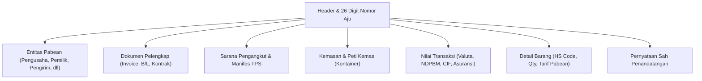

# Pengelolaan Dokumen TPB CEISA 4.0 (djbc_ceisa_tpb)

Modul **`djbc_ceisa_tpb`** mengelola siklus lengkap pembuatan, validasi, pengiriman, dan pemantauan dokumen kepabeanan **Tempat Penimbunan Berikat (TPB)** secara langsung ke sistem **CEISA 4.0** Direktorat Jenderal Bea dan Cukai (DJBC).

---

## Cakupan Fasilitas & Dokumen Pabean TPB

Modul ini mendukung seluruh transaksi kepabeanan Tempat Penimbunan Berikat (Kawasan Berikat, Gudang Berikat, dan Tempat Penyelenggaraan Pameran Berikat) yang meliputi **10 jenis dokumen pabean resmi**:

| Kode BC | Jenis Dokumen | Fungsi & Peruntukan |
|---|---|---|
| **BC 1.6** | Pengeluaran dari LDP ke TPB | Pengeluaran barang impor dari Tempat Penimbunan Sementara (TPS) pelabuhan ke kawasan TPB. |
| **BC 2.3** | Pemasukan Barang Impor ke TPB | Pemasukan bahan baku, barang modal, atau perlengkapan langsung dari Luar Daerah Pabean (fasilitas penangguhan bea masuk). |
| **BC 2.5** | Pengeluaran dari TPB ke TLDDP | Penjualan atau penyerahan barang dari TPB ke pasar lokal/domestik (pelunasan bea masuk dan pajak impor). |
| **BC 2.6.1**| Pengeluaran Subkontrak TPB | Pengeluaran bahan baku atau barang setengah jadi ke perusahaan subkontrak di TLDDP atau TPB lain. |
| **BC 2.6.2**| Pemasukan Kembali Subkontrak | Pemasukan kembali hasil pekerjaan subkontrak dari pihak subkontraktor ke TPB. |
| **BC 2.7** | Pemindahan Barang Antar TPB | Pengeluaran atau pemasukan barang antar Kawasan Berikat atau antar entitas fasilitas TPB lain. |
| **BC 2.8** | Pengeluaran Barang Modal / Contoh | Pengeluaran mesin, peralatan, atau barang contoh dari TPB. |
| **BC 3.3.1**| Ekspor Penyelesaian TPB | Penyelesaian pengeluaran produk jadi untuk tujuan ekspor tertentu. |
| **BC 4.0** | Pemasukan dari TLDDP ke TPB | Pembelian bahan baku atau barang modal lokal dari wilayah domestik ke TPB (fasilitas PPN tidak dipungut). |
| **BC 4.1** | Pengeluaran dari TPB ke TLDDP | Pengeluaran atau retur barang asal lokal dari TPB kembali ke wilayah domestik. |

---

## Struktur & Anatomi Formulir Dokumen TPB

Setiap dokumen pabean pada menu **CEISA Connector > Pabean > TPB** disusun secara sistematis sesuai dengan format baku pertukaran data CEISA 4.0:

### 1. Pembentukan Nomor Aju Otomatis
Sistem secara otomatis menggenerasi **26 Digit Nomor Pengajuan (Nomor Aju)** standar DJBC:
* `[6 digit kode kantor]` + `[6 digit kode perusahaan]` + `[8 digit tanggal YYYYMMDD]` + `[6 digit nomor urut]`.
* Contoh: `040300-000123-20260910-000001`.

### 2. Tab Entitas Pabean
CEISA 4.0 mengelompokkan entitas pabean yang otomatis diurutkan oleh sistem saat konfirmasi dan pengiriman data:

* **Pengusaha TPB** (Kode Entitas `3`): Otomatis diposisikan pada Sequence / Seri 1.
* **Pemilik Barang** (Kode Entitas `7`).
* **Pengirim / Supplier** (Kode Entitas `9`).
* **Penerima / Konsinyee** (Kode Entitas `8`).
* Setiap entitas mencakup identitas resmi: Nomor Identitas (NPWP 16 digit), NIB, Alamat, dan Surat Izin Usaha.

### 3. Tab Dokumen Pelengkap
Sistem secara otomatis mengurutkan prioritas dokumen dan nomor seri dokumen saat konfirmasi dan pengiriman:

* **Faktur / Invoice** (Kode Dokumen `380`): Wajib ada dan otomatis diprioritaskan sebagai Seri 1.
* **Dokumen Angkut**: **Bill of Lading / B/L** (Kode `705`) atau **Air Waybill / AWB** (Kode `740`) otomatis berada pada Seri 2 jika diisi.
* Dokumen pendukung lain: Kontrak (Kode `315`), Packing List (Kode `217`), dan Surat Keterangan Asal / SKA (Kode `861`).

### 4. Tab Pengangkut & Manifes
* Nomor dan Tanggal **BC 1.1** (Nomor Pos, Subpos, dan Sub-subpos) untuk penarikan barang dari pelabuhan/TPS.
* Pelabuhan Muat, Pelabuhan Transit, dan Pelabuhan Bongkar internasional/domestik.
* Data sarana pengangkut (Kapal/Pesawat/Truk) beserta kode bendera negara.

### 5. Tab Kemasan, Kontainer & Transaksi
* Spesifikasi kontainer: Nomor peti kemas, ukuran (20ft, 40ft, 45ft), jenis, dan tipe kontainer.
* Jumlah dan jenis kemasan (Bag, Carton, Pallet, Drum).
* Nilai transaksi finansial: Mata uang asing, Kurs NDPBM mingguan, Nilai FOB, Freight, Asuransi, Nilai CIF, serta Berat Kotor (Bruto) dan Bersih (Netto).

### 6. Tab Rincian Barang
* Pemetaan HS Code (Pos Tarif BTKI) per baris item.
* Kuantitas dan Satuan standar CEISA (UOM).
* Nilai CIF Rupiah dan kalkulasi tarif pungutan (Bea Masuk, PPN, PPh 22).

---

---

## Alur Khusus: Subkontrak TPB (BC 2.6.1 & BC 2.6.2)

Modul ini mengotomatiskan siklus pengeluaran dan pemasukan kembali pekerjaan subkontrak:
1. **BC 2.6.1 (Pengeluaran Subkontrak)**: Mengeluarkan bahan baku dengan fasilitas Bea Masuk Dijaminkan (Kode 8) serta menyertakan Surat Izin Subkontrak (Kode Dokumen `911`).
2. **BC 2.6.2 (Pemasukan Kembali)**:
   * **Dokumen Referensi Asal**: Pengguna cukup memilih dokumen BC 2.6.1 asal (`ref_doc_261_id`), sistem otomatis menarik **Nomor Aju Asal** dan **Nomor Pendaftaran Asal** dari riwayat respon CEISA (`ceisa.status.respon`).
   * **Sinkronisasi Seri Izin Bahan Baku**: Sistem otomatis menghubungkan nomor urut izin (`seri_dokumen`) pada tab Dokumen Pelengkap ke field `seriIjin` pada baris Bahan Baku untuk mencegah penolakan skema CEISA.
   * Panduan selengkapnya: [Panduan Subkontrak BC 2.6.1 & BC 2.6.2](subkontrak_bc261_bc262.md).

## Alur Kerja Transaksi (Lifecycle Dokumen)

Proses pengajuan dokumen ke Bea Cukai melewati 3 tahapan utama:

1. **Draft (Penyusunan Data)**:
    * Pengguna menginput rincian dokumen atau menarik referensi dari transaksi Pembelian (**Purchase Order**) atau Surat Jalan (**Stock Picking**).
    * Data masih dapat diubah dan diperbaiki secara bebas.
2. **Confirm (Validasi Internal)**:
    * Klik tombol **Confirm**.
    * Sistem menjalankan serangkaian validasi otomatis:
        * Memastikan tab Barang, Entitas, Dokumen, Kemasan, dan Pengangkut telah terisi.
        * Memvalidasi urutan dokumen pelengkap (Invoice & B/L/AWB).
        * Memvalidasi kode entitas pabean.
3. **Send Document (Pengiriman ke CEISA 4.0)**:
    * Klik tombol **Send Document** pada dokumen yang telah berstatus *Confirmed*.
    * Payload JSON lengkap dienkapsulasi dan dikirim ke endpoint resmi CEISA OpenAPI.
    * Status dokumen berubah menjadi **Sent** (*Terkirim*).

---

## Pemeriksaan Respon & Status Kepabeanan

Setelah dokumen terkirim ke CEISA, sistem menyediakan tombol **Cek Status & Respon** untuk menarik perkembangan respon pabean:

* Klik **Cek Status & Respon**: BZone akan menghubungi API CEISA untuk memeriksa status terkini dari Nomor Aju yang bersangkutan.
* Respon resmi yang otomatis disimpan:
    * **SPPB (Surat Persetujuan Pengeluaran Barang)**: Izin resmi pengeluaran barang dari pelabuhan atau kawasan.
    * **NPP (Nomor Pendaftaran Pabean)**: Bukti bahwa dokumen telah lolos validasi sistem dan mendapatkan Nomor Pendaftaran resmi.
    * **SPJM (Surat Pemberitahuan Jalur Merah)**: Pemberitahuan pemeriksaan fisik oleh petugas pabean.
    * **Reject / Penolakan**: Dokumen dikembalikan karena kesalahan data dengan keterangan rincian perbaikan.
* Seluruh respon dapat ditinjau melalui stat button **Status Respon** pada formulir dokumen.

---

> [!IMPORTANT]
> Pastikan data entitas pengusaha memiliki nomor izin Kawasan Berikat / TPB yang valid dan masih aktif sebelum melakukan transmisi dokumen ke portal CEISA.
