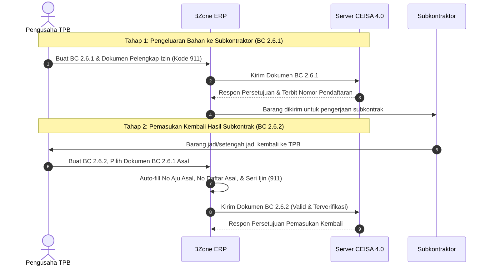

# Panduan Subkontrak TPB: BC 2.6.1 & BC 2.6.2

Dokumen ini menjelaskan alur operasional, ketentuan regulasi pabean CEISA 4.0, serta panduan teknis pengisian dokumen pengeluaran subkontrak (**BC 2.6.1**) dan pemasukan kembali barang hasil subkontrak (**BC 2.6.2**) pada modul **`djbc_ceisa_tpb`**.

---

## 1. Konsep & Siklus Subkontrak Kawasan Berikat

Dalam operasional Tempat Penimbunan Berikat (TPB) / Kawasan Berikat (KB), perusahaan diperbolehkan mensubkontrakkan sebagian proses produksi kepada pihak ketiga (subkontraktor di Tempat Lain Dalam Daerah Pabean / TLDDP maupun antar Kawasan Berikat).

Siklus ini melibatkan dua dokumen kepabeanan yang saling berelasi erat:

| Dokumen | Nama Dokumen | Karakteristik Utama |
|---|---|---|
| **BC 2.6.1** | Pengeluaran Barang Subkontrak | Mengeluarkan bahan baku / modal ke subkontraktor. Pungutan bea masuk berstatus **Dijaminkan (Kode Fasilitas 8)**. Wajib mencantumkan Surat Izin Subkontrak dari Bea Cukai (Kode Dokumen `911`). |
| **BC 2.6.2** | Pemasukan Kembali Barang Subkontrak | Memasukkan kembali barang olahan hasil subkontrak. **Wajib mereferensikan Dokumen Asal (BC 2.6.1)** dan **Seri Izin Dokumen Fasilitas (`seriIjin`)** pada rincian bahan baku. |

---

## 2. Pengisian Dokumen BC 2.6.2 (Pemasukan Kembali)

Pengisian dokumen BC 2.6.2 memiliki validasi skema yang sangat ketat pada server CEISA 4.0. Dua kendala paling sering terjadi adalah:
1. **Nomor Daftar Asal kosong atau tidak valid** (CEISA menolak referensi hanya dengan nomor aju tanpa nomor pendaftaran).
2. **Error Seri Ijin Bahan Baku [0]**: `Gagal Kirim Data: Seri Ijin Bahan Baku [0] tidak ditemukan pada Dokumen Fasilitas/Ijin`.

Berikut langkah-langkah pengisian yang benar di sistem BZone:

### Langkah 1: Memilih Dokumen BC 2.6.1 Asal

Pada tab **Header** dokumen BC 2.6.2:

1. Temukan bagian **Dokumen Referensi / Dokumen Asal**:
   * **Dokumen BC 2.6.1 Asal (`ref_doc_261_id`)**: Pilih dokumen pengeluaran BC 2.6.1 yang sebelumnya telah dibuat dan dikirim melalui BZone.
2. Sistem otomatis menarik data:
   * **Nomor Aju Asal (`nomor_aju_asal`)**: 26 digit nomor aju BC 2.6.1.
   * **Nomor Daftar Asal (`nomor_daftar_asal`)**: Nomor pendaftaran resmi yang diterbitkan oleh server Bea Cukai.
   * **Tanggal Daftar Asal (`tanggal_daftar_asal`)**: Tanggal pendaftaran dokumen BC 2.6.1.

> [!NOTE]
> **Bagaimana Sistem Menarik Nomor Daftar Otomatis?**
> BZone secara cerdas memeriksa tab riwayat respon (**`ceisa.status.respon`**) pada dokumen BC 2.6.1 yang Anda pilih. Begitu dokumen BC 2.6.1 menerima respon persetujuan (SPPD/SPPB) yang memuat nomor pendaftaran, field ini otomatis terisi.
> 
> Jika dokumen BC 2.6.1 Anda dibuat sebelum integrasi sistem atau respon belum ditarik ke Odoo, Anda tetap dapat **mengisi manual** kolom `Nomor Daftar Asal` dan `Tanggal Daftar Asal`.

---

### Langkah 2: Tab Dokumen Pelengkap & Penomoran Seri Otomatis

Pada tab **Dokumen Pelengkap**, daftarkan dokumen-dokumen pendukung transaksi:

* **Surat Izin Subkontrak (Kode Dokumen `911`)**: Dokumen persetujuan/izin fasilitas subkontrak yang diterbitkan oleh Kantor Bea Cukai pengawas.
* **Surat Jalan / Delivery Order Subkontraktor**: Bukti pengiriman kembali barang.
* **Faktur Pekerjaan Jasa Subkontrak (Invoice Ongkos Subkon)** jika ada.

> [!IMPORTANT]
> **Penomoran Otomatis Seri Dokumen Pelengkap (`seri_dokumen`):**
> * Kolom **No. Seri** kini ditampilkan langsung pada tabel dokumen pelengkap.
> * Sistem secara otomatis memberikan nomor seri urut berurutan (**1, 2, 3, ...**) berdasarkan urutan baris dokumen.
> * Nomor seri inilah yang menjadi referensi identitas dokumen untuk dikaitkan dengan rincian barang dan fasilitas izin.

---

### Langkah 3: Tab Bahan Baku & Pengisian `seriIjin` (Anti-Reject)

Pada transaksi BC 2.6.2, selain mendaftarkan barang hasil olahan yang masuk, Anda wajib mencantumkan **Rincian Bahan Baku** yang dipakai untuk menghasilkan barang tersebut.

#### Mengapa Muncul Error "Seri Ijin Bahan Baku [0]"?
Server CEISA 4.0 memvalidasi keterkaitan antara bahan baku subkontrak dengan izin fasilitas:
* Elemen JSON `seriIjin` pada bahan baku **tidak boleh bernilai 0**.
* Nilai `seriIjin` harus cocok persis dengan nilai `seri_dokumen` dari dokumen izin subkontrak (kode `911`) yang ada di tab Dokumen Pelengkap.

#### Otomatisasi di BZone:
1. Saat Anda memilih atau mengonfirmasi **Surat Izin Subkontrak (911)** di tab Dokumen Pelengkap:
   * Seluruh baris bahan baku pada tab Barang otomatis mengisi field **Seri Ijin (`seriIjin`)** mengacu ke nomor seri dokumen izin tersebut (misal: Seri `3` atau `1`).
2. Kolom **Seri Ijin** kini ditampilkan secara transparan di tabel Bahan Baku formulir dokumen, sehingga Anda dapat memastikan nilainya tidak bernilai `0` sebelum transmisi data.

---

## 3. Matriks Referensi Data BC 2.6.2 ke CEISA 4.0

| Kolom di BZone | Field Payload JSON CEISA | Keterangan & Validasi |
|---|---|---|
| **Dokumen BC 2.6.1 Asal** | `nomorAju` (referensi asal) | Dokumen internal BC 2.6.1 yang menjadi asal pengeluaran barang. |
| **Nomor Aju Asal** | `nomorAjuDokumenAsal` | 26 digit nomor aju pengeluaran awal. |
| **Nomor Daftar Asal** | `nomorDaftarDokumenAsal` | 6 digit nomor pendaftaran pabean resmi dari respon Bea Cukai. |
| **Tanggal Daftar Asal**| `tanggalDaftarDokumenAsal`| Tanggal saat dokumen pendaftaran terbit (`YYYY-MM-DD`). |
| **Izin Subkontrak (911)**| `dokumen.kodeDokumen = "911"` | Dokumen izin fasilitas subkontrak yang masih berlaku. |
| **Seri Dokumen Izin** | `dokumen.seriDokumen` | Nomor urut integer (1, 2, 3, ...) pada daftar dokumen pelengkap. |
| **Seri Ijin Bahan Baku**| `bahanBaku.seriIjin` | Wajib sama dengan `dokumen.seriDokumen` milik izin `911`. |

---

## 4. Checklist Pra-Pengiriman BC 2.6.2

Sebelum menekan tombol **Confirm** dan **Send Document**, pastikan:

- [ ] **Nomor Daftar Asal** dan **Tanggal Daftar Asal** sudah terisi (tidak kosong).
- [ ] Surat Izin Subkontrak (kode **911**) tercantum di tab **Dokumen Pelengkap** dengan nomor seri dokumen yang valid.
- [ ] Kolom **Seri Ijin** pada setiap baris **Bahan Baku** sudah terisi angka seri izin (bukan `0`).
- [ ] Kuantitas bahan baku yang dikembalikan tidak melebihi kuantitas yang dikeluarkan pada dokumen BC 2.6.1 asal.
- [ ] Nilai jasa/ongkos pengerjaan subkontrak dicantumkan secara wajar pada rincian nilai transaksi.
