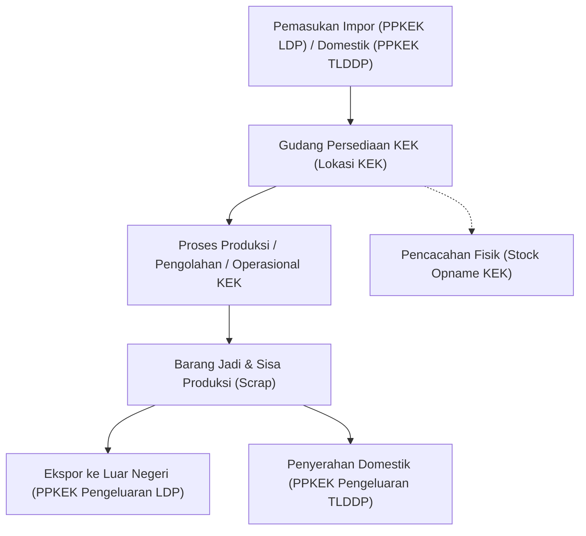

# Fasilitas Kawasan Ekonomi Khusus (djbc_kek)

> **Terakhir diperbarui:** 22 Oktober 2026

Modul **`djbc_kek`** dirancang khusus untuk memenuhi kepatuhan kepabeanan dan pelaporan persediaan (*IT Inventory*) bagi Badan Usaha dan Pelaku Usaha di **Kawasan Ekonomi Khusus (KEK)** sesuai regulasi Direktorat Jenderal Bea dan Cukai (DJBC) Republik Indonesia.

---

## Regulasi & Konsep Fasilitas KEK

Penyelenggaraan Kawasan Ekonomi Khusus berlandaskan pada ketentuan perundang-undangan utama:

* **Peraturan Pemerintah (PP) No. 40 Tahun 2021** tentang Penyelenggaraan Kawasan Ekonomi Khusus.
* **Peraturan Menteri Keuangan (PMK) No. 237/PMK.04/2020** jo. **PMK No. 33/PMK.10/2021** tentang Perlakuan Perpajakan, Kepabeanan, dan Cukai pada Kawasan Ekonomi Khusus.

### Fasilitas & Insentif Fiskal KEK:
1. **Pembebasan Bea Masuk & Cukai**: Berlaku atas pemasukan barang modal, bahan baku, dan barang operasional dari Luar Daerah Pabean (LDP).
2. **Pajak Tidak Dipungut**: PPN dan PPnBM tidak dipungut atas pemasukan barang kena pajak dari LDP maupun Tempat Lain Dalam Daerah Pabean (TLDDP).
3. **Penyederhanaan Dokumen Pabean Terpadu**: Menggunakan dokumen pabean mandiri yaitu **PPKEK (Pemberitahuan Pabean Kawasan Ekonomi Khusus)** yang terintegrasi dengan portal Single Submission KEK (SINSW).
4. **Kewajiban IT Inventory KEK**: Seluruh Pelaku Usaha di dalam KEK wajib mendayagunakan sistem pencatatan persediaan internal (*IT Inventory*) yang dapat diakses secara daring oleh DJBC untuk memantau pergerakan barang secara akuntabel dan *real-time*.

---

## Dokumen Pabean Khusus KEK (PPKEK)

Modul `djbc_kek` mengintegrasikan transaksi pergudangan dengan nomor pendaftaran dokumen resmi KEK:

| Kode Dokumen | Nama Dokumen Resmi | Fungsi & Peruntukan |
|---|---|---|
| **PPKEK Pemasukan LDP** | Dokumen Pemasukan dari Luar Daerah Pabean | Pemasukan barang impor langsung dari luar negeri ke zona KEK (fasilitas pembebasan Bea Masuk & pajak impor tidak dipungut). |
| **PPKEK Pemasukan TLDDP** | Dokumen Pemasukan dari Tempat Lain Dalam Daerah Pabean | Pemasukan barang dari wilayah pabean domestik Indonesia ke KEK (PPN tidak dipungut). |
| **PPKEK Pengeluaran LDP** | Dokumen Pengeluaran ke Luar Daerah Pabean | Pengeluaran barang jadi/komoditas dari KEK untuk tujuan ekspor internasional. |
| **PPKEK Pengeluaran TLDDP** | Dokumen Pengeluaran ke Tempat Lain Dalam Daerah Pabean | Pengeluaran barang dari KEK ke pasar lokal/domestik (pelunasan bea masuk dan pajak impor atas bahan baku impor yang terkandung). |
| **Dokumen Pabean Tambahan** | BC 2.0, BC 2.3, BC 2.7, BC 3.0, PPFTZ-02 | Mendukung pemindahan antar kawasan fasilitas (KB/KITE/FTZ/KEK lain) sesuai regulasi yang berlaku. |

---

## Konfigurasi Master Data KEK

Sebelum menjalankan transaksi operasional, pastikan master data terkait telah dikonfigurasi:

### 1. Klasifikasi Produk KEK (`product.template` & `product.category`)
* Buka menu **Inventory > Products > Products**.
* Pada form produk, pastikan opsi **Can be Used for DJBC KEK** (`djbc_kek_ok`) telah aktif.
* Opsi ini dapat dikonfigurasikan otomatis secara terpusat melalui master **Kategori Produk** (`product.category`).
* Centang field **DJBC KEK** (`djbc_kek`) agar produk masuk ke dalam perhitungan mutasi dan pencatatan IT Inventory KEK.

### 2. Klasifikasi Lokasi Gudang KEK (`stock.location`)
* Buka menu **Inventory > Configuration > Locations**.
* Pilih lokasi gudang penyimpanan di dalam kawasan KEK.
* Pada field **DJBC KEK Lokasi** (`djbc_kek_location`), ubah nilai dari `None` menjadi **Lokasi Product KEK** (`kek`).
* Hanya pergerakan stok yang melibatkan lokasi ber-flag KEK ini yang akan dievaluasi dalam laporan mutasi pabean KEK.

### 3. Tipe Operasi Gudang KEK (`stock.picking.type`)
* Buka menu **Inventory > Configuration > Operations Types**.
* Atur parameter operasional kepabeanan KEK:
    * **DJBC's KEK Movement Type**: Tentukan arah mutasi pabean, yaitu **In** (Pemasukan) atau **Out** (Pengeluaran).
    * **DJBC's KEK Scrap?**: Aktifkan untuk pergerakan limbah/sisa/reject di KEK.
    * **DJBC's KEK Adjustment?**: Aktifkan untuk pergerakan penyesuaian selisih stok (stock opname).
    * **DJBC KEK Doc Required**: Jika dicentang, sistem akan memvalidasi bahwa transaksi picking wajib mencantumkan referensi dokumen pabean sah sebelum status dapat diubah menjadi *Done*.

---

## Alur Transaksi & Mutasi Barang KEK

Operasional persediaan pada KEK mencakup siklus lengkap rantai pasok:

1. **Penerimaan Barang Masuk (Receipt)**:
    * Saat barang tiba di KEK, buat transaksi penerimaan (*Receipt*) yang terhubung dengan dokumen PPKEK Pemasukan (LDP atau TLDDP).
    * Validasi picking akan menambah saldo kuantitas pada lokasi gudang KEK dan secara otomatis tercatat di **Laporan Pemasukan Barang**.
2. **Aktivitas Operasional & Pengolahan**:
    * Pergerakan barang internal di dalam kawasan KEK dipantau secara ketat antar lokasi.
    * Bahan baku yang dikonversi menjadi barang jadi akan tercermin dalam pergerakan stok barang KEK.
3. **Pengeluaran Barang (Delivery / Dispatch)**:
    * Pengeluaran untuk tujuan ekspor didaftarkan dengan **PPKEK Pengeluaran LDP**.
    * Pengeluaran ke pasar dalam negeri didaftarkan dengan **PPKEK Pengeluaran TLDDP** dan melunasi kewajiban bea masuk/pajak impor jika ada.
    * Transaksi pengeluaran otomatis tercatat di **Laporan Pengeluaran Barang**.
4. **Penyesuaian Fisik & Stock Opname**:
    * Secara periodik atau tahunan, Pelaku Usaha KEK melaksanakan pencacahan fisik persediaan.
    * Hasil pencacahan fisik diintegrasikan ke modul `djbc_stock_opname` dan disajikan dalam **Laporan Hasil Pencacahan KEK**.

---

## 4 Laporan Wajib IT Inventory KEK

Menu pelaporan resmi dapat diakses melalui **Laporan Bea Cukai > Reporting > Kawasan Ekonomi Khusus**:

| No | Nama Laporan Resmi | Deskripsi & Informasi yang Disajikan |
|---|---|---|
| **1** | **Laporan Pemasukan Barang** | Daftar seluruh dokumen pemasukan (PPKEK Pemasukan LDP, PPKEK Pemasukan TLDDP, BC), nomor bukti penerimaan (*Receipt Picking*), tanggal dokumen, pemasok/pengirim, kode barang, nama barang, satuan, dan jumlah. |
| **2** | **Laporan Pengeluaran Barang** | Daftar seluruh dokumen pengeluaran (PPKEK Pengeluaran LDP, PPKEK Pengeluaran TLDDP, BC), nomor surat jalan (*Delivery Picking*), tanggal dokumen, penerima/pembeli, kode barang, nama barang, satuan, dan jumlah. |
| **3** | **Laporan Mutasi Barang KEK** | Rekonsiliasi lengkap persediaan pabean KEK: Saldo Awal, Pemasukan, Pengeluaran, Penyesuaian (*Adjustment*), Saldo Akhir Buku, Hasil Pencacahan (*Stock Opname*), serta Nilai Selisih. |
| **4** | **Laporan Hasil Pencacahan / Stock Opname KEK** | Rekapitulasi hasil pencacahan fisik barang KEK per tanggal pelaksanaan, mencakup kode barang, nama barang, kategori, satuan, jumlah fisik riil, dan catatan keterangan. |

---

## Prosedur Penarikan Laporan KEK

1. Buka menu **Laporan Bea Cukai > Reporting > Kawasan Ekonomi Khusus**.
2. Klik salah satu laporan yang ingin ditarik (misalnya **Laporan Mutasi Barang KEK**).
3. Pada jendela wizard popup yang muncul:
    * Masukkan rentang tanggal pada kolom **Dari Tanggal** dan **Sampai Tanggal**, atau gunakan template **Periode Laporan**.
    * Pilih format keluaran yang diinginkan: **Layar / Screen** (*HTML List View*), dokumen cetak **Py3o ODT/PDF**, atau spreadsheet **Excel (XLSX)**.
4. Klik tombol **Print / Preview** untuk menghasilkan laporan resmi yang siap diaudit oleh kantor pengawasan Bea Cukai.

> [!NOTE]
> Laporan Mutasi Barang KEK secara otomatis menyaring pergerakan barang berdasarkan master produk yang berstatus `djbc_kek = True` dan lokasi gudang yang diklasifikasikan sebagai `djbc_kek_location = 'kek'`.
