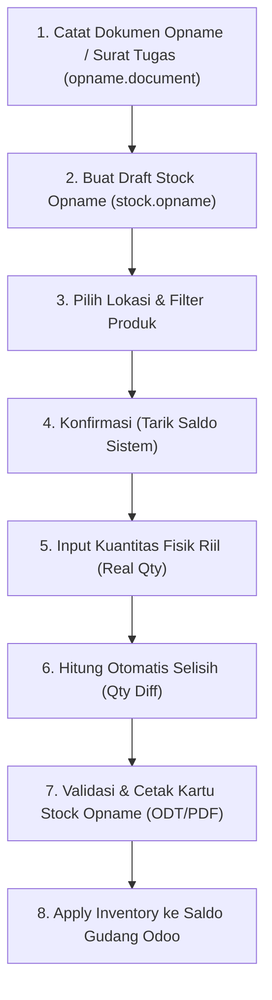

# Pelaksanaan Stock Opname IT Inventory (djbc_stock_opname)

> **Terakhir diperbarui:** 22 Oktober 2026

Modul **`djbc_stock_opname`** dirancang khusus untuk mengelola seluruh tahapan pelaksanaan perhitungan fisik persediaan (*Stock Opname*) di fasilitas Kawasan Berikat, KITE, maupun Tempat Penimbunan Berikat lainnya guna memenuhi ketentuan kepatuhan Direktorat Jenderal Bea dan Cukai (DJBC).

---

## Regulasi & Ketentuan Pelaksanaan

Sesuai dengan regulasi Bea Cukai (antara lain **PER-02/BC/2019** dan **PER-09/BC/2021**):

1. Perusahaan penerima fasilitas kepabeanan wajib melakukan pencacahan atau perhitungan fisik persediaan (*stock opname*) sekurang-kurangnya **1 (satu) kali dalam setahun**.
2. Pelaksanaan stock opname dapat dihadiri atau diawasi langsung oleh Pejabat Bea Cukai dari Kantor Pelayanan Pengawasan Bea dan Cukai (KPPBC) setempat berdasarkan **Surat Tugas Resmi**.
3. Hasil perhitungan fisik wajib direkonsiliasikan dengan saldo buku IT Inventory dan dituangkan ke dalam **Berita Acara Stock Opname**.

---

## Alur Kerja Stock Opname BZone

Pelaksanaan stock opname terbagi menjadi dua bagian utama di sistem:

1. **Dokumen Stock Opname (`opname.document`)**: Registrasi surat tugas dan pejabat pemeriksa pabean.
2. **Eksekusi Stock Opname (`stock.opname`)**: Penarikan saldo sistem, penginputan hasil hitung fisik di gudang, penghitungan selisih (*variance*), dan penyesuaian saldo (*apply inventory*).

---

## 1. Registrasi Dokumen Stock Opname (Surat Tugas)

Sebelum memulai perhitungan fisik di lapangan, catat surat penugasan dari Kantor Bea Cukai atau manajemen perusahaan:

1. Buka menu **Laporan Bea Cukai > Stock Opname**.
2. Klik tombol **New / Create**.
3. Lengkapi kolom informasi:
   * **Surat Tugas**: Nomor surat tugas resmi (contoh: `ST-012/KPPBC.TMP.A/2025`).
   * **Tanggal**: Tanggal diterbitkannya surat tugas atau tanggal pelaksanaan.
   * **Nama Pejabat**: Nama petugas / pemeriksa Bea Cukai yang ditugaskan.
4. Klik **Save**.

> [!NOTE]
> Nomor surat tugas dan nama pejabat ini nantinya akan terhubung secara otomatis ke lembar kerja perhitungan fisik serta tercetak pada formulir kartu stock opname resmi.

---

## 2. Pembuatan Lembar Kerja Stock Opname

Setelah dokumen surat tugas terdaftar, lakukan inisiasi lembar kerja perhitungan persediaan:

1. Buka menu **Inventory > Operations > Adjustments > Stock Opname**.
2. Klik tombol **New / Create**.
3. Isi data pada formulir:
   * **Inventoried Location**: Pilih lokasi gudang yang akan dihitung (contoh: `WH/Stock`).
   * **Nomor Surat Tugas**: Pilih referensi dokumen yang telah dibuat pada langkah sebelumnya. Sistem akan otomatis mengisi field *Responsible* dengan nama pejabat terkait.
   * **Inventory Date**: Tanggal dan waktu pelaksanaan *cut-off* opname.
   * **Inventory of (Filter Pemilihan Produk)**:
     * **Select products manually (*Partial*)**: Pengguna memilih daftar barang yang dihitung secara manual baris per baris.
     * **One product only**: Terfokus pada satu produk tertentu.
     * **One product category**: Menghitung seluruh produk di bawah kategori barang tertentu (misal: Bahan Baku atau Barang Jadi).
   * **Keterangan**: Catatan operasional opname (misal: `Stock Opname Tahunan Periode 2025`).

---

## 3. Penarikan Saldo Sistem & Input Hitung Fisik

1. Klik tombol **Confirm / Start**. Status akan berubah menjadi **In Progress** (`confirm`).
2. Sistem secara otomatis menjalankan query kalkulasi saldo buku:
   * Mengambil saldo dari kuantitas fisik yang tercatat di sistem (`stock.quant`).
   * Menghitung mutasi masuk/keluar yang sedang berlangsung.
   * Mengisi kolom **Theoretical Qty** pada baris persediaan (`stock.opname.line`).
3. Tim pencacah di lapangan melakukan perhitungan riil di gudang.
4. Masukkan hasil perhitungan fisik ke kolom **Real Qty**:
   * Jika produk memiliki pelacakan lot/serial, cantumkan nomor **Lot/Serial Number**.
   * Kolom **Inventory Qty (Qty Diff)** akan dihitung otomatis oleh sistem:
     `Qty Diff = Real Qty - Theoretical Qty` (Selisih = Qty Fisik − Qty Buku)

> [!TIP]
> Nilai selisih positif menunjukkan **selisih lebih** (fisik lebih banyak dari buku), sedangkan nilai negatif menunjukkan **selisih kurang** (fisik lebih sedikit dari buku).

---

## 4. Validasi & Cetak Kartu Stock Opname

1. Pastikan seluruh baris barang telah terisi nilai *Real Qty* yang valid (tidak boleh bernilai negatif).
2. Klik tombol **Validate / Approve** untuk memfinalisasi status opname menjadi **Validated** (`done`).
3. Untuk mencetak dokumen fisik pertanggungjawaban pabean, klik menu **Print > Stock Opname Card**:
   * Dokumen dicetak dalam format resmi berbasis Py3o (ODT/PDF).
   * Berisi identitas perusahaan, nomor surat tugas, lokasi gudang, rincian produk, saldo buku vs fisik, persentase selisih, dan kolom tanda tangan tim pemeriksa bersama pejabat Bea Cukai.

---

## 5. Penyesuaian Saldo Sistem (Apply Inventory)

Setelah hasil opname divalidasi dan disetujui bersama oleh manajemen dan petugas Bea Cukai:

1. Klik tombol **Apply Inventory**.
2. Sistem BZone akan:
    * Mengupdate kuantitas stok di tabel `stock.quant` Odoo sesuai dengan nilai *Real Qty*.
    * Menandai status lembar kerja menjadi *Inventoried*.
    * Mencatat mutasi penyesuaian (*adjustment*) ke dalam buku mutasi IT Inventory sehingga saldo buku pada periode berjalan berikutnya langsung sinkron dengan fisik riil.

> [!WARNING]
> Selisih persediaan yang tidak wajar atau tidak dapat dibuktikan penyebabnya (misal: hilang tanpa dokumen pelindung pabean) dapat menjadi temuan audit kepabeanan dan berisiko dikenakan pungutan bea masuk serta denda administrasi.
